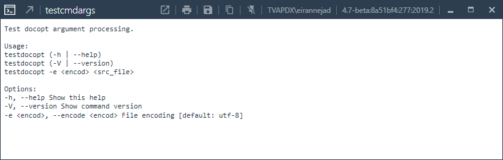

# Advanced bundles

!!! tip ""

    Start with the short introduction to bundles at [Your first command](../tutorials/first-command.md).  
    See [Bundle metadata](metadata.md) for the `bundle.yaml` file and [Bundle lib and bin](lib-and-bin.md) for the `lib/` and `bin/` folders.  
    The other bundle types are on [Command bundles](command-bundles.md) and [UI bundles](ui-bundles.md).

There are a few more advanced bundle types in pyRevit. These bundles are designed for specific use cases. It is good to know that they exist and what they do, just in case you need them in the future.

## ComboBox Bundle
```yaml
extension: .combobox
```

ComboBox bundles create dropdown selection controls in the Revit ribbon. Unlike buttons, ComboBoxes do not execute commands directly. Instead, they provide a selection mechanism that scripts can respond to via events. ComboBoxes are useful for:

- Selecting options or settings
- Switching between modes or views
- Choosing from a list of predefined items

### Bundle Structure
```yaml
MyComboBox.combobox/
    bundle.yaml       # Required: configuration and members
    script.py         # Optional: initialization and event handling
    icon.png          # Optional: ComboBox icon (16x16 or 32x32)
    icon.dark.png     # Optional: dark theme icon

```

### Configuration (bundle.yaml)
The `bundle.yaml` file defines the ComboBox properties and its dropdown members.

**Basic Example**

```yaml
title: My ComboBox
tooltip: Select an option

members:
  - Option 1
  - Option 2
  - Option 3
```

**Full Example with Rich Metadata**

```yaml
title: View Settings
tooltip: Configure view settings
tooltip_ext: |
  Extended description that appears
  after hovering for a moment.
help_url: https://docs.example.com/view-settings

members:
  # Basic items (minimal configuration)
  - id: option_a
    text: Option A
    group: Basic Options
    tooltip: A basic option

  # Rich items (full metadata)
  - id: option_b
    text: Option B
    group: Rich Options
    icon: option_b.png
    tooltip: Option with all properties
    tooltipImage: option_b_preview.png
    longDescription: |
      Extended tooltip description with
      multiple lines of detail.
```

**ComboBox Properties**

| **Property** | **Type** | **Description** |
|---|---|---|
| `title` | string | Display title for the ComboBox |
| `tooltip` | string | Short tooltip text |
| `tooltip_ext` | string | Extended tooltip description |
| `help_url` | string | URL for contextual help (F1) |
| `members` | list | List of member definitions |

**Member Properties**

| **Property** | **Aliases** | **Description** |
|---|---|---|
| `id` | `name` | Unique identifier for the member |
| `text` | `title` | Display text shown in dropdown |
| `icon` | - | Path to icon image (16x16 PNG, relative to bundle) |
| `group` | `groupName` | Group name for organizing members visually |
| `tooltip` | - | Short tooltip for the member |
| `longDescription` | `tooltip_ext` | Extended tooltip description |
| `tooltipImage` | `tooltip_image` | Path to tooltip preview image |

**Member Formats**

Members can be defined in multiple formats:

```yaml
# String format (id and text are the same)
members:
  - Option A
  - Option B

# List/tuple format
members:
  - [option_a, "Option A"]
  - [option_b, "Option B"]

# Dictionary format (recommended for rich metadata)
members:
  - id: option_a
    text: Option A
    icon: option_a.png
    group: My Group
```

### Script Integration
A ComboBox bundle can include a `script.py` that defines event handlers. pyRevit looks for three functions by name and connects each one it finds to the matching Revit event:

| Function | Revit event | Called when |
|---|---|---|
| `__cmb_on_change__` | `CurrentChanged` | the user selects a different item |
| `__cmb_dropdown_open__` | `DropDownOpened` | the dropdown opens, before the items are shown |
| `__cmb_dropdown_close__` | `DropDownClosed` | the dropdown closes |

Every handler takes the same three arguments: the Revit `ComboBox` that raised the event, the event arguments, and a context object.

```python
from Autodesk.Revit.UI import TaskDialog


def __cmb_on_change__(sender, args, ctx):
    current = sender.Current
    if current:
        TaskDialog.Show("Selection changed", "Selected: {}".format(current.ItemText))


def __cmb_dropdown_open__(sender, args, ctx):
    print("Dropdown opened")


def __cmb_dropdown_close__(sender, args, ctx):
    print("Dropdown closed with: {}".format(ctx.current_value))
```

Do not show a `TaskDialog` from `__cmb_dropdown_open__`: it blocks the dropdown from opening.

### The context object
The third argument gives access to the ComboBox and keeps state between calls.

| Member | Description |
|---|---|
| `combobox` | The Revit API `ComboBox` |
| `ui_item` | Wrapper with helper methods, see below |
| `current_item` | The selected `ComboBoxMember` |
| `current_value` | Text of the selected item |
| `current_name` | Name (id) of the selected item |
| `items`, `item_count`, `item_texts`, `item_names` | The members and their texts and names |
| `set_current(name_or_text)` | Select an item by its name or text |
| `get_item_by_name(name)`, `get_item_by_text(text)` | Find a member |
| `uiapp` | The Revit `UIApplication` |
| `directory`, `name`, `display_name` | The bundle folder and names |
| `user_data` | A dictionary that keeps its content between handler calls |

### Dynamic Members
Add members from a handler through `ctx.ui_item`. Use `ctx.user_data` to do it only once:

```python
def __cmb_dropdown_open__(sender, args, ctx):
    if ctx.user_data.ContainsKey("items_added"):
        return
    ui_item = ctx.ui_item
    ui_item.add_separator()
    ui_item.AddItem("dynamic_single", "Dynamic Single", "Dynamic Items")
    ui_item.add_items(
        [("dynamic_batch_1", "Dynamic Batch 1"), ("dynamic_batch_2", "Dynamic Batch 2")],
        "Dynamic Items",
    )
    ctx.user_data["items_added"] = True
```

### Wrapper API Reference
`ctx.ui_item` provides:

| Member | Description |
|---|---|
| `AddItem(name, text, group_name)` | Add one member; the group name is optional |
| `add_items(items, default_group_name)` | Add several members from `(name, text)` pairs |
| `add_separator()` | Add a separator line in the dropdown |
| `get_items()` | List of `ComboBoxMember` objects |
| `current` | Get or set the selected member |
| `enabled` | Enable or disable the control |
| `visible` | Show or hide the control |
| `get_contexthelp()`, `set_contexthelp(help)` | Read or set the contextual help |

### Complete Example
The `Test ComboBox.combobox` bundle in the pyRevitDevTools extension uses all three handlers, dynamic members and the wrapper API: [script.py](https://github.com/pyrevitlabs/pyRevit/blob/develop/extensions/pyRevitDevTools.extension/pyRevitDev.tab/Debug.panel/Test%20ComboBox.combobox/script.py).

### Icon Specifications
| **Icon Type** | **Size** | **Format** | **Purpose** |
|---|---|---|---|
| `icon.png` | 16x16 or 32x32 | PNG | Main ComboBox icon |
| `icon.dark.png` | 16x16 or 32x32 | PNG | Dark theme variant |
| Member `icon` | 16x16 | PNG | Individual dropdown item icon |
| `tooltipImage` | ~200-300px wide | PNG | Tooltip preview image |

### Troubleshooting
**ComboBox not appearing**

1. Check that the bundle directory ends with `.combobox`
1. Verify `bundle.yaml` is valid YAML syntax
1. Check pyRevit logs for parsing errors

**Members not showing**

1. Verify `members` key exists in `bundle.yaml`
1. Check member format matches supported formats
1. Look for errors in pyRevit output window

**Events not firing**

1. Check the handler names: `__cmb_on_change__`, `__cmb_dropdown_open__`, `__cmb_dropdown_close__`
1. Each handler must take three arguments: `sender`, `args`, `ctx`
1. Check for exceptions in event handlers (they may be swallowed silently)

**Icons not displaying**

1. Check icon file path is relative to bundle directory
1. Verify icon file exists and is a valid PNG
1. Use 16x16 pixels for member icons

## CheckBox Bundle

```text
extension: .checkbox
```

CheckBox bundles add a checkbox to the ribbon. Their `script.py` can define `__chk_init__(ctx)` and `__chk_on_change__(sender, args, ctx)`. See [Extensions](../../extensions.md) for the handlers and the context object. They require pyRevit 7.2.0 or later.

## Smart-Button Command Bundle

```text
extension: .smartbutton
```

Smart buttons are python scripts that are written like modules. They should define `__selfinit__` function as shown below. This function gets executed at startup time to give a chance to the button to initialize itself (e.g set its icon based on its state, or run necessary pre-initializations).

The `__selfinit__` must return `True` if the initialization is successful and `False` if it is not. pyRevit will not create the button if the initialization returns `False` and is determined unsuccessful. This allows the tools to decide whether they want to be available in UI or not depending on conditions.

```python
def __selfinit__(script_cmp, ui_button_cmp, __rvt__):
    """
    Args:
        script_cmp: script component that contains info on this script
        ui_button_cmp: this is the UI button component
        __rvt__: Revit UIApplication

    Returns:
                    bool: Return True if successful, False if not
    """

    run_self_initialization()
```

## No-Button Bundle

```text
extension: .nobutton
```

No-Button bundles are just like Push Button bundles except that they will never show up inside Revit UI and thus don’t need any icons. The only way to run these commands is through pyRevit ***Search*** tool. These commands are meant for more advanced commands that not every user needs, and so they remain fairly hidden.

Open the pyRevit ***Search*** and run `testcmdargs -h` and see what happens.




This is the source for this test command that uses the `docopt` module to process the input arguments

```python
"""Test docopt argument processing.

Usage:
    testdocopt (-h | --help)
    testdocopt (-V | --version)
    testdocopt -e <encod> <src_file>

Options:
    -h, --help                          Show this help
    -V, --version                       Show command version
    -e <encod>, --encode <encod>        File encoding [default: utf-8]
"""

import sys
import docopt

args = docopt.docopt(__doc__,
                     version='testdocopt {}'.format('v0.1'),
                     help=True)
```

## Panel-Button Bundle

```text
extension: .panelbutton
```

Panel Button bundles are just like Push Button bundles except that they will be set as the panel configuration button (small arrow at the corner of UI Panels).

- Panel Buttons do not need to have an icon as the standard small arrow icon \[↘︎\] is used for panel configuration buttons by default. These commands work just like any pyRevit command but their primary purpose should be to configure a set of related tools in a panel.
- Panel Buttons do not read context directives. Their context is automatically set, so they are available at all times.

## Invoke-Button Bundle

```text
extension: .invokebutton
```

Invoke buttons can call an external command (implementing **IExternalCommand**) from another dll. However, they run the external command without loading the assembly in Revit context so the dll file can be modified while Revit is running. They are a great method to incorporate your high-performance C# dlls into your pyRevit extensions. Invoke Buttons, need the parameters below defined in the bundles' metadata file.  
See [Bundle Metadata](metadata.md)  for more information on these files.

```yaml
# include the key:values below in the bundle metadata file

assembly: PyRevitTestInvokeCommand.dll              # full path to dll. if the dll is included in the bundle lib/
                                                    # or the parent bundle lib/ directory just enter the full dll name
                                                    # pyRevit will find the dll in the parent lib/ directories

command_class: PyRevitTestInvokeExternalCommand     # name of the external command class
```

Invoke Buttons are also smart about the assembly types implementing the IExternalCommand interface. So if there is only one external command inside your dll assembly that implements the IExternalCommand interface, you can skip defining the `command_class` in the bundle metadata file. pyRevit will automatically find the correct type and will run the `Execute` method on it.

## Link-Button Bundle

```text
extension: .linkbutton
```

Link buttons can call an external command (implementing **IExternalCommand**) from another loaded Addin. Link buttons are good for adding shortcuts to other addin functionality in your pyRevit extensions to improve user experience. Link Buttons, need the parameters below defined in the bundles metadata file.  
See [Bundle Metadata](metadata.md)  for more information on these files.

!!! warning ""

    **Note:** For Link Buttons to work properly, the target addin assembly must be already loaded when this button is being created, otherwise Revit can not tie the UI button to the assembly that is not already loaded.

```yaml
# include the key:values below in the bundle metadata file

assembly: PyRevitTestLinkCommand.dll                # full path to dll. if the dll is included in the bundle lib/
                                                    # or the parent bundle lib/ directory just enter the full dll name
                                                    # pyRevit will find the dll in the parent lib/ directories

command_class: PyRevitTestLinkExternalCommand       # name of the external command class
```

You can also add an availability type to the link bundle file. Since Link buttons points to a completely different assembly, pyRevit can not assign its internal zero-doc or other automatic context filters to these buttons. If that is desired, it is better to use Invoke buttons instead.

```yaml
availability_class: PyRevitTestLinkExternalCommandAvail
```

The Link buttons assembly needs to implement an instance of the availability class. For example:

```csharp
public class PyRevitTestLinkExternalCommandAvail : IExternalCommandAvailability {
    public PyRevitTestLinkExternalCommandAvail() {}
    public bool IsCommandAvailable(UIApplication uiApp, CategorySet selectedCategories) {
        return true;
    }
}
```
