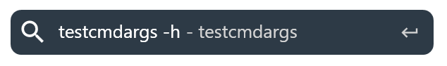

# Advanced bundles

!!! tip ""

    Start with the short introduction to bundles at [Your first command](../tutorials/first-command.md).  
    See [Bundle metadata](metadata.md) for the `bundle.yaml` file and [Bundle lib and bin](lib-and-bin.md) for the `lib/` and `bin/` folders.  
    The other bundle types are on [Command bundles](command-bundles.md) and [UI bundles](ui-bundles.md).

There are a few more advanced bundle types in pyRevit. These bundles are designed for specific use cases. It is good to know that they exist and what they do, just in case you need them in the future.

## ComboBox Bundle
```yaml
extension: .combobox
```

ComboBox bundles create dropdown selection controls in the Revit ribbon. Unlike buttons, ComboBoxes do not execute commands directly. Instead, they provide a selection mechanism that scripts can respond to via events. ComboBoxes are useful for:

- Selecting options or settings
- Switching between modes or views
- Choosing from a list of predefined items

### Bundle Structure
```yaml
MyComboBox.combobox/
    bundle.yaml       # Required: configuration and members
    script.py         # Optional: initialization and event handling
    icon.png          # Optional: ComboBox icon (16x16 or 32x32)
    icon.dark.png     # Optional: dark theme icon

```

### Configuration (bundle.yaml)
The `bundle.yaml` file defines the ComboBox properties and its dropdown members.

**Basic Example**

```yaml
title: My ComboBox
tooltip: Select an option

members:
  - Option 1
  - Option 2
  - Option 3
```

**Full Example with Rich Metadata**

```yaml
title: View Settings
tooltip: Configure view settings
tooltip_ext: |
  Extended description that appears
  after hovering for a moment.
help_url: https://docs.example.com/view-settings

members:
  # Basic items (minimal configuration)
  - id: option_a
    text: Option A
    group: Basic Options
    tooltip: A basic option

  # Rich items (full metadata)
  - id: option_b
    text: Option B
    group: Rich Options
    icon: option_b.png
    tooltip: Option with all properties
    tooltipImage: option_b_preview.png
    longDescription: |
      Extended tooltip description with
      multiple lines of detail.
```

**ComboBox Properties**

| **Property** | **Type** | **Description** |
|---|---|---|
| `title` | string | Display title for the ComboBox |
| `tooltip` | string | Short tooltip text |
| `tooltip_ext` | string | Extended tooltip description |
| `help_url` | string | URL for contextual help (F1) |
| `members` | list | List of member definitions |

**Member Properties**

| **Property** | **Aliases** | **Description** |
|---|---|---|
| `id` | `name` | Unique identifier for the member |
| `text` | `title` | Display text shown in dropdown |
| `icon` | - | Path to icon image (16x16 PNG, relative to bundle) |
| `group` | `groupName` | Group name for organizing members visually |
| `tooltip` | - | Short tooltip for the member |
| `longDescription` | `tooltip_ext` | Extended tooltip description |
| `tooltipImage` | `tooltip_image` | Path to tooltip preview image |

**Member Formats**

Members can be defined in multiple formats:

```yaml
# String format (id and text are the same)
members:
  - Option A
  - Option B

# List/tuple format
members:
  - [option_a, "Option A"]
  - [option_b, "Option B"]

# Dictionary format (recommended for rich metadata)
members:
  - id: option_a
    text: Option A
    icon: option_a.png
    group: My Group
```

### Script Integration
ComboBox bundles can include a `script.py` with a `__selfinit__` function that runs during UI creation. This function allows you to:

!!! tip ""

    > IMPORTANT: Do not use print() inside event handlers! While print() works in \_\_selfinit\_\_, it causes silent failures inside event handlers (e.g., on\_current\_changed). Use TaskDialog.Show() from Autodesk.Revit.UI for feedback in event handlers.

- Subscribe to ComboBox events
- Dynamically add members
- Configure the ComboBox based on conditions

```python
def __selfinit__(script_cmp, ui_button_cmp, __rvt__):
    """Initialize the ComboBox.

    Args:
        script_cmp: The ComboBoxGroup component object (bundle metadata)
        ui_button_cmp: The _PyRevitRibbonComboBox wrapper instance
        __rvt__: The Revit UIApplication object

    Returns:
        bool: Return True if successful, False to deactivate the ComboBox
    """
    # Get the underlying Revit API ComboBox
    combobox = ui_button_cmp.get_rvtapi_object()

    # Subscribe to events
    combobox.CurrentChanged += on_selection_changed

    return True
```

### Events
The Revit API ComboBox supports three events that can be subscribed to in `__selfinit__`:

**CurrentChanged**

Fired when the user selects a different item.

```python
from pyrevit.forms import alert

def on_current_changed(sender, args):
    selected = sender.Current
    if selected:
        alert(
            "Selected: {}\nID: {}".format(selected.ItemText, selected.Name),
            "Selection Changed"
        )

combobox.CurrentChanged += on_current_changed
```

**DropDownOpened**

Fired when the dropdown is opened (before items are shown). Avoid showing modal dialogs (like `TaskDialog`) in this handler as it blocks the dropdown expansion.

!!! tip ""

    > Note: This event is useful for refreshing items or updating state before the user sees the dropdown, but not for showing UI feedback. Standard `print()` won't produce visible output in this context.

```python
def on_dropdown_opened(sender, args):
    # Useful for refreshing dynamic items or updating enabled states
    # Do NOT use TaskDialog here - it blocks the dropdown
    pass

combobox.DropDownOpened += on_dropdown_opened
```

**DropDownClosed**

Fired when the dropdown is closed.

```python
from pyrevit.forms import alert

def on_dropdown_closed(sender, args):
    current = sender.Current
    alert(
		    "Current selection: {}".format(current.ItemText if current else "None"),
        "Dropdown Closed"
    )

combobox.DropDownClosed += on_dropdown_closed
```

> Important: Keep references to event handlers on the `ui_button_cmp` object to prevent garbage collection:
>
> ```python
> ui_button_cmp._my_handler = on_current_changed
> ```

### Dynamic Members
Members can be added programmatically in `__selfinit__`:

```python
from Autodesk.Revit.UI import ComboBoxMemberData

def __selfinit__(script_cmp, ui_button_cmp, __rvt__):
    # Add a separator
    ui_button_cmp.add_separator()

    # Add single item
    member = ComboBoxMemberData("item_id", "Item Text")
    member.GroupName = "Dynamic Items"
    ui_button_cmp.add_item(member)

    # Add multiple items
    items = [
        ComboBoxMemberData("item_1", "Item 1"),
        ComboBoxMemberData("item_2", "Item 2"),
    ]
    ui_button_cmp.add_items(items)

    return True
```

### Wrapper API Reference
The `ui_button_cmp` parameter provides these methods and properties:

**Methods**

| **Method** | **Description** |
|---|---|
| `get_rvtapi_object()` | Get underlying Revit API ComboBox |
| `add_item(member_data)` | Add a single ComboBoxMemberData |
| `add_items(member_data_list)` | Add multiple members at once |
| `add_separator()` | Add a separator line in dropdown |
| `get_items()` | Get list of ComboBoxMember objects |
| `get_title()` | Get display title |
| `set_title(title)` | Set display title |
| `set_contexthelp(url)` | Set F1 help URL |
| `get_contexthelp()` | Get contextual help object |
| `activate()` | Show and enable the ComboBox |
| `deactivate()` | Hide and disable the ComboBox |

**Properties**

| **Property** | **Type** | **Description** |
|---|---|---|
| `current` | `ComboBoxMember` | Get/set currently selected member |
| `enabled` | `bool` | Enable/disable the control |
| `visible` | `bool` | Show/hide the control |
| `name` | `str` | ComboBox identifier |

### Complete Example
**bundle.yaml**

```text
title: View Scale
tooltip: Select view scale
tooltip_ext: Changes the scale of the active view
help_url: https://docs.example.com/view-scale

members:
  - id: "1:1"
    text: "1:1"
    group: Detail Scales

  - id: "1:2"
    text: "1:2"
    group: Detail Scales

  - id: "1:50"
    text: "1:50"
    group: Plan Scales

  - id: "1:100"
    text: "1:100"
    group: Plan Scales
```

**script.py**

```text
from pyrevit import revit
from Autodesk.Revit.UI import ComboBoxMemberData

def __selfinit__(script_cmp, ui_button_cmp, __rvt__):
    combobox = ui_button_cmp.get_rvtapi_object()

    def on_scale_changed(sender, args):
        selected = sender.Current
        if not selected:
            return

        scale_text = selected.Name  # e.g., "1:100"
        scale_value = int(scale_text.split(":")[1])

        doc = revit.doc
        view = revit.active_view

        if view and hasattr(view, 'Scale'):
            with revit.Transaction("Set View Scale"):
                view.Scale = scale_value

    combobox.CurrentChanged += on_scale_changed
    ui_button_cmp._scale_handler = on_scale_changed

    return True
```

### Icon Specifications
| **Icon Type** | **Size** | **Format** | **Purpose** |
|---|---|---|---|
| `icon.png` | 16x16 or 32x32 | PNG | Main ComboBox icon |
| `icon.dark.png` | 16x16 or 32x32 | PNG | Dark theme variant |
| Member `icon` | 16x16 | PNG | Individual dropdown item icon |
| `tooltipImage` | ~200-300px wide | PNG | Tooltip preview image |

### Troubleshooting
**ComboBox not appearing**

1. Check that the bundle directory ends with `.combobox`
1. Verify `bundle.yaml` is valid YAML syntax
1. Check pyRevit logs for parsing errors
1. Ensure `__selfinit__` returns `True` (not `False`)
1. **Do not use** **`print()`** **inside event handlers** - it causes silent failures. Use `TaskDialog.Show()` instead. (`print()` works fine in `__selfinit__` itself.)

**Members not showing**

1. Verify `members` key exists in `bundle.yaml`
1. Check member format matches supported formats
1. Look for errors in pyRevit output window

**Events not firing**

1. Ensure event handlers are subscribed in `__selfinit__`
1. Keep handler references on `ui_button_cmp` to prevent garbage collection
1. Check for exceptions in event handlers (they may be swallowed silently)

**Icons not displaying**

1. Check icon file path is relative to bundle directory
1. Verify icon file exists and is a valid PNG
1. Use 16x16 pixels for member icons

## Smart-Button Command Bundle

```text
extension: .smartbutton
```

Smart buttons are python scripts that are written like modules. They should define `__selfinit__` function as shown below. This function gets executed at startup time to give a chance to the button to initialize itself (e.g set its icon based on its state, or run necessary pre-initializations).

The `__selfinit__` must return `True` if the initialization is successful and `False` if it is not. pyRevit will not create the button if the initialization returns `False` and is determined unsuccessful. This allows the tools to decide whether they want to be available in UI or not depending on conditions.

```python
def __selfinit__(script_cmp, ui_button_cmp, __rvt__):
    """
    Args:
        script_cmp: script component that contains info on this script
        ui_button_cmp: this is the UI button component
        __rvt__: Revit UIApplication

    Returns:
                    bool: Return True if successful, False if not
    """

    run_self_initialization()
```

## No-Button Bundle

```text
extension: .nobutton
```

No-Button bundles are just like Push Button bundles except that they will never show up inside Revit UI and thus don’t need any icons. The only way to run these commands is through pyRevit ***Search*** tool. These commands are meant for more advanced commands that not every user needs, and so they remain fairly hidden.

Open the pyRevit ***Search*** and run `testcmdargs -h` and see what happens.




This is the source for this test command that uses the `docopt` module to process the input arguments

```python
"""Test docopt argument processing.

Usage:
    testdocopt (-h | --help)
    testdocopt (-V | --version)
    testdocopt -e <encod> <src_file>

Options:
    -h, --help                          Show this help
    -V, --version                       Show command version
    -e <encod>, --encode <encod>        File encoding [default: utf-8]
"""

import sys
import docopt

args = docopt.docopt(__doc__,
                     version='testdocopt {}'.format('v0.1'),
                     help=True)
```

## Panel-Button Bundle

```text
extension: .panelbutton
```

Panel Button bundles are just like Push Button bundles except that they will be set as the panel configuration button (small arrow at the corner of UI Panels).

- Panel Buttons do not need to have an icon as the standard small arrow icon \[↘︎\] is used for panel configuration buttons by default. These commands work just like any pyRevit command but their primary purpose should be to configure a set of related tools in a panel.
- Panel Buttons do not read context directives. Their context is automatically set, so they are available at all times.

## Invoke-Button Bundle

```text
extension: .invokebutton
```

Invoke buttons can call an external command (implementing **IExternalCommand**) from another dll. However, they run the external command without loading the assembly in Revit context so the dll file can be modified while Revit is running. They are a great method to incorporate your high-performance C# dlls into your pyRevit extensions. Invoke Buttons, need the parameters below defined in the bundles' metadata file.  
See [Bundle Metadata](metadata.md)  for more information on these files.

```yaml
# include the key:values below in the bundle metadata file

assembly: PyRevitTestInvokeCommand.dll              # full path to dll. if the dll is included in the bundle lib/
                                                    # or the parent bundle lib/ directory just enter the full dll name
                                                    # pyRevit will find the dll in the parent lib/ directories

command_class: PyRevitTestInvokeExternalCommand     # name of the external command class
```

Invoke Buttons are also smart about the assembly types implementing the IExternalCommand interface. So if there is only one external command inside your dll assembly that implements the IExternalCommand interface, you can skip defining the `command_class` in the bundle metadata file. pyRevit will automatically find the correct type and will run the `Execute` method on it.

## Link-Button Bundle

```text
extension: .linkbutton
```

Link buttons can call an external command (implementing **IExternalCommand**) from another loaded Addin. Link buttons are good for adding shortcuts to other addin functionality in your pyRevit extensions to improve user experience. Link Buttons, need the parameters below defined in the bundles metadata file.  
See [Bundle Metadata](metadata.md)  for more information on these files.

!!! warning ""

    **Note:** For Link Buttons to work properly, the target addin assembly must be already loaded when this button is being created, otherwise Revit can not tie the UI button to the assembly that is not already loaded.

```yaml
# include the key:values below in the bundle metadata file

assembly: PyRevitTestLinkCommand.dll                # full path to dll. if the dll is included in the bundle lib/
                                                    # or the parent bundle lib/ directory just enter the full dll name
                                                    # pyRevit will find the dll in the parent lib/ directories

command_class: PyRevitTestLinkExternalCommand       # name of the external command class
```

As of pyRevit 4.8.5, you can also add Accessibility types to the link bundle file. Since Link buttons points to a completely different assembly, pyRevit can not assign its internal zero-doc or other automatic context filters to these buttons. If that is desired, it is better to use Invoke buttons instead.

```yaml
availability_class: PyRevitTestLinkExternalCommandAvail
```

The Link buttons assembly needs to implement an instance of the availability class. For example:

```csharp
public class PyRevitTestLinkExternalCommandAvail : IExternalCommandAvailability {
    public PyRevitTestLinkExternalCommandAvail() {}
    public bool IsCommandAvailable(UIApplication uiApp, CategorySet selectedCategories) {
        return true;
    }
}
```
