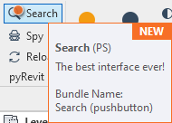
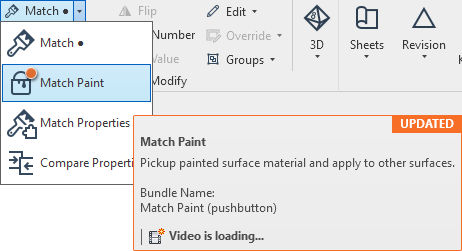

# Command bundles

!!! tip ""

    Start with the short introduction to bundles at [Your first command](../tutorials/first-command.md).  
    See [Bundle metadata](metadata.md) for the `bundle.yaml` file and [Bundle lib and bin](lib-and-bin.md) for the `lib/` and `bin/` folders.  
    The other bundle types are on [UI bundles](ui-bundles.md) and [Advanced bundles](advanced-bundles.md).

Command bundles are the smallest unit of executable code in pyRevit. In most cases, they show up as a button on the Revit UI, and can be executed in a variety of ways.

## All Command Bundles

The requirements and conventions below are shared among all command bundles

### Button Highlighting Directives

You can provide highlighting directives inside the command bundle metadata. Revit will highlight the button and the tooltip in the interface.

```yaml
# highlight as new
highlight: new
```



```yaml
# highlight as updated
highlight: updated
```



## Push-Button Bundle

Push Button bundles include a script that is executed fresh, every time the user clicks on the button. They are the most used bundle in pyRevit.

```text
extension: .pushbutton

requires:
    - *script.*           # note the wildcard. BuildWall_script.py or Analyse-script.cs are both acceptable names
    - bundle.yaml         # includes bundle metadata e.g. tooltip message
                          # OPTIONAL for python scripts only.
                          # python scripts can use the __var__ convention to set bundle metadata

optional:
    - *config.*           # optional config scripts. Revit UI will show a ● in front of the button name e.g. "Match ●"
                          # Shift-Clicking the button, launches this config.* script instead
    - icon.png            # for Revit UI icons
    - icon.dark.png       # for Revit UI icons in Dark mode
    - tooltip.png         # for Revit UI button tooltip image
    - tooltip.mp4         # for Revit UI button tooltip video
    - *help.*             # for Revit UI button help, opening with F1 key
    - lib/                # can include a lib/ directory that hosts modules required by the bundle code
    - bin/                # can include a bin/ directory that hosts binaries required by the bundle code
```

### IronPython Scripts

Push-Button bundles can contain a IronPython  `*.py` file as their main script. pyRevit will run the script with the active IronPython engine.

See [Anatomy of IronPython Scripts](../scripting/ironpython.md)  for more detail on IronPython scripts.

See [Configure pyRevit](../../get-started/configure.md) for more information about setting the active IronPython engine version.

### CPython Scripts

Push-Button bundles can contain a CPython  `*.py` file as their main script. pyRevit runs the script with the active CPython engine when its first line is `#! python3`. An `engine: type` set in the bundle file takes precedence over that line.

See [Anatomy of CPython Scripts](../scripting/cpython.md)  for more detail on CPython scripts.

See [Configure pyRevit](../../get-started/configure.md) for more information about setting the active CPython engine version.

### C#, VB.NET Scripts

Push-Button bundles can contain a C#  `*.cs` , or a VB.NET `*.vb` file as their main script. pyRevit will compile and run the script.

See [Anatomy of .NET (C#, VB) Scripts](../scripting/dotnet.md)  for more detail on .NET scripts.

### DynamoBIM Scripts

Push-Button bundles can contain a DynamoBIM `*.dyn` file as their main script. pyRevit will launch the installed DynamoBIM on the host Revit and asks to run the bundle script.

**DynamoBIM Engine Configs**

Dynamo has an option to shutdown the executor after running the dynamo script. This means that scripts take longer to run since it has to load dynamo first (and if dynamo needs to check for updates or do other startup tasks that is also added to the script execution time)

You can specify whether to use a clean dynamo engine or keep it in memory for the next executions. Set the option below in your bundle file.

```yaml
engine:
  clean: false
```

Similarly, the Dynamo **Automation** mode. If Dynamo **Automation** is on, dynamo runtime will remain in memory for faster execution. This however causes issues with Dynamo definitions that create windows and GUI to get/report information from/to the user. Since the dynamo definition is initialized once in **Automation** mode, the GUIs only pop up once on the first execution and will not be opened after. For dynamo scripts containing GUI, the `automate` engine option must be `false`

```yaml
engine:
  automate: false
```

You can also set the other [Dynamo Journal Keys](https://github.com/DynamoDS/DynamoRevit/blob/3aa28a7e1ba560aebb4a060de0f36beb6975c105/src/DynamoRevit/DynamoRevit.cs#L118) in the bundle yaml file

```yaml
engine:
  dynamo_path: String
  dynamo_path_check_existing: Boolean
  dynamo_force_manual_run: Boolean
  dynamo_model_nodes_info: String
```

### Grasshopper Scripts

Push-Button bundles can contain a Grasshopper `*.gh` file as their main script. pyRevit will launch the installed [Rhino.Inside.Revit](https://www.rhino3d.com/inside/revit/) on the host Revit and asks to run the bundle script.

## Content-Button Bundle

Content Bundles carry contents for Revit, and help with reducing modeling errors by making it easy to place specific contents inside Revit models. This bundle places a Revit family file `.rfa` inside the active Revit document.

Set the family in the bundle file. The path can be absolute or relative to the bundle folder:

```yaml
content: "..\\A.rfa"                              # family placed when the button is clicked
content_alt: "C:\\Standards\\Families\\B.rfa"       # optional family placed on SHIFT+Click
```

```text
extension: .content
requires:
    - bundle.yaml         # with the content key, or a family file named by convention (see below)

optional:
    - icon.png            # for Revit UI icons
    - icon.dark.png       # for Dark Theme Revit UI
    - tooltip.png         # for Revit UI button tooltip image
    - tooltip.mp4         # for Revit UI button tooltip video
```

When the bundle file has no `content` key, pyRevit looks for the family inside the bundle folder, in this order:

1. the first file named `content_*.rfa`
1. `content.rfa`
1. any other `.rfa` file

The alternative family follows the same convention with `other_*.rfa` and `other.rfa`.

!!! warning ""

    The suffix after `content_` or `other_` is not compared with the running Revit version. Keep one such file per bundle, or set `content` and `content_alt` in the bundle file. When a bundle has an alternative family, Revit UI shows a ● in front of the button name e.g. "Marker ●".

## URL-Button Bundle

URL Bundles open the URL link specified in the bundle file, in the default browser. They are great for creating intranet shortcut buttons.

```text
extension: .urlbutton
requires:
    - bundle.yaml         # includes bundle metadata e.g. tooltip message

optional:
    - icon.png            # for Revit UI icons
    - tooltip.png         # for Revit UI button tooltip image
    - tooltip.mp4         # for Revit UI button tooltip video
```

URL buttons need to provide the target URL in the bundle file

```yaml
hyperlink: "https://www.youtube.com/pyrevit"
```
