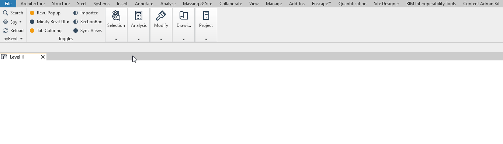

# UI bundles

!!! tip ""

    Start with the short introduction to bundles at [Your first command](../tutorials/first-command.md).  
    See [Bundle metadata](metadata.md) for the `bundle.yaml` file and [Bundle lib and bin](lib-and-bin.md) for the `lib/` and `bin/` folders.  
    The other bundle types are on [Command bundles](command-bundles.md) and [Advanced bundles](advanced-bundles.md).

UI bundles are designed to create easily sharable UI layouts for the **Command Bundles**

A UI bundle is a bundle that can contain command bundles and other UI bundles. 

## All UI Bundles

The requirements and conventions below are shared among all UI bundles

```text
optional:
    - bundle.yaml         # includes bundle metadata e.g. layout, title, tooltip
    - icon.png            # for Revit UI icons
    - icon.dark.png       # for Revit UI icons in Dark mode
    - lib/                # can include a lib/ directory that hosts modules required by the commands inside this bundle
    - bin/                # can include a bin/ directory that hosts binaries required by the commands inside this bundle
```

### Bundle Layout Directives

UI bundles can provide directives on how the child bundles should be ordered in Revit UI. These directives are defined in the bundle file and are limited to UI bundles only.

!!! tip ""

    See [Bundle Layout](layout.md) for  more information about layout directives

**Example**

```yaml
# layout directives are listed in order under `layout` key
layout:
  - Logs
  - -----
  - Unit Tests
  - Bundle Tests
  - Misc Tests[title:Third-Party\nUnit Tests]
  - Debug Dialog Config
```

## Tab UI Bundle

This bundle creates a Tab in the Ribbon with the bundle name. The rest of the required and optional components are identical to **All UI Bundles**

```text
extension: .tab
can_contain: Only .panel bundles; all other bundles will be ignored
```

## Panel UI Bundle

This bundle creates a Panel in a Ribbon Tab with the bundle name.

```text
extension: .panel
can_contain: All other command and UI bundle types
```

### Panel Background

You can set the background color for main, title, and slideout parts of a panel in the bundle metadata file. The colors are in CSS style and can be in ARGB or RGB format. Note that colors need to be wrapped in quotes since # is a comment character in YAML

```yaml
# set background for all parts
background: '#ff0000'                   # or ARGB e.g. #ff0000ff

# or for individual parts
background:
  panel: '#ff0000'
  title: '#00ff00'
  slideout: '#0000ff'
```

### Collapsing Panels By Default

If you have a lot of panels on your tab, you might want to set some of those tabs to be collapsed by default so they don't take space on the tab bar. Users can hover over the panels to see the tools. Set the option below in the Panel bundle file.

```yaml
collapsed: true
```

This is how the panels would show up (collaped) and expand when user hovers over the panel.



## Stack UI Bundle

This bundle creates a stack of 2 or 3 buttons in a panel.

```text
extension: .stack
can_contain:
    - Pull-down UI bundle
    - Split-button UI bundle
    - Split-push-button UI bundle
    - All command bundles

max_children: 3 bundles total (of any kind)
```

## Pull-Down UI Bundle

This bundle creates a Pulldown Button in a Ribbon Panel or a Stack, with the bundle name and icon.

```text
extension: .pulldown
can_contain: Other Command bundles
```

## Split-Button UI Bundle

This bundle creates a Split Button button in a Ribbon Panel or a Stack, with the bundle name and icon.

```text
extension: .splitbutton
can_contain: Other Command bundles
```

## Split-Push-Button UI Bundle

This bundle creates a Split Push Button button (The sticky split button) in a panel or a stack, with the bundle name and icon.

```text
extension: .splitpushbutton
can_contain: Other Command bundles
```
