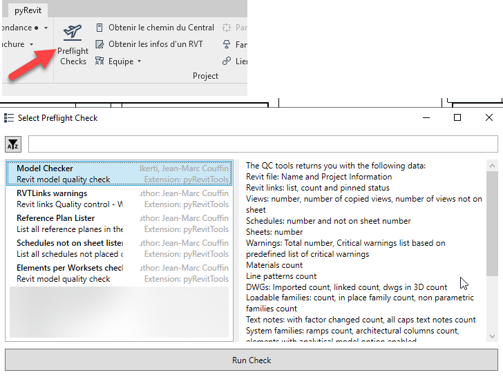

# Checks

**Preflight Checks**, in the **Project** panel of the pyRevit tab, runs model checks. Extensions can add their own.



- The ‘checks’ are all located in a ‘checks’ folder at the root of any extension folder (meaning even in a custom extension folder). The basic ones that comes with pyRevit as well:

!!! info ""

    [Preflight Checks - Checks Folder](https://github.com/pyrevitlabs/pyRevit/tree/develop/extensions/pyRevitTools.extension/checks)  

- Start by duplicating any of the suffixed \*\_check.py files, the extension of the filename being the important part
- In the file itself, the important parts are:

```python
from pyrevit.preflight import PreflightTestCase
from pyrevit import HOST_APP
from pyrevit.script import get_output
from pyrevit.coreutils import Timer
from datetime import timedelta

doc = HOST_APP.doc
output = get_output()

def checkModel(doc, output):
    # your tests and its outputs with a very basic thing as an example
    title = doc.Title
    output.print_md("# data I want to display to the end user")
    output.print_md("Title of the document opened is **{}**".format(title))

class ModelChecker(PreflightTestCase):
    """Description of what it does
    - list of things it checks
    - how it checks
    - what it does if it finds something wrong
    """

    name = "title listed in the preflight checks ui"
    author = "your name"

    def setUp(self, doc, output):
        pass

    def startTest(self, doc, output):
        timer = Timer()

        checkModel(doc, output)

        endtime = timer.get_time()
        endtime_hms = str(timedelta(seconds=endtime))
        endtime_hms_claim = "Transaction took " + endtime_hms
        output.print_md(endtime_hms_claim)

    def tearDown(self, doc, output):
        pass

    def doCleanups(self, doc, output):
        pass

```

!!! info ""

    If you want to improve the model checker check itself.  
    Feel free to make a PR against the develop branch.
