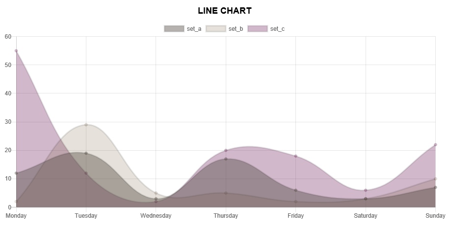
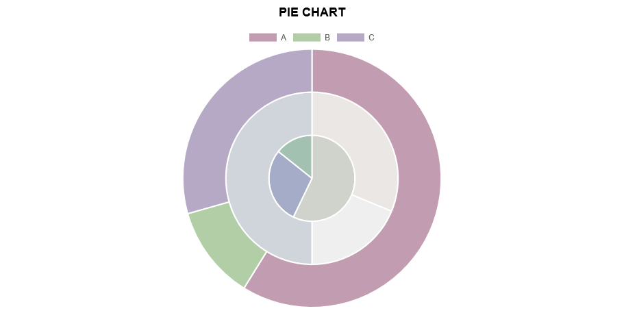
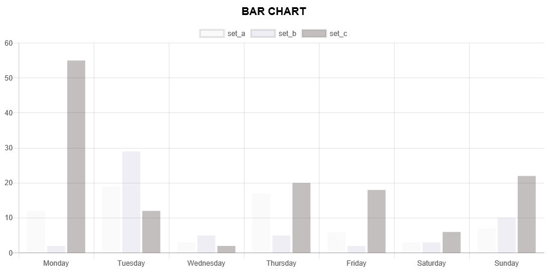
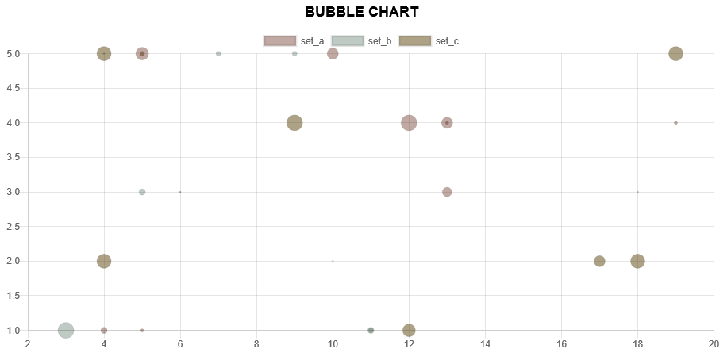
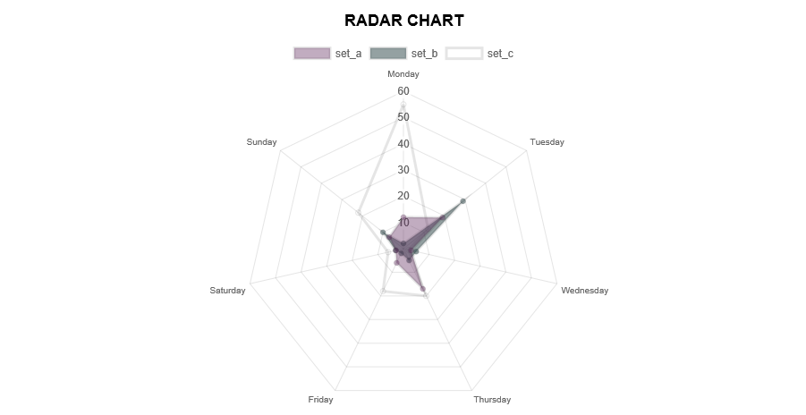
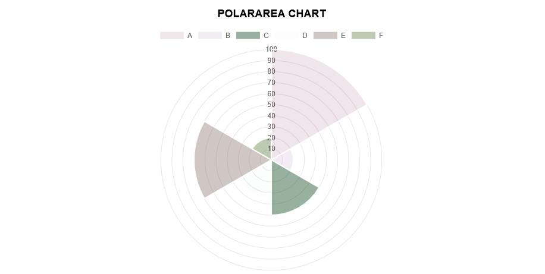
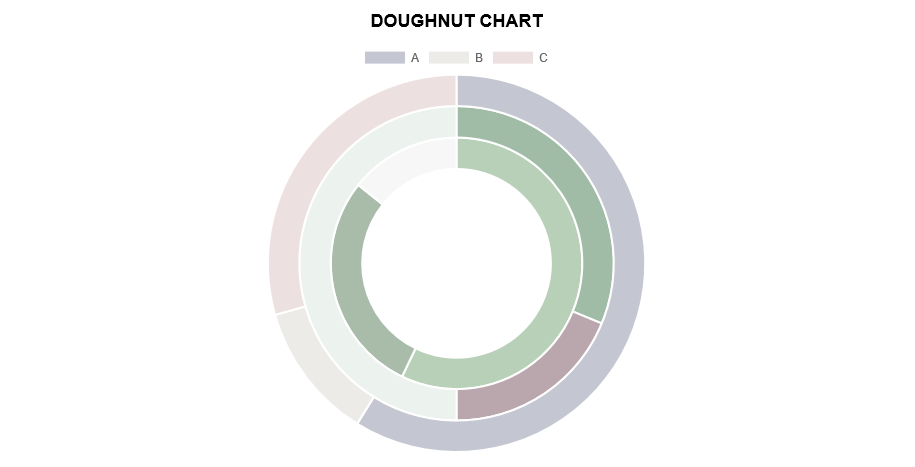

# Charts

##  **Charts Engine**

!!! warning ""

    The Charts engine in pyRevit uses the [Charts.js](https://www.chartjs.org) module as the underlying renderer. See the [Charts.js docs](https://www.chartjs.org/docs/latest/) for detail info on the chart configuration and options.

pyRevit has an internal charts engine (See Charts Engine ). This feature can easily be used thought the output window wrapper object, to create beautiful and interactive charts in the output window of your scripts.

Get the wapper object for the output window, and see the examples below on creating the most popular chart types

```python
from pyrevit import script

output = script.get_output()
```

### Overview

#### Step 1
Create a chart object for the chart type that you want. We’ll add data to this later…

```python
from pyrevit import script

output = script.get_output()

# Line chart
chart = output.make_line_chart()

# Bar chart
chart = output.make_bar_chart()

# Bubble chart
chart = output.make_bubble_chart()

# Radar chart
chart = output.make_radar_chart()

# Polar chart
chart = output.make_polar_chart()

# Pie chart
chart = output.make_pie_chart()

# Doughnut chart
chart = output.make_doughnut_chart()
```

#### Step 1a \[Optional\]
Setup the chart title, and other options. the full list of options for every chart is available on [Charts.js Documentation](https://www.chartjs.org/docs/) page. Some of the properties have their own sub-properties, for example the `title` option for the charts has multiple sub-properties as shown below. The value for these type of properties should be a dictionary of the sub-properties you’d like to set.

```python
chart.set_style('height:150px')
chart.options.title = {'display': True, 'text':'Chart Title', 'fontSize': 18, 'fontColor': '#000', 'fontStyle': 'bold'}
```

#### Step 2
Now let’s add data to the chart. Every chart object has a data property `chart.data `that we can interact with to add datasets to the chart. Different types of charts need different types of data sets in terms of how data is organized, so the chart can present multiple data sets correctly. I’m providing two examples here, one for a simple line chart (showing 3 different data sets) and another for a radial chart (also showing 3 different data sets within the same chart). They’re all very similar to each other though.

```python
# setting the charts x line data labels
chart.data.labels = ['Monday', 'Tuesday', 'Wednesday', 'Thursday', 'Friday', 'Saturday', 'Sunday']
# Let's add the first dataset to the chart object
# we'll give it a name: set_a
set_a = chart.data.new_dataset('set_a')
# And let's add data to it.
# These are the data for the Y axis of the graph
# The data length should match the length of data for the X axis
set_a.data = [12, 19, 3, 17, 6, 3, 7]
# Set the color for this graph
set_a.set_color(0xFF, 0x8C, 0x8D, 0.8)
```

#### Step 3
The last step is to ask the chart object to draw itself.

```python
# Before drawing the chart you can randomize the colors
# if you have not added any color to the datasets.
chart.randomize_colors()
# Finally let's draw the chart
chart.draw()
```

### Line charts

See the comments in the script for more info

```python
# get line chart object
chart = output.make_line_chart()

# this is a list of labels for the X axis of the line graph
chart.data.labels = ['Monday', 'Tuesday', 'Wednesday', 'Thursday', 'Friday', 'Saturday', 'Sunday']

# Let's add the first dataset to the chart object
# we'll give it a name: set_a
set_a = chart.data.new_dataset('set_a')

# And let's add data to it.
# These are the data for the Y axis of the graph
# The data length should match the length of data for the X axis
set_a.data = [12, 19, 3, 17, 6, 3, 7]

# Set the color for this graph
set_a.set_color(0xFF, 0x8C, 0x8D, 0.8)

# Same as above for a new data set: set_b
set_b = chart.data.new_dataset('set_b')

# You can also set custom options for this graph
# See the Charts.js documentation for all the options
set_b.fill = False

# Obviously a different set of data and a different color
set_b.data = [2, 29, 5, 5, 2, 3, 10]
set_b.set_color(0xFF, 0xCE, 0x56, 0.8)

# Same as above for a new data set: set_c
set_c = chart.data.new_dataset('set_c')

# Obviously a different set of data and a different color
set_c.data = [55, 12, 2, 20, 18, 6, 22]
set_c.set_color(0x36, 0xA2, 0xEB, 0.8)
```

And here is the result



### Pie charts

See the comments in the script for more info

```python
# get pie chart object
chart = output.make_pie_chart()

# Set the labels for the circumference axis
chart.data.labels = ['A', 'B', 'C']

# Create new data sets
set_a = chart.data.new_dataset('set_a')
set_a.data = [100, 20, 50]

# You can set a different color for each pie of the chart
set_a.backgroundColor = ["#560764", "#1F6CB0", "#F98B60"]
set_b = chart.data.new_dataset('set_b')
set_b.data = [50, 30, 80]
set_b.backgroundColor = ["#913175", "#70A3C4", "#FFC057"]
set_c = chart.data.new_dataset('set_c')
set_c.data = [40, 20, 10]
set_c.backgroundColor = ["#DD5B82", "#E7E8F5", "#FFE084"]
```



### Bar charts

See the comments in the script for more info

```python
# get bar chart object
chart = output.make_bar_chart()

# the rest is similar to line charts
```



### Bubble charts

See the comments in the script for more info

```python
# get bubble chart object
chart = output.make_bubble_chart()

# the rest is similar to line charts
```



### Radar charts

See the comments in the script for more info

```python
# get radar chart object
chart = output.make_radar_chart()

# the rest is similar to line charts
```



### Polar Area charts

See the comments in the script for more info

```python
# get polar chart object
chart = output.make_polar_chart()

# the rest is similar to line charts
```



### Doghnut charts

See the comments in the script for more info

```python
# get doughnut chart object
chart = output.make_doughnut_chart()

# the rest is similar to line charts
```



pyRevit charts module is `pyrevit.coreutils.charts`. This is the module that the output window interacts with to create the charts.

The charts module provides the chart object and handles the creation of datasets. The first thing it does when drawing the graph is to create a html `<canvas> `element and assign a unique id to it:

```python
<canvas id="chart123456"></canvas>
```

Then it parses the input data and creates a JSON representation of the data. The JSON string (json\_data) will be inserted into a template javascript. This javascript creates a Chart object from the `Chart.js` library:

```python
var ctx = document.getElementById('{}').getContext('2d');
var chart = new Chart(ctx, json_data);
```

and finally, the pyRevit chart object, injects this dynamically created javascript into the \<head\> of the output window `WebBrowser` component:

```python
output.inject_script(js_code)
```
