# Input and forms

## Effective Input

### Alerts

Use [`forms.alert()`](https://docs.pyrevitlabs.io/reference/pyrevit/forms/#pyrevit.forms.alert) and [`forms.alert_ifnot()`](https://docs.pyrevitlabs.io/reference/pyrevit/forms/#pyrevit.forms.alert_ifnot) to send alerts to the user and ask quick questions

```python
from pyrevit import forms

res = forms.alert("Reloading increases the memory footprint and is "
                  "automatically called by pyRevit when necessary.\n\n"
                  "pyRevit developers can manually reload when:\n"
                  "    - New buttons are added.\n"
                  "    - Buttons have been removed.\n"
                  "    - Button icons have changed.\n"
                  "    - Base C# code has changed.\n"
                  "    - Value of pyRevit parameters\n"
                  "      (e.g. __title__, __doc__, ...) have changed.\n"
                  "    - Cached engines need to be cleared.\n\n"
                  "Are you sure you want to reload?",
                  ok=False, yes=True, no=True)
if res:
    do_stuff()
```

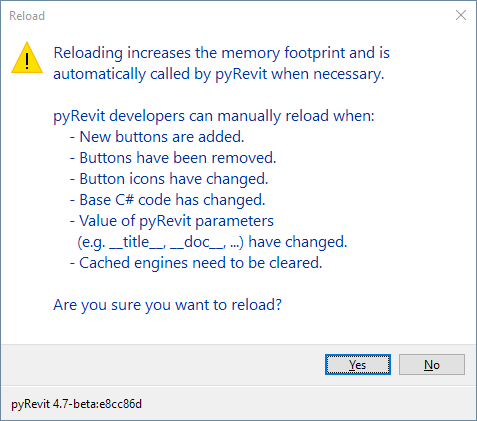

Use the `options` argument to show options to the user on the alert window

```python
from pyrevit import forms

res = forms.alert("Existing keynote file needs to be converted to "
                  "a format usable by this tool. The resulting keynote "
                  "file is still readble by Revit and could be shared "
                  "with other projects. Users should NOT be making changes to "
                  "the existing keynote file during the conversion process.\n"
                  "Are you sure you want to convert?",
                  options=["Convert",
                           "Select a different keynote file",
                           "Give me more info"])
if res == "Convert":
    do_stuff()
```

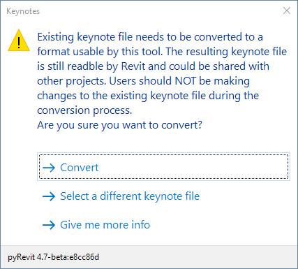

Use the `exitscript` option to end the script if user says No, or hits OK

```python
from pyrevit import forms

forms.alert('You must be on a sheet to use this tool.', exitscript=True)
# if user says no, the alert function will end the script
# and the command does not execute the next line
do_stuff()

```

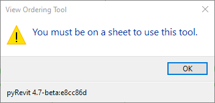

Use the [`alert_ifnot`](https://docs.pyrevitlabs.io/reference/pyrevit/forms/#pyrevit.forms.alert_ifnot) to check for a condition and show the alert based on the results

```python
# asks "Are you sure?" if value > 12
# exits the script if user says No
forms.alert_ifnot(value > 12,
                  'Are you sure?',
                  yes=True, no=True, exitscript=True)
```

### Toast

Use [`forms.toast()`](https://docs.pyrevitlabs.io/reference/pyrevit/forms/#pyrevit.forms.toast) to send a toast notification (Windows 10 only)

```python
from pyrevit import forms

forms.toast(
    "Hello World!",
    title="My Script",
    appid="MyAPP",
    click="https://docs.pyrevitlabs.io/",
    actions={
        "Open Google":"https://google.com",
        "Open Toast64":"https://github.com/go-toast/toast"
        })
```

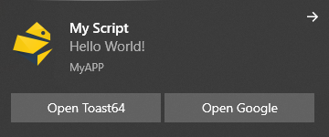

### Command Options

Use the [`forms.CommandSwitchWindow`](https://docs.pyrevitlabs.io/reference/pyrevit/forms/#pyrevit.forms.CommandSwitchWindow) to present options to the user and ask for a choice

```python
from pyrevit import forms

selected_option = forms.CommandSwitchWindow.show(
    ['Option_1', 'Option 2', 'Option 3', 'Option 4', 'Option 5'],
     message='Select Option:',
)

if selected_option == 'Option 2':
    do_stuff()
```

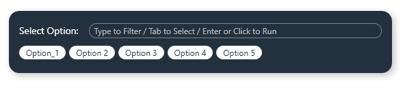

Use the `switches` option to provide toggle switches to modify your command behaviour

```python
selected_option, switches = \
    forms.CommandSwitchWindow.show(
        ['Option_1', 'Option 2', 'Option 3', 'Option 4', 'Option 5'],
        switches=['Switch 1', 'Switch 2'],
        message='Select Option:',
        recognize_access_key=True
        )

if selected_option:
    print('Selected Option: {}'
          '\n Switch 1 = {}'
          '\n Switch 2 = {}'.format(selected_option,
                                    switches['Switch 1'],
                                    switches['Switch 2']))
```

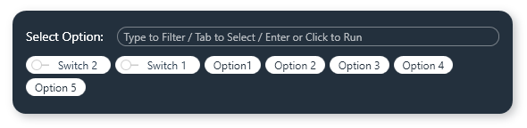

For example the ***Rename Views*** tool provides a switch to print a report or not

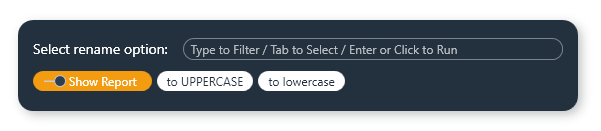

The `recognize_access_key` option will translate the `_` characters in the option name to ALT+? commands. In the example above `Option_1` configures the window to allow the ALT+1 combination to select this option. (This is a [WPF feature](https://docs.microsoft.com/en-us/dotnet/api/system.windows.controls.contentpresenter.recognizesaccesskey?view=netframework-4.8) )

### Warning Bar

Use the [`forms.WarningBar`](https://docs.pyrevitlabs.io/reference/pyrevit/forms/#pyrevit.forms.WarningBar) context manager to show a warning or message bar on top of the Revit window

```python
from pyrevit import forms

with forms.WarningBar(title='Pick source object:'):
    do_stuff()
```

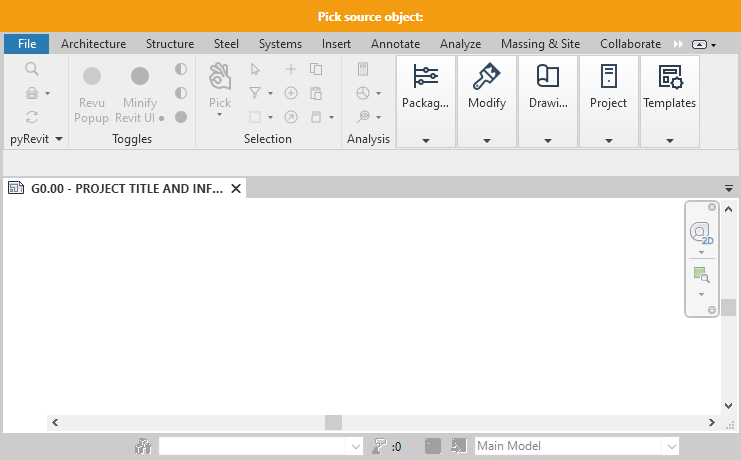

### Pick / Save (Excel ) File

These methods are great for asking for a file, excel file, or a directory for your command operation

See [`forms.pick_file()`](https://docs.pyrevitlabs.io/reference/pyrevit/forms/#pyrevit.forms.pick_file), [`forms.pick_excel_file()`](https://docs.pyrevitlabs.io/reference/pyrevit/forms/#pyrevit.forms.pick_excel_file), [`forms.save_file()`](https://docs.pyrevitlabs.io/reference/pyrevit/forms/#pyrevit.forms.save_file), [`forms.save_excel_file()`](https://docs.pyrevitlabs.io/reference/pyrevit/forms/#pyrevit.forms.save_excel_file), [`forms.pick_folder()`](https://docs.pyrevitlabs.io/reference/pyrevit/forms/#pyrevit.forms.pick_folder)

```python
from pyrevit import forms

# ask for file
source_file = forms.pick_file(file_ext='csv')
if source_file:
    do_stuff()
```

```python
# ask for excel file
excel_file = forms.pick_excel_file()
if excel_file:
    do_stuff()
```

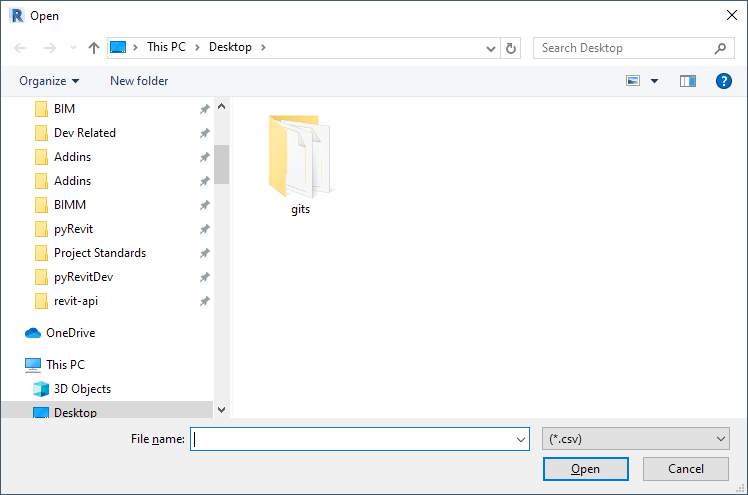

```python
# ask for folder
target_folder = forms.pick_folder()
if target_folder:
    do_stuff()
```

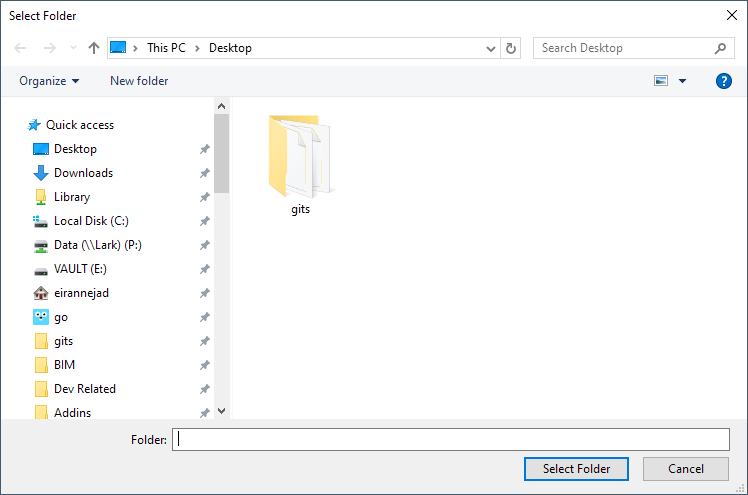

### Selecting an Option

#### Select Views

Use [`forms.select_views()`](https://docs.pyrevitlabs.io/reference/pyrevit/forms/#pyrevit.forms.select_views) to ask for a selection of views

```python
from pyrevit import forms

selected_views = forms.select_views()
if selected_views:
    do_stuff()
```

```python
# use more advanced options to filter

legends = forms.select_views(
    title='Select Legend Views',
    filterfunc=lambda x: x.ViewType == DB.ViewType.Legend
)
```

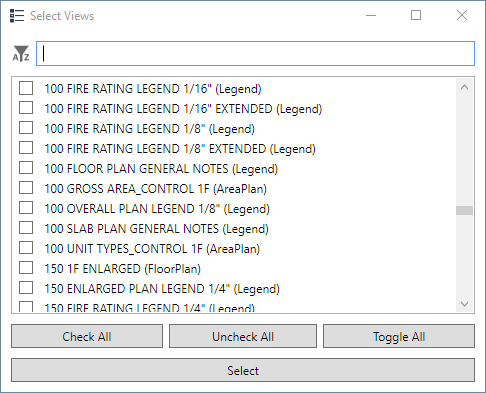

#### Select View Templates

Use [`forms.select_viewtemplates()`](https://docs.pyrevitlabs.io/reference/pyrevit/forms/#pyrevit.forms.select_viewtemplates) to ask for a selection of view templates

```python
from pyrevit import forms

selected_viewtemplates = forms.select_viewtemplates()
if selected_viewtemplates:
    do_stuff()
```

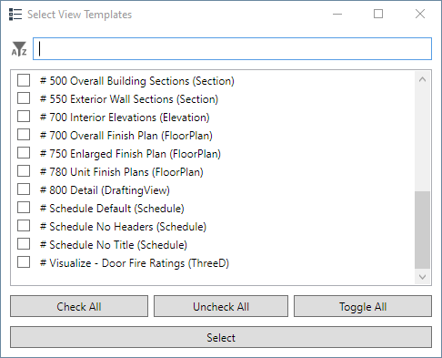

#### Select Schedules

Use [`forms.select_schedules()`](https://docs.pyrevitlabs.io/reference/pyrevit/forms/#pyrevit.forms.select_schedules) to ask for a selection of schedules

```python
from pyrevit import forms

selected_schedules = forms.select_schedules()
if selected_schedules:
    do_stuff()
```

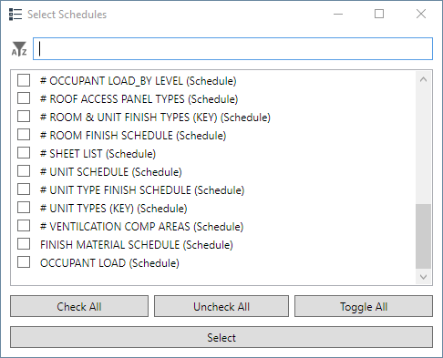

#### Select Sheets

Use [`forms.select_sheets()`](https://docs.pyrevitlabs.io/reference/pyrevit/forms/#pyrevit.forms.select_sheets) to ask for a selection of sheets

```python
from pyrevit import forms

selected_sheets = forms.select_sheets()
if selected_sheets:
    do_stuff()
```

#### Select Revisions

Use [`forms.select_revisions()`](https://docs.pyrevitlabs.io/reference/pyrevit/forms/#pyrevit.forms.select_revisions) to ask for a selection of revisions

```python
from pyrevit import forms

selected_revisions = forms.select_revisions()
if selected_revisions:
    do_stuff()
```

#### Select TitleBlocks

Use [`forms.select_titleblocks()`](https://docs.pyrevitlabs.io/reference/pyrevit/forms/#pyrevit.forms.select_titleblocks) to ask for a selection of titleblocks

```python
from pyrevit import forms

selected_titleblocks = forms.select_titleblocks()
if selected_titleblocks:
    do_stuff()
```

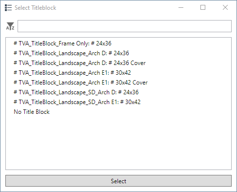

#### Select Element Parameters

Use [`forms.select_parameters()`](https://docs.pyrevitlabs.io/reference/pyrevit/forms/#pyrevit.forms.select_parameters) to ask for a selection of type or instance parameters on a Revit element

```python
from pyrevit import forms, revit

element = revit.pick_element()
selected_parameters = forms.select_parameters(element)
if selected_parameters:
    do_stuff_with_parameters()
```

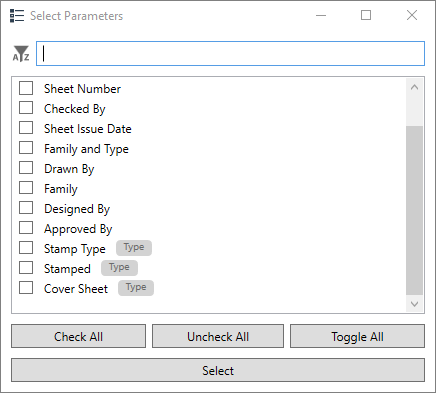

#### Select Family Parameters

Use [`forms.select_family_parameters()`](https://docs.pyrevitlabs.io/reference/pyrevit/forms/#pyrevit.forms.select_family_parameters) to ask for a selection of type or instance parameters on a Revit Famiy Document.

```python
from pyrevit import forms, revit

doc = revit.doc

selected_parameters = forms.select_family_parameters(doc)
if selected_parameters:
    do_stuff_with_parameters()
```

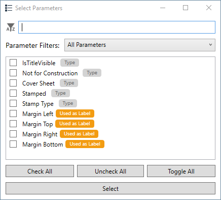

#### Select an Open Document

Use [`forms.select_open_docs()`](https://docs.pyrevitlabs.io/reference/pyrevit/forms/#pyrevit.forms.select_open_docs) to ask for a selection of schedules

```python
from pyrevit import forms

dest_docs = forms.select_open_docs(title='Select Destination Documents')
if dest_docs:
    do_stuff()
```

The method will show an alert if there is only one document open

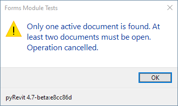

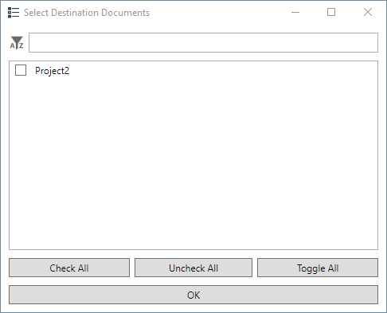

#### Select From List (Single, Multiple)

Use the generic [`forms.SelectFromList`](https://docs.pyrevitlabs.io/reference/pyrevit/forms/#pyrevit.forms.SelectFromList) to create your own customized selection windows

```python
from pyrevit import forms
items = ['item1', 'item2', 'item3']
res = forms.SelectFromList.show(items, button_name='Select Item')
if res == 'item1':
    do_stuff()
```

You can also include Revit elements as the options

```python
ops = [viewsheet1, viewsheet2, viewsheet3]
res = forms.SelectFromList.show(ops,
                                multiselect=False,
                                name_attr='Name',
                                button_name='Select Sheet')
if res and res.Id == viewsheet1.Id:
    do_stuff()
```

The options also support groups of lists. When option groups are used, a combo box group selector will appear on the window

```python
forms.SelectFromList.show(
        {'All': '1 2 3 4 5 6 7 8 9 0'.split(),
         'Odd': '1 3 5 7 9'.split(),
         'Even': '2 4 6 8 0'.split()},
        title='MultiGroup List',
        group_selector_title='Select Integer Range:',
        multiselect=True
    )
```

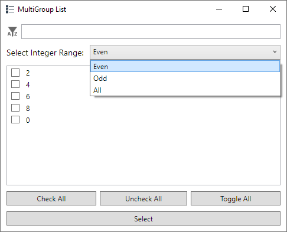

An example of grouped options, are grouping sheets into sheet sets

```python
ops = {'Sheet Set A': [viewsheet1, viewsheet2, viewsheet3],
       'Sheet Set B': [viewsheet4, viewsheet5, viewsheet6]}
res = forms.SelectFromList.show(ops,
                                multiselect=True,
                                name_attr='Name',
                                group_selector_title='Sheet Sets',
                                button_name='Select Sheets')
if res:
    selected_ids = [sheet.Id for sheet in res]
    if viewsheet1.Id in selected_ids:
        do_stuff()
```

This module also provides a wrapper base class [`TemplateListItem`](https://docs.pyrevitlabs.io/reference/pyrevit/forms/#pyrevit.forms.TemplateListItem) for when the checkbox option is wrapping another element, e.g. a Revit ViewSheet. Derive from this base class and define the name property to customize how the checkbox is named on the dialog.

```python
from pyrevit import forms

class MyOption(forms.TemplateListItem):
    @property
    def name(self):
        return "Option: {}".format(self.item)

ops = [MyOption('op1'), MyOption('op2', checked=True), MyOption('op3')]
res = forms.SelectFromList.show(ops,
                                multiselect=True,
                                button_name='Select Item')
```

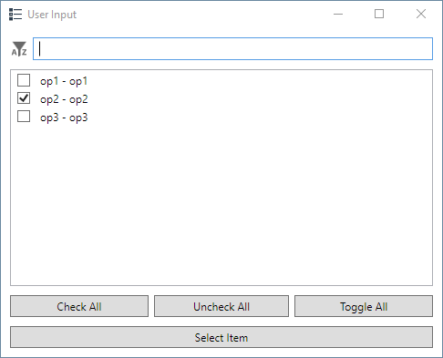

#### Select an Image

Use [`forms.select_image()`](https://docs.pyrevitlabs.io/reference/pyrevit/forms/#pyrevit.forms.select_image) to select from a series of images

```python
from pyrevit import script
from pyrevit import forms

images = forms.select_image(
    script.get_bundle_files('images/')
)

if images :
    do_stuff()
```

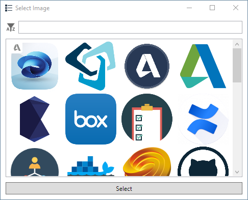

#### Select a Swatch

Use [`forms.select_swatch()`](https://docs.pyrevitlabs.io/reference/pyrevit/forms/#pyrevit.forms.select_swatch) to ask for a string input

```python
from pyrevit import forms

forms.select_swatch(
    title='test title',
    button_name='Test button name'
)
```

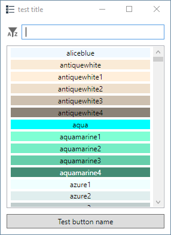

### Asking for Input

#### Ask for Text Input

Use [`forms.ask_for_string()`](https://docs.pyrevitlabs.io/reference/pyrevit/forms/#pyrevit.forms.ask_for_string) to ask for a string input

```python
from pyrevit import forms

forms.ask_for_string(
    default='some-tag',
    prompt='Enter new tag name:',
    title='Tag Manager'
)
```

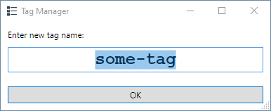

#### Ask for Unique String Input

Use [`forms.ask_for_unique_string()`](https://docs.pyrevitlabs.io/reference/pyrevit/forms/#pyrevit.forms.ask_for_unique_string) to ask for a unique string input

```python
from pyrevit import forms

forms.ask_for_unique_string(
    prompt='Enter a Unique Name',
    title=self.Title,
    reserved_values=['Ehsan', 'Gui', 'Guido']
)
```

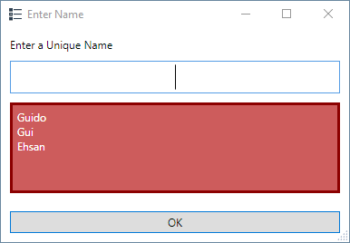

#### Ask for Single Input

Use [`forms.ask_for_one_item()`](https://docs.pyrevitlabs.io/reference/pyrevit/forms/#pyrevit.forms.ask_for_one_item) to ask for an input from a fixed list

```python
from pyrevit import forms

forms.ask_for_one_item(
    ['test item 1', 'test item 2', 'test item 3'],
    default='test item 2',
    prompt='test prompt',
    title='test title'
)
```

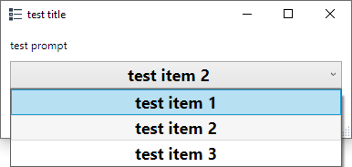

#### Ask for a Date

Use [`forms.ask_for_date()`](https://docs.pyrevitlabs.io/reference/pyrevit/forms/#pyrevit.forms.ask_for_date) to ask for a string input

```python
from pyrevit import forms

forms.ask_for_date(default="", title="Enter deadline:")
```

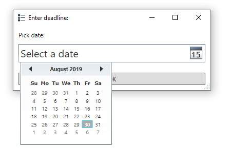

### Checking Conditions and Informing the User

#### Check Model is Workshared

Use [`forms.check_workshared()`](https://docs.pyrevitlabs.io/reference/pyrevit/forms/#pyrevit.forms.check_workshared) to make sure the model is workshared. If not a prompt will be shown to the user automatically.

```python
from pyrevit import forms

if forms.check_workshared():
   do_stuff()
```

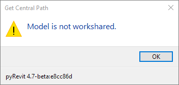

#### Check There is Selection

Use [`forms.check_selection()`](https://docs.pyrevitlabs.io/reference/pyrevit/forms/#pyrevit.forms.check_selection) to make sure there are one or more selected elements. If not a prompt will be shown to the user automatically.

```python
from pyrevit import forms

if forms.check_selection():
   do_stuff()
```

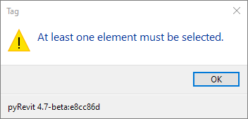

#### Check Active Document is a Family

Use [`forms.check_familydoc()`](https://docs.pyrevitlabs.io/reference/pyrevit/forms/#pyrevit.forms.check_familydoc) to make sure the active document is a Revit family document. If not a prompt will be shown to the user automatically.

```python
from pyrevit import forms

if forms.check_familydoc():
   do_stuff()
```

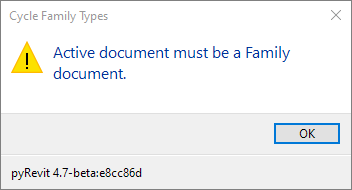

#### Check Active Document is a Model

Use [`forms.check_modeldoc()`](https://docs.pyrevitlabs.io/reference/pyrevit/forms/#pyrevit.forms.check_modeldoc) to make sure the active document is a Revit model document. If not a prompt will be shown to the user automatically.

```python
from pyrevit import forms

if forms.check_modeldoc():
   do_stuff()
```

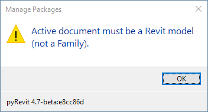

#### Check Active View is a Model View

Use [`forms.check_modelview()`](https://docs.pyrevitlabs.io/reference/pyrevit/forms/#pyrevit.forms.check_modelview) to make sure the active view is a Revit model view. If not a prompt will be shown to the user automatically.

```python
from pyrevit import forms

if forms.check_modelview(revit_view):
   do_stuff()
```


#### Check Active View is a Specific View Type

Use [`forms.check_viewtype()`](https://docs.pyrevitlabs.io/reference/pyrevit/forms/#pyrevit.forms.check_viewtype) to make sure the active view is of a specific view type (DB.ViewType). If not a prompt will be shown to the user automatically.

```python
from pyrevit import forms
from pyrevit import revit, DB

if forms.check_viewtype(revit.active_view, DB.ViewType.DrawingSheet):
   do_stuff()
```

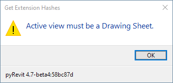

#### Inform Work In Progress Tool

Use [`forms.inform_wip()`](https://docs.pyrevitlabs.io/reference/pyrevit/forms/#pyrevit.forms.inform_wip) to inform the user that your tool is a Work in Progress

```python
from pyrevit import forms

forms.inform_wip()
```

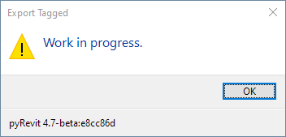
