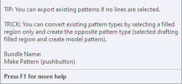

# IronPython scripts

!!! tip ""

    Start with the short introduction to scripts at [Create Your First Command](../tutorials/first-command.md)  

!!! tip ""

    See [Python Script Facilities](script-facilities.md) for information about the script support module

## Language Safe Code

If you are using unicode characters in your code e.g. `__title__ = "测试包"`, you need to start the script with the line below and save the file in UTF-8 encoding.

```python
# -*- coding: utf-8 -*-
```

## Setting Script Metadata

pyRevit looks for certain global scope variables in each scripts that provide metadata about the script and follow the `__<name>__` format.

!!! warning ""

    It's preferred to use the [Bundle Metadata](../bundles/metadata.md) files for this purpose. The convention described here is only for convenience when creating very simple IronPython scripts.

!!! warning ""

    pyRevit reload is required for changes to take effect.

#### Title

Similar to [Bundle Metadata](../bundles/metadata.md)  

**Button Title**: When using the bundle name as the button name in Revit UI is not desired, or you want to add a newline character to the command name to better display the butonn name inside Revit UI Panel, you can define the `__title__` variable in your script and set it to the desired button title.

```python
__title__ = 'Test\\nBundle'

# title can also be in various locales
# pyRevit pulls the correct title based on Revit langauge
__title__  = {
  "en_us": "Test Bundle",
  "chinese_s": "测试包"
}

```

#### DocString (Tooltip)

Similar to [Bundle Metadata](../bundles/metadata.md)  

**Button Tooltip**: Tooltips are displayed similar to the other buttons in Revit interface. You can define the tooltip for a script using the doscstring at the top of the script or by explicitly defining `__doc__` metadata variable.

```python
# defining tooltip as the script docstring
"""You can place the docstring (tooltip) at the top of the script file.
This serves both as python docstring and also button tooltip in pyRevit.
You should use triple quotes for standard python docstrings."""
# defining tooltip by setting metadata variable
__doc__ = 'This is the text for the button tooltip associated with this script.'

# docstrings can also be in various locales
# pyRevit pulls the correct docstring based on Revit langauge
__doc__ = {
  "en_us": "Create new patterns in Revit",
  "chinese_s": "创建新模式"
}
```

#### Author

Similar to [Bundle Metadata](../bundles/metadata.md)  

**Button Author/Creator:** You can define the script author as shown below. This will show up on the button tooltip.

```python
__author__ = 'Ehsan Iran-Nejad'

# or
__authors__ = ["Ehsan Iran-Nejad", "Gui Talarico"]
```

#### Help URL

Similar to [Bundle Metadata](../bundles/metadata.md)  

**Button F1 Help URL:** You can define the help URL of the script. When this is provided, hitting F1 button when hovering over the button will open this URL in the default browser.

```python
# bundle help url
__helpurl__ = "https://www.youtube.com/watch?v=H7b8hjHbauE&t=8s&list=PLc_1PNcpnV57FWI6G8Cd09umHpSOzvamf"

# help url can also be in various locales
# pyRevit pulls the correct help url based on Revit langauge
__helpurl__  = {
  "en_us": "https://www.youtube.com/watch?v=H7b8hjHbauE&t=8s&list=PLc_1PNcpnV57FWI6G8Cd09umHpSOzvamf",
  "chinese_s": "https://www.youtube.com/watch?v=H7b8hjHbauE&t=8s&list=PLc_1PNcpnV57FWI6G8Cd09umHpSOzvamf"
}
```

Revit will also show a tip for this F1 action, at the bottom of the tooltip.



#### Supported Revit Versions

Similar to [Bundle Metadata](../bundles/metadata.md)  

You can specify the min and max Revit versions that support your script.

```python
__min_revit_ver__ = 2022
__max_revit_ver__ = 2025
```

#### Beta Tools

Similar to [Bundle Metadata](../bundles/metadata.md)  

You can mark your script as beta. By default beta tools will not be loaded in the interface. This option helps you work on your tool in private and turn off beta only when it is tested and ready.

```python
__beta__ = True
```

#### Button Highlighters

Similar to [pyRevit Bundles](../bundles/command-bundles.md)  

You can use provide highlighting directives inside the bundle metadata as well. Revit will highlight the button the tooltip in the interface.

```python
# highlight as new
__highlight__ = 'new'

# highlight as updated
__highlight__ = 'updated'
```

#### Context Directives

You can define the required context for your script. See [Bundle Context](../bundles/context.md)  

```python
__context__ = [ "selection", "active-section-view"]
```

#### IronPython Engine Configurations

**Clean Engine:** When pyRevit is in Rocket Mode (default), it caches the engines used to execute commands. This means that a module that is imported into your script (e.g. `import os`) will remain imported on the next executions and thus speeds up the tool execution. Set the engine to clean if this is causing issues for your tool. See [Button Click Modes](click-modes.md) for manually requesting a new clean engine.

```python
__cleanengine__ = True
```

**Full-Frame Engine:** Full-Frame engines, contain all the frame stack information that is required for code inspection but they have a much higher memory footprint. pyRevit disables the full-frame by default. This setting might break some module (e.g. `import requests`). If that's the case, activate the full-frame in your code

```python
__fullframeengine__ = True
```

**Persistent Engine:** To reduce the memory footprint, pyRevit clears the global scope of each script after execution. If you are leaving global objects in memory that are going to be used later (e.g. event handler functions, and non-modal windows), you need to activate the persistent engine flag. pyRevit will not clear the scope for the tools that need a persistent engine.

```python
__persistentengine__ = True
```

#### Engine Configurations in Bundle File
IronPython bundles can define the engine configurations inside the bundle metadata file as well.

See [Bundle Metadata](../bundles/metadata.md)  for more information on these files.

```yaml
engine:
  clean: false
  full_frame: true
  persistent: true
```

## Shipped Packages

[Packages listed here](https://github.com/pyrevitlabs/pyRevit/tree/develop/site-packages) are shipped with pyRevit by default for convenience
