# Output

## Effective Output

### Emojis 🥳

You can easily print emojis to the output window using the `:emoji-shorthand:` convention. To see all the shorthand options, launch the ***Emoji*** tool under pyRevit slideout.

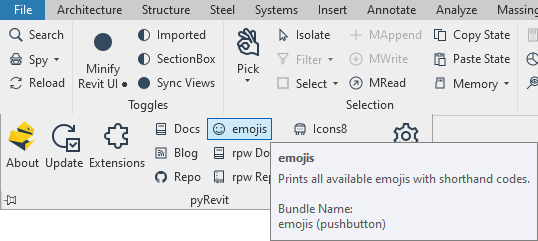

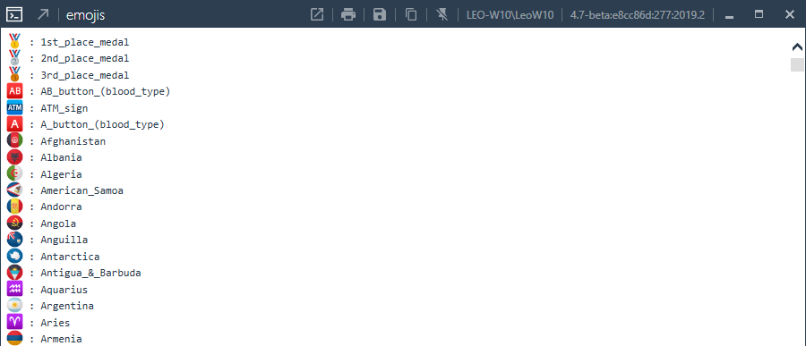

Use the codes printed on the output for each emoji. For example the code below prints 👌

```python
print(':OK_hand:')
```

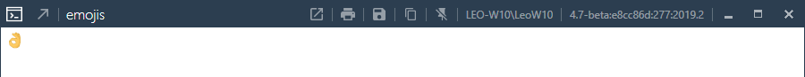

Emojis are a feature of the output window so they are supported from any language or script that prints to the output window

```csharp
Console.WriteLine(":OK_hand:");
```

### Creating Clickable Element Links

The link maker from the output object, can be used to create clickable links on the output window. [See documentation here.](https://docs.pyrevitlabs.io/reference/pyrevit/output/#pyrevit.output.PyRevitOutputWindow.linkify)

```python
from pyrevit import script

output = script.get_output()

# assuming element is an instance of DB.Element
print(output.linkify(element.Id))
```

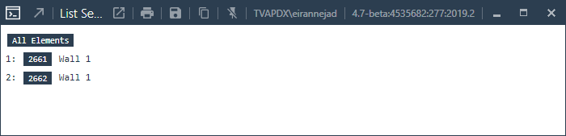

### Printing **Tables**

The table maker from the output object, can be used to create tables on the output window.

It has two methods:

`print_table()` which is based on markdown and supports markdown in the cell’s data strings.  [See documentation here.](https://docs.pyrevitlabs.io/reference/pyrevit/output/#pyrevit.output.PyRevitOutputWindow.print_table)

`print_html_table()` which outputs HTML directly and allows more control over table formatting through CSS.

#### print\_table()

```javascript
from pyrevit import script

output = script.get_output()

data = [
['row1', 'data', 'data', 80 ],
['row2', 'data', 'data', 45 ],
]
output.print_table(
table_data=data,
title="Example Table",
columns=["Row Name", "Column 1", "Column 2", "Percentage"],
formats=['', '', '', '{}%'],
last_line_style='color:red;'
)
```

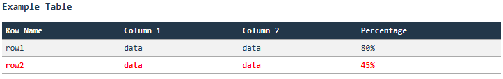

#### print\_html\_table()

```python

from pyrevit import script

output = script.get_output()

table_data = [[1234.0, "Cell data aaa", "12.00", "41"],
              [123456.00, "Cell data bbb", "12.20", "01"],
              [123.0, "Cell data ccc", "22.02", "12"],
              [5.001, "Cell data ddd", "11.00", "44"],
              ["123456", "-", "22.45", "41"]]

"""Print provided data in a HTML table in output window.
           The same window can output several tables, each with their own formatting options.

        Args:
            table_data (list[iterable[Any]]): 2D array of data
            title (str): table title, output as ###mark-down before the table
            columns (list[str]): list of column names
            formats (list[str]): column data formats using python string formatting
            last_line_style (str): css style of last row of data (NB applies to all tables in this output)
            column_head_align_styles (list[str]): list css align-text styles for header row
            column_data_align_styles (list[str]): list css align-text styles for data rows
            column_widths (list[str]): list of CSS widths in either px or %
            column_vertical_border_style (str): CSS compact border definition
            table_width_style (str): CSS to use for width for the whole table, in either px or %
            repeat_head_as_foot (bool): Repeat the header row at the table foot (useful for long tables)
            row_striping (bool): False to override the default white-grey row stripes and make all white)
"""

output.print_html_table(table_data=table_data,
                        title="Example table with formatting options",
                        columns=["NUMBERS", "STRINGS", "DECIMALS", "PERCENTAGE"],
                        formats=['{:.5}', '{}', '', '{}%'],
                        last_line_style='color:red; font-weight:bold',
                        column_head_align_styles=["center", "left", "right", "center"],
                        column_data_align_styles=["right", "left", "right", "center"],
                        column_widths=["115px", "auto", "auto", "auto"],
                        column_vertical_border_style="border:black solid 1px",
                        repeat_head_as_foot=len(table_data) > 14,
                        table_width_style="100%",
                        row_striping=True)
```

- Call the print\_table method with a 2D list of data.
- The length of the first row of data is used in validation: all rows of data must be of the same length.
- All other arguments that are of type list must also be of this length.
- The formats parameter uses python string formatting.
- Formatting parameters with style in their name use CSS.
- The parameter repeat\_head\_as\_foot can reinsert the header row as a footer, to help readability of long tables.

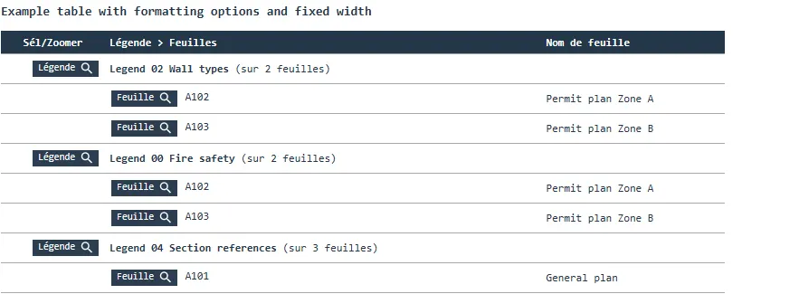

The row\_striping parameter is True by default, giving white-grey row stripes. False will make all data rows white.


!!! tip ""

    Since print\_html\_table() outputs HTML, you can include formatting within the data by including HTML and CSS:

    `<span style="font-style: italic;">General plan</span>`

### Printing Markdown

You can use the [`output.print_md() `](https://docs.pyrevitlabs.io/reference/pyrevit/output/#pyrevit.output.PyRevitOutputWindow.print_md)to print markdown to the output window:

```python
from pyrevit import script

output = script.get_output()

output.print_md('# My Title')
output.print_md('**Bold message**')
```

### Styling Output (Printing HTML)

You can use the [`output.print_html()`](https://docs.pyrevitlabs.io/reference/pyrevit/output/#pyrevit.output.PyRevitOutputWindow.print_html) method to print html directly to the output window. This allows custom styling of the output elements:

```python
from pyrevit import script

output = script.get_output()

output.print_html('<div style="background:green">SUCCESS</div>')
```

You can also add custom CSS styling to the output window:

```python
output.add_style('body { color: blue; }')
```

### Printing Code Blocks

The code maker from the output object, can be used to create code sections on the output window. [See documentation here.](https://docs.pyrevitlabs.io/reference/pyrevit/output/#pyrevit.output.PyRevitOutputWindow.print_code)

```python
from pyrevit import script

output = script.get_output()

output.print_code("""
#include <iostream>
using namespace std;

int main()
{
    cout << "Hello world!" << endl;
    return 0;
}
""")
```

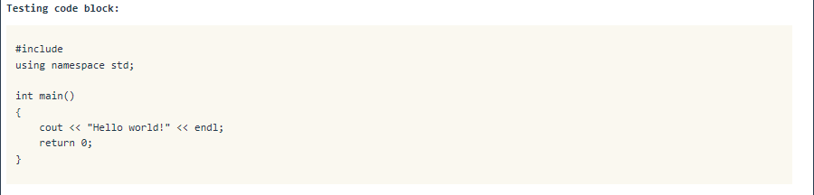

### Scrolling to the Top

The output window follows the end of the output while a script prints. For long reports, call `scroll_to_top()` after the last print to show the beginning instead. [See documentation here](https://docs.pyrevitlabs.io/reference/pyrevit/output/#pyrevit.output.PyRevitOutputWindow.scroll_to_top).

```python
from pyrevit import script

output = script.get_output()

for i in range(500):
    output.print_md('Line {}'.format(i))

output.scroll_to_top()
```

### Showing Progress

#### Output Progress Bar

The progress bar from the output object, can be used to report progress on the output window.  [See documentation here](https://docs.pyrevitlabs.io/reference/pyrevit/output/#pyrevit.output.PyRevitOutputWindow.update_progress).

```python
from pyrevit import script

output = script.get_output()

for i in range(100):
    # do stuff here
    output.update_progress(i, 100)
```

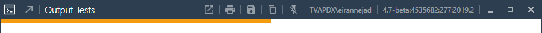

**Indeterminate Progress**

You can also set the output window progress to indeterminate. The progress bar will show an animated pattern until deactivated.

```python
output.indeterminate_progress(True)
# do stuff here
# split the work in chunks and run output.update_progress periodically
output.indeterminate_progress(False)
```

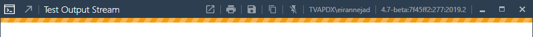

**Manually Hiding and Unhiding the Progress Bar**

```python
output.hide_progress()
output.unhide_progress()
```

#### Application Progress Bar

pyRevit forms module has an application progress bar that is displayed on top of the Revit window, can accept formatting for the progress text, has indeterminate state, and is cancellable as well.

**Basic Usage**

```python
from pyrevit.forms import ProgressBar

max_value = 1000
with ProgressBar() as pb:
    for counter in range(0, max_value):
        pb.update_progress(counter, max_value)
```

**Update Intervals**

Steps could be provided to update the progress bar at intervals specified by `step`

```python
max_value = 1000
with ProgressBar(step=10) as pb:
    for counter in range(0, max_value):
        pb.update_progress(counter, max_value)
```

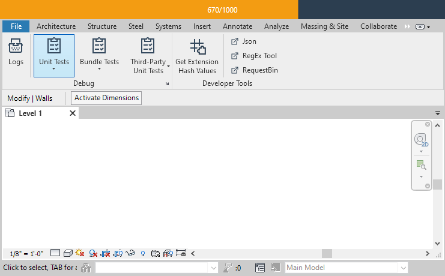

**Formatted Progress**

The progress bar text can be formatted to your desire. The `{value}` and `{max_value}` formatting keys must exist in the formatting string that is set on progress bar `title` argument

```python
max_value = 1000
with ProgressBar(title='My Process... ({value} of {max_value})') as pb:
    for counter in range(0, max_value):
        pb.update_progress(counter, max_value)
```

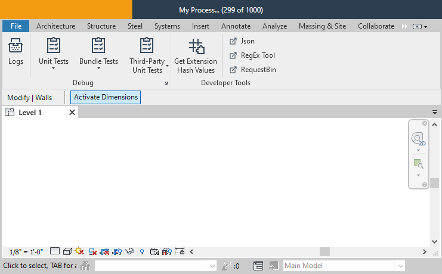

**Cancellable Progress**

If the progress bar is marked as `cancellable`, a cancel button will be displayed and the `.cancelled` propery will be set to `True` when user clicks on the cancel. You need to check for the `.cancelled` value in your code and cancel the operation graceully.

```python
max_value = 1000
with ProgressBar(cancellable=True) as pb:
    for counter in range(0, max_value):
        if pb.cancelled:
            break
        else:
            pb.update_progress(counter, max_value)
```

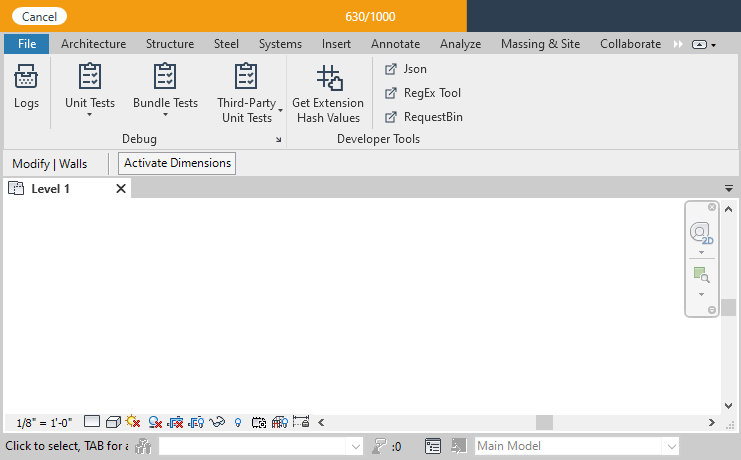

**Indeterminate Progress**

If the progress bar is marked as Cancellable, a cancel button will be displayed and the `.cancelled` propery will be set to `True` when user clicks on the cancel. You need to check for the `.cancelled` value in your code and cancel the operation graceully. It is good practice for indeterminate progress bars to be cancellable.

```python
max_value = 1000
with ProgressBar(indeterminate=True, cancellable=True) as pb:
    # split the work in chunks and run pb.update_progress
    # periodically
    for counter in range(0, max_value):
        if pb.cancelled:
            break
        else:
            pb.update_progress(counter, max_value)
```

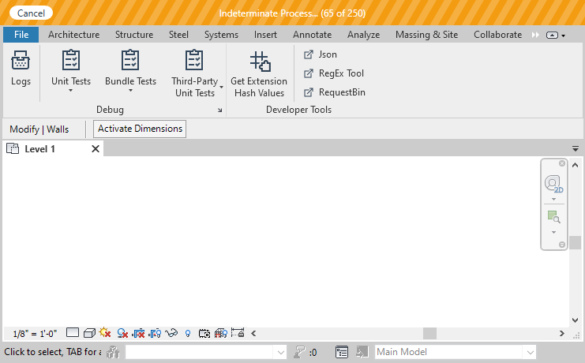


During progress updates (Output or Application), the application icon on the taskbar shows the progress.  
When completed, the colored progress bar will go away.  
Except when using **Application Progress Bar** with **Revit ≤ 2018**

### Showing Operation Results

The output window has a colored bar (where the progress bar is usually shown) that could be used to visualize the results of a progress or report errors without adding the error reports in the main output contents. When shown, it also shows a small `CLEAR` button to the user to clear the message.

**Reporting Errors**

```python
from pyrevit import script

output = script.get_output()

output.log_error('Some error message')
```

The message is shown on the colored bar

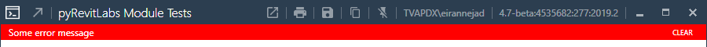

If the user clicks on the bar, it expands showing all of the contents. Clicking the **Close** button will close this expanded panel.

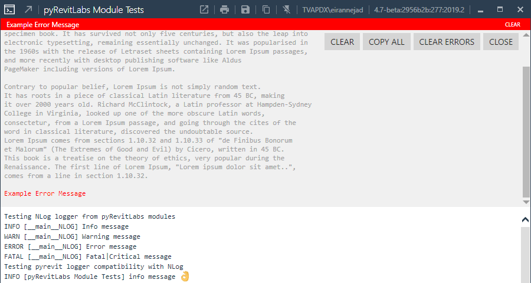

**Reporting Other Message Types**

There are more message types for this panel, each have their own color.

```python
from pyrevit import script

output = script.get_output()

# warnings
output.log_warning('Some message')

# success
output.log_success('Some message')

# general info
output.log_info('Some message')
```

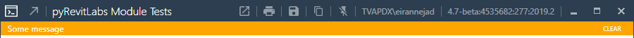

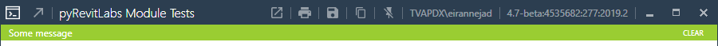

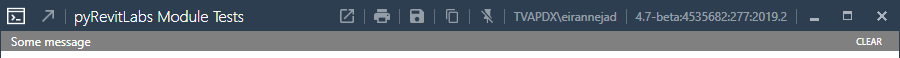

You can also log debug messages to this panel without changing the color. These messages will only be visible when this panel is expanded.

```python
from pyrevit import script

output = script.get_output()

# hidden messages
output.log_debug('Some message')
```

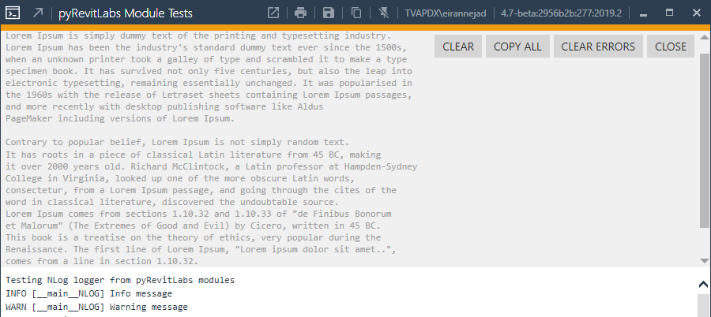
