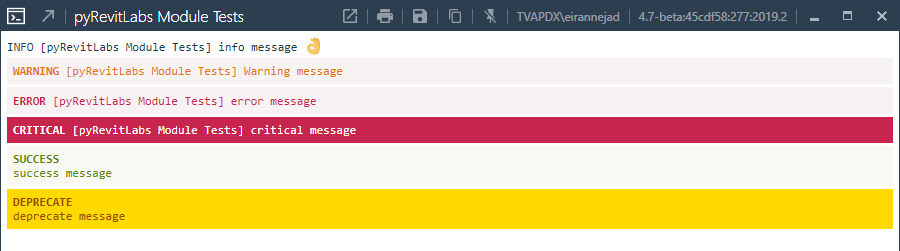
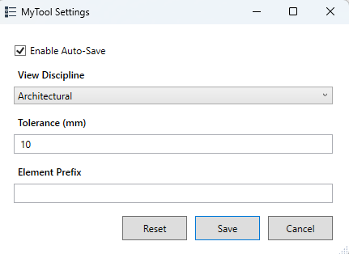

# Script facilities

All pyRevit python scripts should use the [`pyrevit.script`](https://docs.pyrevitlabs.io/reference/pyrevit/script/) module to access pyRevit functionality. pyRevit internals are subject to change and accessing them directly is not suggested. Here is a list of supported modules for pyRevit scripts. This module provides access to **output window** (`pyrevit.output`), **logging** (`pyrevit.coreutils.logger`), **temporary files** (`pyrevit.coreutils.appdata`), and other misc features.

## Logging

You can get the default logger for the script, and log information related to what your script is doing

```python
from pyrevit import script

logger = script.get_logger()

logger.info('Test Info Log Level :OK_hand:')
logger.success('Test Success Log Level')
logger.debug('Test Debug Log Level')
logger.warning('Test Warning Log Level')
logger.error('Test Error Log Level')
logger.critical('Test Critical Log Level')
logger.deprecate('Test Deprecate Message')
```

All messages are printed in color for clarity. Normally debug messages are not printed. You can hold CTRL and click on a command button to put that command in DEBUG mode and see all its debug messages.



## Controlling Output Window

Each script can control its own output window

!!! tip ""

    See [Effective Output](output.md)  for more information on the output window features

```python
from pyrevit import script

output = script.get_output()

output.set_height(600)
output.get_title()
output.set_title('More control please!')
```

## Script Config

Each script can save and load its own configurations.

```python
from pyrevit import script

config = script.get_config()

# set a new config parameter: firstparam
config.firstparam = True

# or via method
config.set_option('firstparam', True)

# saving configurations
script.save_config()

# read the config parameter value
if config.firstparam:
    do_task_A()

# safe access with fallback default
if config.get_option('firstparam', True):
		do_task_A()
```

These configs are saved into the pyRevit’s user configuration file, alongside pyRevit's internal configs and the configurations for other tools. The configs for your tool will be saved under their own config section. A section can also be defined as `script.get_config("MySection")` to be reused for multiple tools.

The example below shows the configs for the ***Match*** tool (partial). Note that all the options are saved under the `[Match_config]` config section that belongs to the ***Match*** tool.

```text
[Match_config]
halftone = true
transparency = true
proj_line_color = true
proj_line_pattern = true
proj_line_weight = true
proj_fill_color = true
proj_fill_pattern = true
proj_fill_pattern_visibility = true
proj_bg_fill_color = true
proj_bg_fill_pattern = true
proj_bg_fill_pattern_visibility = true
...
```

If multiple parameters of different types have to be configured, the `settings_window` library can be used to avoid having to build a UI for that. It will dynamically generate a window based on the chosen setting types. Currently the following types are supported:

```text
"bool", "choice", "int", "float", "string", "color", "folder", or "file"
```

```python
from pyrevit.forms import settings_window

settings = [
# Boolean settings
{"name": "auto_save", "type": "bool", "label": "Enable Auto-Save", "default": True},
# Choice settings (dropdown)
{"name": "view_discipline","type": "choice","label": "View Discipline",
"options": ["Architectural", "Structural", "Mechanical", "Electrical"],"default": "Architectural"},
# Integer settings with min/max validation
{"name": "tolerance", "type": "int", "label": "Tolerance (mm)", "default": 10, "min": 0, "max": 1000},
# String settings
{"name": "prefix", "type": "string", "label": "Element Prefix", "default": ""}
]
settings_window.show_settings(settings, section="MyTool", title="MyTool Settings")
```

This will generate a settings window looking like this:



If a lot of parameters have to be set, the builtin `coreutils.yaml` can be used to manage these settings inside a more readable yaml file.

```yaml
settings:
- name: show_progressbar
  type: bool
  label: Show Progressbar
  default: true
- name: tree_type
  type: choice
  label: Tree Type
  options:
    - Apple
    - Orange
  default: Apple
```

```python
from pyrevit import script
from pyrevit.forms import settings_window
from pyrevit.coreutils.yaml import load_as_dict

settings_in_yaml = load_as_dict(script.get_bundle_file("settings.yaml"))
settings = settings_in_yaml.get("settings", [])

settings_window.show_settings(settings)
```

## Using Temporary Files

Scripts can create four  different types of data files:

#### Universal files
- These files are NOT marked by host Revit version and could be shared between all Revit versions and instances.
- These data files are saved in pyRevit’s appdata directory and are NOT cleaned up at Revit restarts.

!!! warning ""

    Script should take care of cleaning up these data files.

```python
from pyrevit import script

# provide a unique file id and file extension
# Method will return full path of the data file
script.get_universal_data_file(file_id, file_ext)
```

#### Data files
- These files ARE marked by host Revit version and could be shared between instances of host Revit version
- Data files are saved in pyRevit’s appdata directory and are NOT cleaned up when Revit restarts.

!!! warning ""

    Script should take care of cleaning up these data files.

```python
from pyrevit import script

# provide a unique file id and file extension
# Method will return full path of the data file
script.get_data_file(file_id, file_ext)
```

#### Instance Data files
- These files are marked by host Revit version and process Id and  are only available to current Revit instance. This avoids any conflicts  between similar scripts running under two or more Revit instances.
- Data files are saved in pyRevit’s appdata directory (with extension `.tmp`) and ARE cleaned up when Revit restarts.

```python
from pyrevit import script

# provide a unique file id and file extension
# Method will return full path of the data file
script.get_instance_data_file(file_id)
```

#### Document Data files
- These files are marked by host Revit version and the name of the active project, and could be shared between instances of host Revit version.
- Data files are saved in pyRevit’s appdata directory and are NOT cleaned  up when Revit restarts.

!!! warning ""

    Script should take care of cleaning up these data files.

```python
from pyrevit import script

# provide a unique file id and file extension
# Method will return full path of the data file
script.get_document_data_file(file_id, file_ext)

# add_cmd_name=True adds the command name to the file name
script.get_document_data_file(file_id, file_ext, add_cmd_name=True)
```

## Sending Custom Data to Telemetry Server

See [Sending Custom Telemetry Data](custom-telemetry.md)  

## Runtime Information

pyRevit provides some information about the command runtime. See [Python Runtime Variables](runtime-variables.md)  
