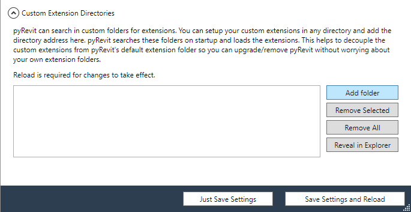

# Your first command

!!! note ""

    **Requirements**  
    Basic undestanding of python programming language, and Revit API

Let's talk about **pyRevit Bundles**, mostly focusing on:

- Creating your first **pyRevit Extension Bundle**.  
  This bundle will include the command we are going to make
- Creating your first **pyRevit Command Bundle**

## What's a Bundle?

Bundle is basically a group of resources, placed inside a folder, with a special name.

For example, pyRevit command bundles usually include a python script file (`script.py`), and an icon (`icon.png`). These files are placed inside a folder with a name that ends in `.pushbutton`. The last part of the naming defines the type of bundle. For example, pyRevit command bundle for Revit buttons are named similar to `MyButton.pushbutton`. The last part of the name after the dot, is the type of this bundle, in this case, a Push Button.

Here is how the folder and its contents look like. The `/` at the end of the first line, means it is a directory.

```text
MyCommand.pushbutton/
├── icon.png
└── script.py
```

## What's an Extension?

pyRevit extensions are a type of pyRevit Bundles. Their name ends in `.extension`

Extension bundles, are basically groups of other bundles (mostly command bundles). pyRevit has been designed to find these extensions when starting up Revit, and create buttons and other user interface components for the bundles inside the extension.

Now let's make our first extension

#### Creating the Extension Bundle

pyRevit’s extension bundles are designed to be flexible and easy to work with. Here, we will dive right into how you can create your own extension, but let’s answer one important question first:

**Question**

    Why would I need to create a separate extension?  
    Why can’t I just add my scripts to the current pyRevit tools?

**Answer**

    By creating separate extension bundles, you will have all your precious scripts and tools in a safe place and away from the changes being made to the pyRevit core tools. Your extension bundles can even live somewhere on your company shared drives and be shared between your teams as well.

Let's create a folder under `~/Documents`. `~` means "user home directory". [It's a Unix convention](https://en.wikipedia.org/wiki/Tilde#Computing)  and a special character in directory paths. We are going to use this convention in this guide because it is simpler. On Windows you can use `%USERPROFILE%` instead e.g. `%USERPROFILE%\Documents`.

Create the folder structure as shown here.

```text
MyExtensions/
└── MyFirstExtension.extension/
    └── MyTools.tab/
        └── MyTools.panel/
```

Other than the bundle types, you can change the rest of the bundle directory names to whatever you want. Notice that we are introducing two more bundle types here. **Tab** and **Panel** bundles (respectively `.tab` and `.panel`). We are using this bundles since Revit buttons can only be placed inside a panel that is inside a Revit tab.

#### Telling pyRevit Where to Find Our Extension

Now we need to tell pyRevit where to find this extension. Let's launch Revit, go to pyRevit tab and open the pyRevit **Settings**.

Add the `MyExtensions` folder to the list of **Custom Extension Directories**. Add the folder that contains the extension, not the `.extension` folder itself.



#### Creating the Command Bundle

!!! warning ""

    A description of all the command bundle types is available here:

    - [pyRevit Bundles](../bundles/command-bundles.md)

Now let's browse to the `MyTools.panel` bundle and create our `.pushbutton` bundle inside it.

```text
MyTools.panel/
└── MyFirstCommand.pushbutton/
```

Then browse to `MyFirstCommand.pushbutton` and create an empty text file, and name it `script.py`

```text
MyFirstCommand.pushbutton/
└── script.py
```

We need an icon for our button as well to make it stand out and identify what it does. [Let use this icon since this is our first command](https://icons8.com/icon/set/first/windows). All pyRevit tools are using icons from this website and are Recolored to `#34495E` for consistency. You can do the same:


Download the icon in PNG format and 96x96 pixel size and place inside the command bundle.

```text
MyFirstCommand.pushbutton/
├── icon.png
└── script.py
```

#### Writing The Script

Here comes the fun part. Let's write our first pyRevit script. We are going to create a script that collects all the walls in the active model and calculates the total volume.

I usually use [VSCode](https://code.visualstudio.com) to edit the python scripts. VSCode supports many other languages and is a great development environment.

Open the script in VSCode and type this up. Read the comments for more information on what each line does.

```python
"""Calculates total volume of all walls in the model."""

from Autodesk.Revit import DB

doc = __revit__.ActiveUIDocument.Document

# Creating collector instance and collecting all the walls from the model
wall_collector = DB.FilteredElementCollector(doc)\
                   .OfCategory(DB.BuiltInCategory.OST_Walls)\
                   .WhereElementIsNotElementType()

# Iterate over wall and collect Volume data
total_volume = 0.0

for wall in wall_collector:
    vol_param = wall.Parameter[DB.BuiltInParameter.HOST_VOLUME_COMPUTED]
    if vol_param:
        total_volume = total_volume + vol_param.AsDouble()

# now that results are collected, print the total
print("Total Volume is: {}".format(total_volume))
```

The first line of the file is called the **docstring**. It's a python string that is used to explain what the script does. pyRevit places this string inside the button tooltip.

```python
"""Calculates total volume of all walls in the model."""
```

On the next line we are importing the DB namespace from Revit API assemblies

```python
from Autodesk.Revit import DB
```

We will need to access the active document. The UIApplication instance is referenced by the `__revit__` builtin variable, provided by pyRevit execution engine

```python
doc = __revit__.ActiveUIDocument.Document
```

Now we will use Revit API to collect all the walls in the active document (`doc`). Revit walls are builtin elements and we use the `DB.BuiltInCategory.OST_Walls` category to request collection of these elements to the `FilteredElementCollector`. We also want to make sure to collect all the wall instances and not the wall Type elements, so we are filtering the results using `.WhereElementIsNotElementType` method.

```python
# Creating collector instance and collecting all the walls from the model
wall_collector = DB.FilteredElementCollector(doc)\
                   .OfCategory(DB.BuiltInCategory.OST_Walls)\
                   .WhereElementIsNotElementType()
```

Now that we have all the walls collected (assume that the collected list might be empty if there are no walls in the model), we will iterate over the walls, grab the value for the builtin **Volume** property, and add that to the `total_volume`

Note that Revit uses a different name for the element properties depending on the locale (language) of the installed Revit. So we need to use the built-in identifiers for these parameters to ensure we are collecting the same parameter, independent of the locale. For the **Volume** property, this builtin value is `DB.BuiltInParameter.HOST_VOLUME_COMPUTED`

```python
# Iterate over wall and collect Volume data
total_volume = 0.0

for wall in wall_collector:
    vol_param = wall.Parameter[DB.BuiltInParameter.HOST_VOLUME_COMPUTED]
    if vol_param:
        total_volume = total_volume + vol_param.AsDouble()
```

And finally let's print the results

```python
# now that results are collected, print the total
print("Total Volume is: {}".format(total_volume))
```

#### Reloading pyRevit, and Testing the Command

Now that we have successfully created the command bundle, let's reload pyRevit, and test the command. Launch Revit and create a model with a couple of walls inside it as our test data. You can calculate the volume of these walls manually to test the output of the command.

When the document is ready, Reload pyRevit to see the button to our newly created command. (If you have restarted Revit, the button should be there already)

Now click on the button and test the results

Yaaay!! 🎉

!!! tip ""

    See [Anatomy of IronPython Scripts](../scripting/ironpython.md)

---
