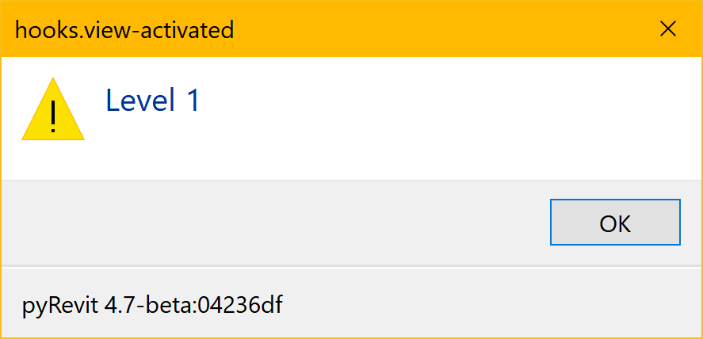
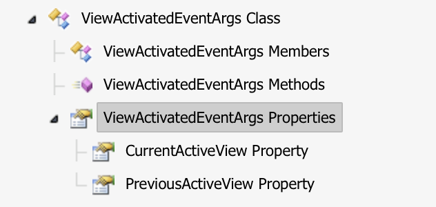

# Your first hook

!!! tip ""

    Understanding how extensions work, is a prerequisite for this guide.  

    See an introduction to extension bundles at [Create Your First Command](first-command.md)   
    See [Extension Bundles](../extensions/structure.md)  for more detailed information about extensions  
    See [Extension Hooks/](../extensions/hooks.md) for detailed information about hooks

Hook scripts are specially named scripts that would hook up to the Revit event system and will get executed whenever that event occurs. For example, a `doc-changed.py` hook script  gets executed automatically every time **DocumentChanged** event occurs in Revit.

The hook scripts live inside the `hooks/` subdirectory in an extension bundle.

## "View Activated" Hook Script

Let's create a hook script, to listen to a **ViewActivated** event (fires when a new view is activated in the Revit user interface) and check whether the view name is formatted correctly. We are going to write this script in IronPython, but you can use more languages in extension hooks. See [Extension Hooks/](../extensions/hooks.md) for more information.

Create a python file under our test extension from [Create Your First Command](first-command.md)  

```text
MyExtensions/
└── MyFirstExtension.extension/
    └── hooks/
        └── view-activated.py
```

Make sure the file is named correctly as `view-activated.py` otherwise the hook system will not see or use this script.

Let's open the file and add the code below.

```python
from pyrevit import forms
from pyrevit import EXEC_PARAMS

forms.alert(EXEC_PARAMS.event_args.CurrentActiveView.Name)
```

Now reload pyRevit and (assuming your extension is active), pyRevit will hook up this script into the **ViewActivated** event of the running Revit instance. Once pyRevit is reloaded, the hook should be active and running.

If you open a new view in your model, you should get a popup with the name of the view



Ok, let's talk about the script now. On the first line we are importing the pyRevit forms module to use the ready-made `alert()` function to show the popup window.

```python
from pyrevit import forms
```

On the second line we used the `EXEC_PARAMS.event_args` to access the event arguments that are passed to the **ViewActivated** event by Revit. The type for this `EXEC_PARAMS.event_args` object instance is **ViewActivatedEventArgs**.

Look that up in the API documents and you can see all its properties. As you can see the event args object, provides access to the current view (**CurrentActiveView**) and the previously active view (**PreviousActiveView**)



On the second line we are using the **CurrentActiveView** property of the **ViewActivatedEventArgs** instance to get access to the active view (of type **View**) and get its view name.

```python
forms.alert(
    EXEC_PARAMS.event_args.CurrentActiveView.Name
)
```

That's all you really need to do to set up a hook script in your extension. Remember that the name of the script defines the event that it will be tied to, and the `EXEC_PARAMS.event_args` property will provide access to its event arguments passed by Revit. Check the Revit API for documentation on these event argument types.

!!! tip ""

    See [Anatomy of Hook Scripts](../extensions/hooks.md)  
