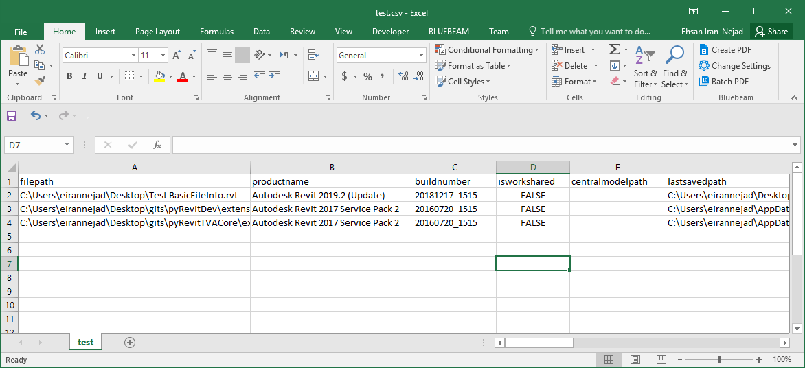

# Revit installs and file info

List installed or running Revits:

```powershell
pyrevit revits [--installed] [--log=<log_file>]

$ pyrevit revits --installed        # list installed revits
<Revit product name> | Version: <version> | Build: <build>(<target>) | Language: <language code> | Path: "C:\Program Files\Autodesk\Revit <year>"
```

Close all or specific running Revit:

```powershell
pyrevit revits killall [<revit_year>] [--log=<log_file>]

$ pyrevit revits killall 2026   # close all Revit 2026s
```

!!! warning ""

    `killall` ends the Revit processes without giving users a chance to save.

Generate a report from `RVT` or `RFA` file info:

```powershell
pyrevit revits fileinfo <file_or_dir_path> [--csv=<output_file>]

$ pyrevit revits fileinfo "C:\model.rvt"
Created in: Autodesk Revit 2018.3.1 (20180423_1000(x64))
Workshared: Yes
Central Model Path: \\central\path\Project3.rvt
Last Saved Path: C:\Downloads\Project3.rvt
Document Id: bfb3db00-ca65-4c6a-aa64-329761e5d0ca
Open Workset Settings: LastViewed
Document Increment: 2
```

- `file_or_dir_path`: could be a file or directory
- `--csv=`: Write output to specified CSV file

```powershell
pyrevit revits fileinfo "C:\Models\Test BasicFileInfo.rvt"
```

The output is identical to the pyRevit gui tool:

```text
Created in: Autodesk Revit 2019.2 (Update) (20181217_1515(x64))
Workshared: No
Last Saved Path: C:\Models\Test BasicFileInfo.rvt
Document Id: f86eb316-c79a-419f-98ba-67031c6ab92b
Open Workset Settings: LastViewed
Document Increment: 1
```

You can also provide a directory path instead of a single file, and the cli tool will look for all Revit files in that subdirectory recursively and will print out the results. Use the `--csv` option and provide a file path so all this info is exported to a data file properly. You can use this pyrevit cli feature to periodically collect version information about your Revit files.

```powershell
pyrevit revits fileinfo "/Projects" --csv="~/Desktop/test.csv"
```



The new pyRevit CLI (\>0.13.0) automates this process by reading the stream, passing it to `ZipArchive`, extracting the xml file and parsing the xml stream for the project information data:

```powershell
$ pyrevit revits fileinfo Project1.rvt

Created in: Autodesk Revit 2019.2 (Update) (20181217_1515(x64))
Workshared: No
Last Saved Path: C:\Models\Project1.rvt
Document Id: 5cafc5e6-644c-40c6-9e6d-df04b4469fd5
Open Workset Settings: LastViewed
Document Increment: 1
Project Information (Properties):
        Building Name = Value
        Client Name = Value
        Custom Project Parameter = Custom Value
        Organization Description = Value
        Organization Name = Value
        Project Address = Multiline Value\r\nMultiline Value\r\nMultiline Value
        Project Issue Date = Value
        Project Name = Value
        Project Number = Value
        Project Status = Value
```

As before, you can also export this data to csv. This process can be  
used to automatically collect information about your revit files.

```powershell
$ pyrevit revits fileinfo Project1.rvt --csv="data.csv"
```

```text
"{""Building Name"":""Value"",""Client Name"":""Value"",""Custom Project Parameter"":""Custom Value"",""Organization Description"":""Value"",""Organization Name"":""Value"",""Project Address"":""Multiline Value\r\nMultiline Value\r\nMultiline Value"",""Project Issue Date"":""Value"",""Project Name"":""Value"",""Project Number"":""Value"",""Project Status"":""Value""}"
```

You can read this value from the csv file and convert into a JSON object for further analysis

```json
{
    "Building Name": "Value",
    "Client Name": "Value",
    "Custom Project Parameter": "Custom Value",
    "Organization Description": "Value",
    "Organization Name": "Value",
    "Project Address": "Multiline Value\r\nMultiline Value\r\nMultiline Value",
    "Project Issue Date": "Value",
    "Project Name": "Value",
    "Project Number": "Value",
    "Project Status": "Value"
}
```

The project information key:value output will be written as a json object under the `projectinfo` field. When parsing the csv file in your own code, you can pass this value to a json loader from string (e.g. `json.loads` in python) and get the json data object as result.
