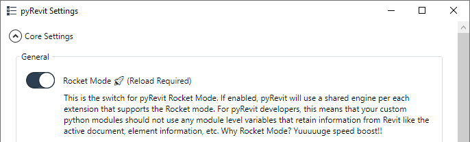
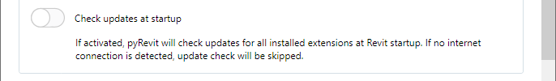
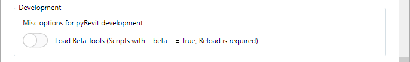
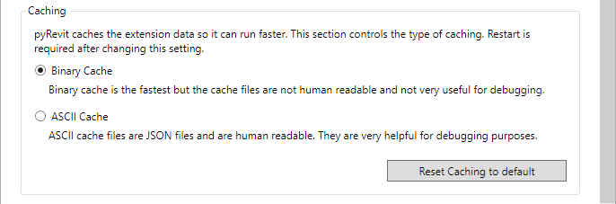
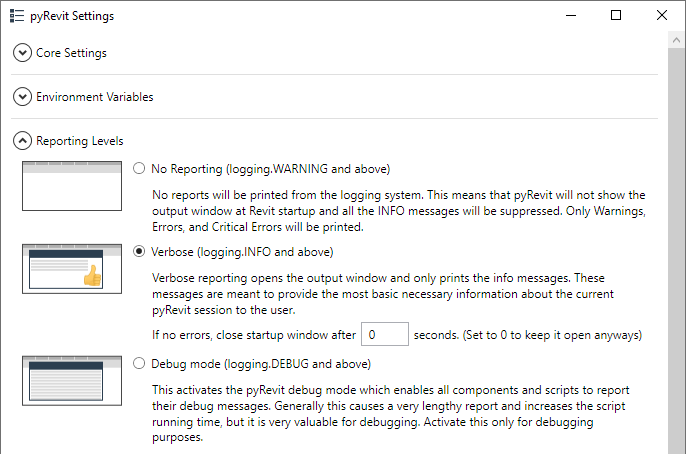

# Configure pyRevit

pyRevit ships with a decent set of configuration defaults. To change them, open **Settings** in the **pyRevit** panel of the **pyRevit** tab. Shift-click the button to show the configuration file in Explorer instead.

The window is a list of sections, described below. **Just Save Settings** saves without reloading, **Save Settings and Reload** saves and reloads pyRevit. Some options need a reload or a Revit restart, and the window says so next to them.

!!! note "Screenshots"

    The screenshots on this page come from an older version of the window. The options they show are unchanged, the styling is not.

When an administrator has locked the configuration, the window shows *pyRevit settings are set by your admin* and the settings cannot be changed. See [Configuration file](../teams/configuration-file.md).

## Core Settings

### General

**Rocket Mode** lets pyRevit keep one engine per extension that supports it, which makes tools start faster.

**Check updates at startup** checks every installed extension for updates when Revit starts.

**Close other open consoles** closes the output windows that are already open when a new script runs, either those of the same command or all of them.

### Engines

**Active Engine** is the IronPython engine pyRevit is attached with, and **Active CPython Engine** is the engine used by scripts that ask for CPython. Restart Revit after changing either one. [Engines](../runtime/engines.md) lists the engines shipped with pyRevit.

### Development

**Load Beta Tools** loads the tools marked as beta.

### Loader

**Read script metadata** makes pyRevit read `__title__`, `__author__`, `__doc__` and the other in-script variables from Python scripts. Turning it off speeds up loading, but commands lose the metadata defined in their scripts. Values from `bundle.yaml` are used either way.

### Caching

Select the type of extension cache pyRevit creates on startup.

## Environment Variables

Lists the pyRevit environment variables of the current session and their values. Right-click a variable to copy its name or its value.

## Reporting Levels

pyRevit has a logging system that reports its activity on several levels. Select how much pyRevit shows, especially at load time, and after how many seconds the startup window closes when there is no error.

**File debug logging** writes all the runtime logs to a file. This slows pyRevit down, so only activate it to debug a problem. See [Reporting issues](../help/reporting-issues.md).

## Startup Checks

Set a required Revit build number and a minimum free space on the host drive. pyRevit shows a warning at startup when the running Revit does not match.

Example of a warning message in the output window:

## Routes

Turns the Routes server on and off, and its built-in REST API. See [Routes (HTTP API)](../teams/routes.md).

## Telemetry

Sets where pyRevit sends script and application telemetry. Both are off by default. See [Telemetry](../teams/telemetry.md).

## Supported Revit Versions

Select the installed Revit versions pyRevit is attached to. pyRevit loads in the versions that are checked.

## UI / UX

- **Region Settings**: the language of the pyRevit user interface. pyRevit is not yet translated to all the listed languages, see [Translate pyRevit](../contribute/translate.md).
- **Ribbon**: whether the pyRevit ribbon tabs show an icon.
- **Tab Coloring**: colors the Revit document tabs by document. See [Tab Coloring](../tools/tab-coloring.md).
- **Output Window**: a CSS file to style the output window. Use the default as a starting point.

## Custom Extension Directories

Manage the extra folders pyRevit searches for extensions. See [Install extensions](install-extensions.md).

## Agent Runtime (MCP)

Lets MCP coding agents read and change the open model through pyRevit. It is off by default. See [Agent runtime](../agent-runtime.md).

## Import / Export Settings

**Export Settings** saves the configuration to a file and **Import Settings** loads one.
