# Configure pyRevit

!!! note "Screenshots"

    The screenshots on this page come from an older version of the Settings window. The sections have the same purpose, but their layout has changed, and the window now also has **Routes**, **Telemetry** and **Agent** sections.

pyRevit ships with a decent set of configuration defaults. If you like to change any of these settings however, open the **pyRevit Settings** and follow the sections below.

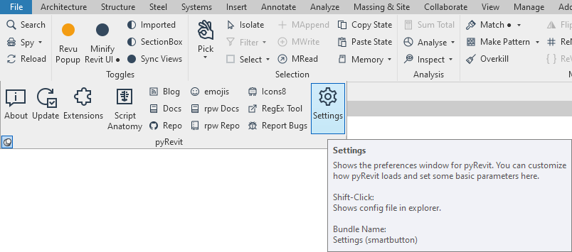

There is not much that you need to set after install. Take a look at the sections below and see if you would like to make adjustments for a better experience

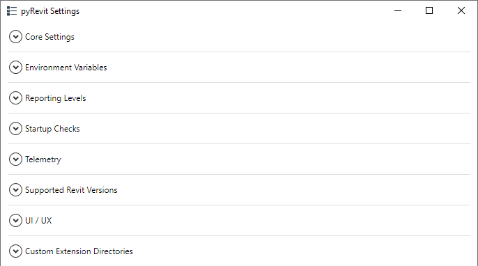

## pyRevit Language

!!! warning ""

    pyRevit is being translated. The langauge options are available but pyRevit has not yet been translated to all the provided languages.

Select the desired language from the UI/UX section in the Settings tool

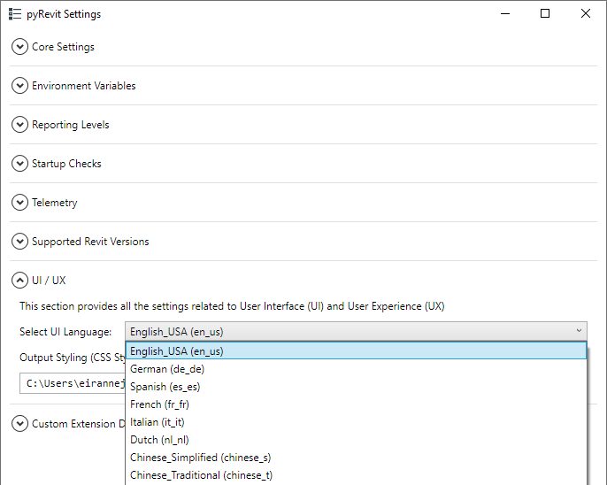

## Reporting Levels

pyRevit has a logging system that can report the activities on various levels, (DEBUG, INFO, ERROR, ...). You can select the level of information that pyRevit is going to show especially at load time.

The options are explained clearly in the Settings window. Pick the one that is appropriate for you.

## Supported Revit Versions

You can select which version of Revit you want pyRevit to be attached to. When pyRevit is attached to a Revit version, it will load in that Revit version environment.

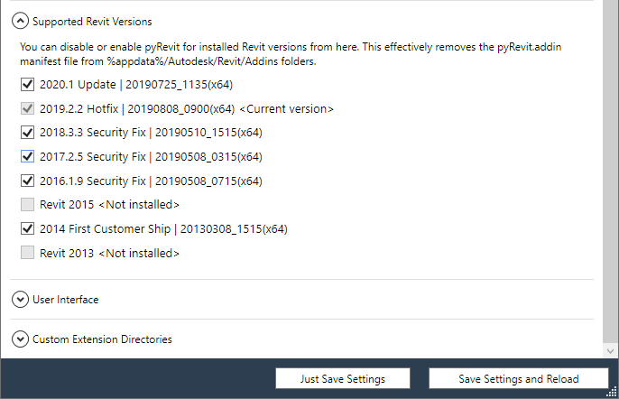

## Advanced Configuration

### Core Settings

Configure the Rocket Mode and Startup Check for Updates. Both are explained in the UI.

### Active Engines

Select the Active IronPython and CPython Engines

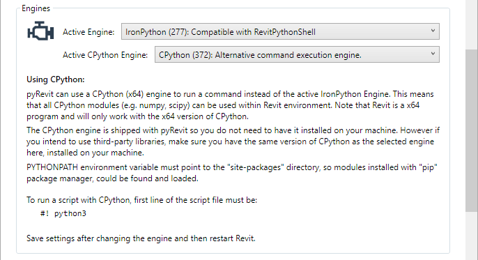

### Developer Configs

Set developer configurations e.g. whether you want to load the tools marked as Beta or not

### Extension Caching

Select the type of extension cache that pyRevit should create on startup

### Environment Variables

See the values for pyRevit environment variables.

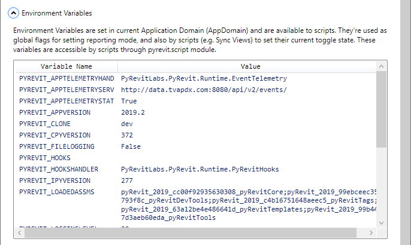

 You can right click on each variable to copy the name or the value

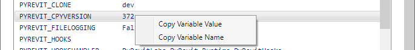

### File Logging

Choose whether you want pyRevit to write all the runtime logs to a separate file. This usually reduces runtime performance. Only activate when you need to debug the runtime.

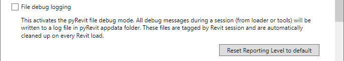

### Startup Checks

Provide options to check at pyRevit runtime. For example if the Revit build number does not match the provided number, pyRevit will show a warning.

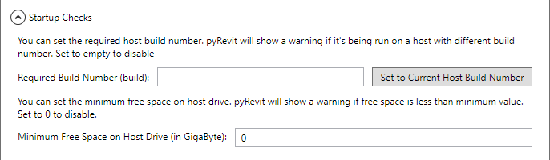

Example of a warning message in output window.

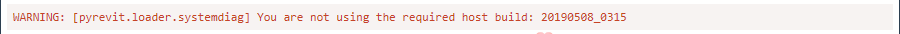

### Output Window Styling

Select a different CSS file to style the output window. You can use the default as a starting point.

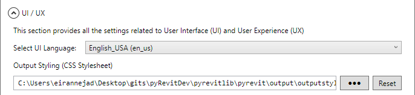

### Custom Extension Directories

Manage the extra paths that pyRevit is expected to search for extensions

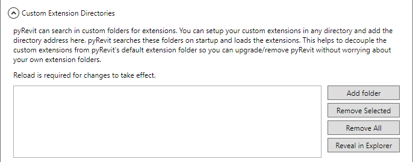
