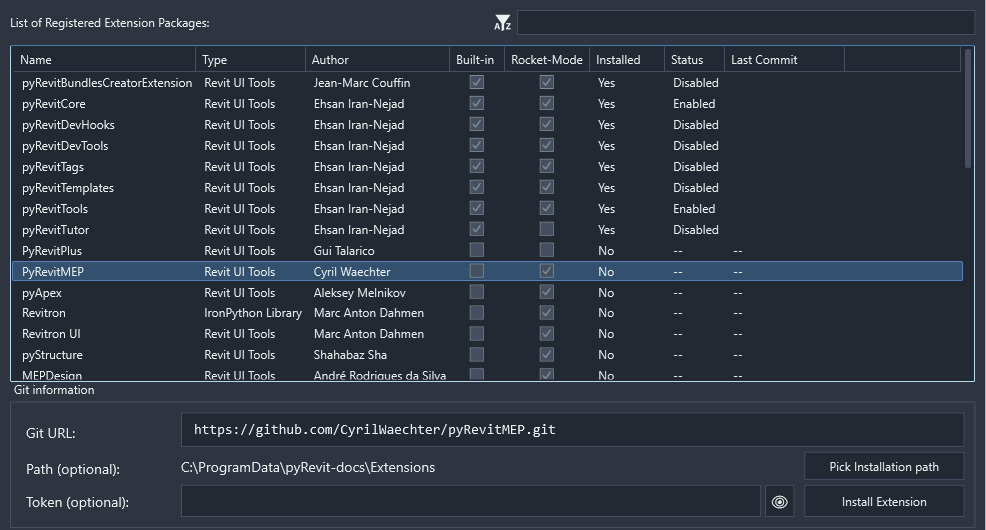
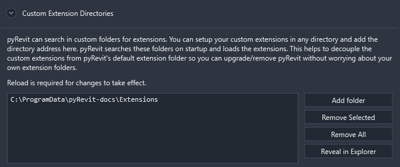

# Install extensions

Use the **Extensions** tool in the **pyRevit** panel to install third-party extensions.

The Extension Manager lists all the registered extensions you can install on your machine, and the ones already installed.

To install an extension, select it in the list and look at its information and website below the list. Its Git URL is filled in. **Path** is the folder the extension is installed into, the pyRevit extensions folder by default; use **Pick Installation path** to change it. A private repository needs a **Token**. Then click **Install Extension**.

pyRevit installs the extension, adds its folder to the extension folders when needed, and reloads.

Most extensions will add their own tab in Revit UI with their tools inside.

To install an extension that is not in the list, click **Deselect** if an extension is selected, then type its Git URL and click **Add and install**.

## Adding Extension Manually

To manually add an extension to pyRevit, open the pyRevit **Settings** and add the folder that contains the extension under **Custom Extension Directories**. Add the parent folder of the `.extension` folder, not the `.extension` folder itself. For example, for `C:\ProgramData\pyRevit-docs\Extensions\Test.extension`, add `C:\ProgramData\pyRevit-docs\Extensions`.

Click **Save Settings and Reload** to load the extension. **Just Save Settings** keeps it for the next reload.
