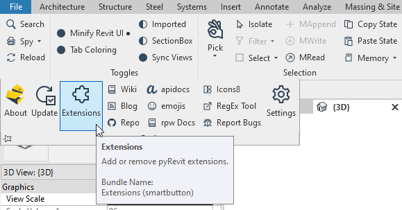
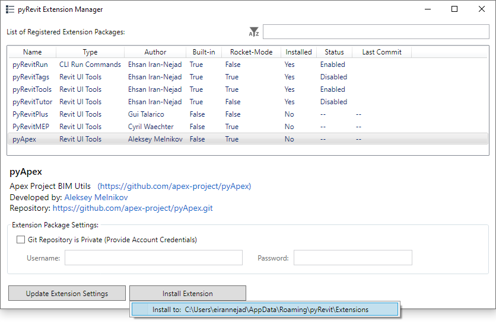
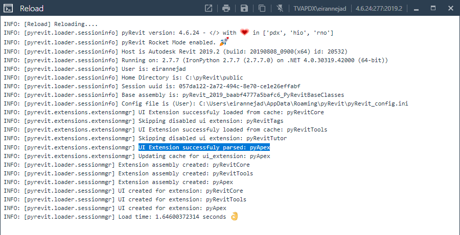
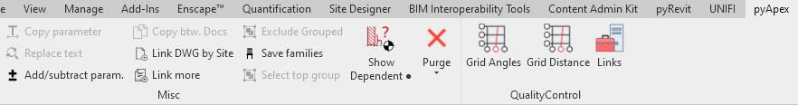
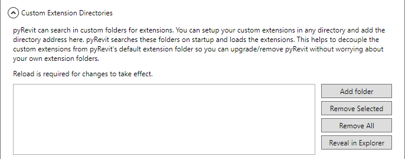
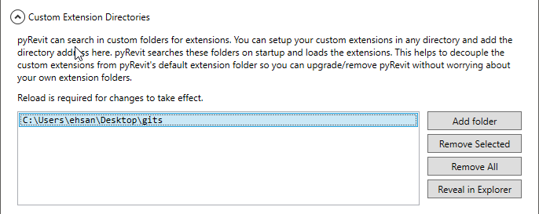

# Install extensions

Use the Extensions tool under pyRevit panel and install third-party extensions as you wish.

The Extensions window, shows all the registered extensions that you can install on your machine.

To install an extension, select the extension that you want, take a look at the information about that extension and the website, then click on the Install Extension button and select the destination (By default there is only one destination)

pyRevit will install the extension and will reload automatically.

Most extensions will add their own tab in Revit UI with their tools inside.

## Adding Extension Manually

To manually add an extension to pyRevit, open the pyRevit settings and add the path of the direcotry containing the extension to pyRevit

In this example, my extension is called `Test.extension` and is inside the `gits` directory on my desktop. Therefore the parent directory is `C:\Users\ehsan\Desktop\gits` and it has been added to the custom extension directories list.

