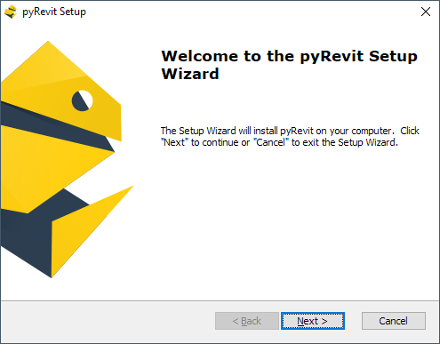
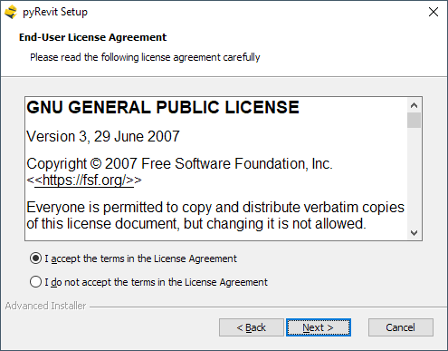
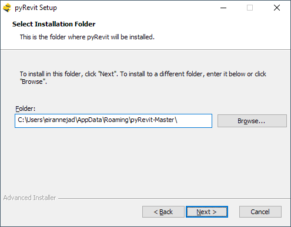
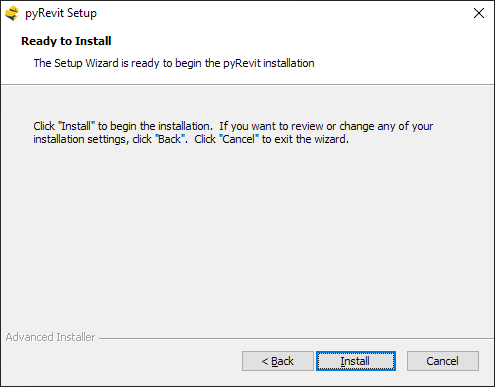
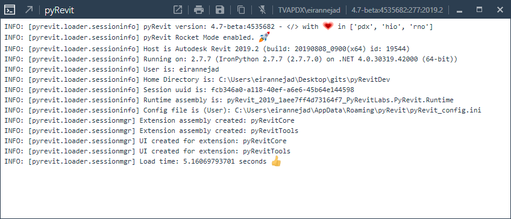

# Install pyRevit

!!! warning ""

    If you have installed pyrevit previously, please do **uninstall** previous versions first.

- Download the installer for the most recent version of pyRevit from here.

[Releases · pyrevitlabs/pyRevit](https://github.com/pyrevitlabs/pyRevit/releases)

There are two installers. `pyRevit_<version>_signed.exe` installs for the current user and needs no administrator rights. `pyRevit_<version>_admin_signed.exe` installs for every user of the machine and needs administrator rights. See [Installers](../installers.md).

- Run the installer on your machine and follow through the steps. The user installer does not require Administrator privileges to your machine. You can choose a different installation path than the default as well.



*Start the install*



*Accept the license terms*



*Select a destination path*



*Click install*

- Once completed, Launch any of the installed Revit versions. Revit should show a prompt similar to the one shown below and ask whether you want to load this new addon or not. Say **Always Load** please 🙏


- If you have not had pyRevit on your machine or disabled the load-time log report, you should see a window similar to this that lets you know pyRevit has loaded successfully and also provides some information about the runtime environment.



The samples below come from an older version, so the version numbers and the engine line differ today.

The first couple of lines tell you about the running pyRevit version, Revit version, Python engine version, and whether Rocket mode is active (Rocket mode makes the python tools run a lot faster by caching them, and is on by default).

```text
pyRevit version: 4.6.24:1e25e63 - </> with 💓 in ['pdx', 'hio', 'rno']
pyRevit Rocket Mode enabled. 🚀
Host is Autodesk Revit 2019.2 (build: 20190808_0900(x64) id: 20444)
Running on: 2.7.7 (IronPython 2.7.7 (2.7.7.0) on .NET 4.0.30319.42000 (64-bit))
```

Then there is some information about the user environment, the runtime assembly and the configuration file

```text
User is: eirannejad
Home Directory is: C:\pyRevit\
Session uuid is: 2e35d891-a51d-4759-a90b-f579ec532ffd
Config file is (User): C:\Users\eirannejad\AppData\Roaming\pyRevit\pyRevit_config.ini
```

Then pyRevit goes on to parsing extensions, finding bundles, creating buttons in the UI.  
When all done, it reports the total load time.

```text
UI Extension successfuly loaded from cache: pyRevitCore
Skipping disabled ui extension: pyRevitTags
UI Extension successfuly loaded from cache: pyRevitTools
Skipping disabled ui extension: pyRevitTVAExtension
Extension assembly created: pyRevitCore
Extension assembly created: pyRevitTools
UI created for extension: pyRevitCore
UI created for extension: pyRevitTools
Load time: 1.10900115967 seconds 👍
```

### Install Errors

If you experienced any errors during the install, please see [Installation issues](../help/installation-issues.md)  
