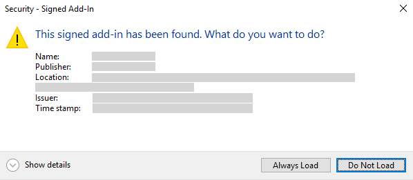

# Install pyRevit

!!! warning ""

    If you have installed pyRevit previously, **uninstall** the previous version first.

## Download

Download the installer of the most recent release from [Releases · pyrevitlabs/pyRevit](https://github.com/pyrevitlabs/pyRevit/releases).

There are two installers. `pyRevit_<version>_signed.exe` installs for the current user and needs no administrator rights. `pyRevit_<version>_admin_signed.exe` installs for every user of the machine and needs administrator rights. See [Installers](../installers.md).

## Run the installer

Close Revit, then run the installer and follow the steps:

1. Accept the license.
1. Choose the destination folder. The user installer proposes `%APPDATA%\pyRevit-Master`, the admin installer `Program Files\pyRevit-Master`.
1. Choose the components. **pyRevit Core Tools** is always installed. **pyRevit Extended Extensions**, **pyRevit Developer Extensions** and **pyRevit Tutorials Extension** are optional.
1. Click **Install**.

The installer registers the installed clone and attaches it to the Revit versions it supports. It also installs the `pyrevit` command line tool, see [CLI](../cli/index.md).

## First start in Revit

Launch any of the installed Revit versions. Revit shows a prompt similar to the one below and asks whether to load the add-in. Choose **Always Load**.

When the load-time report is active, pyRevit opens its output window while it loads. The report lists, in this order:

- the pyRevit version, and whether Rocket mode is enabled
- the Revit version, build and process id
- the Python engine pyRevit runs on
- the user, the pyRevit home directory and the session id
- the runtime assembly and the configuration file in use
- the extensions it loads, and the total load time

[Reporting Levels](configure.md#reporting-levels) controls whether this window opens.

## Install errors

If the install fails or pyRevit does not load, see [Installation issues](../help/installation-issues.md).
