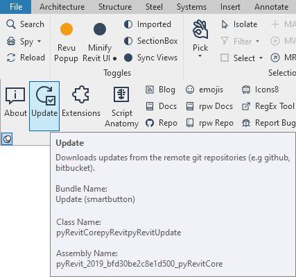
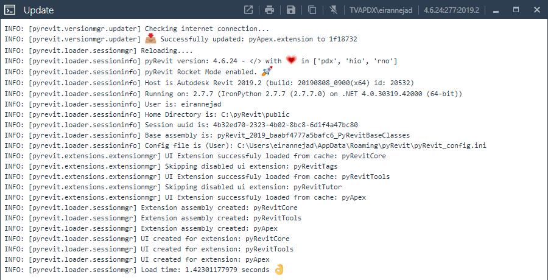

# Update pyRevit

!!! warning ""

    If pyRevit has been deployed in your environment by an admin, consult with them on how to keep pyRevit updated. Most probably they have an update procedure.

- To keep pyRevit updated, download the new installers and install the new pyRevit version.
- To update the installed extensions, use the Update tool

pyRevit will pull the new updates from the remote Git repositories of the installed extensions and will reload automatically. A list of updated packages (📩) is reported if you have the reporting active.

#### For Developers

If you are a pyRevit developer, see [pyRevit CLI](../cli/index.md) for the command-line utility that helps you manage the pyRevit environment and clones.
