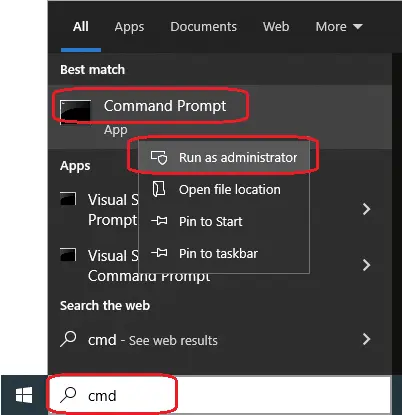
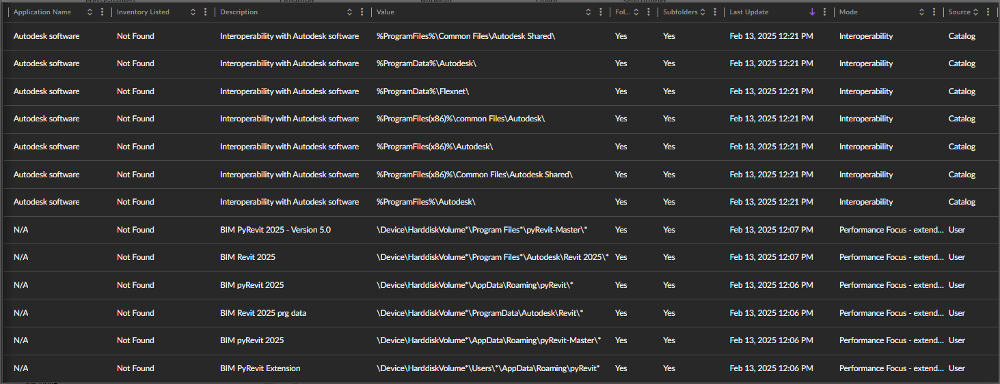

# Installation issues

!!! warning ""

    If you are using the Admin installer → Use the command line as admin or do the cli procedure under the Admin user  

    

## pyRevit Is Installed But Does Not Load

- Open a command prompt and run `pyrevit attached`
- Take a look the `==> Attachments` section. It should look similar to this. It should show that `master` is attached to all your installed Revit versions. The report looks similar to this:

    ```text
    ==> Attachments
    master | Product: "<Revit product name>" | Engine: IPY2712PR (2712) | Path: "....."
    ```
- If nothing is listed then run `pyrevit clones` and check to make sure `master` is listed as the installed clone

    ```text
    ==> Registered Clones (full git repos)
    ==> Registered Clones (deployed from archive/image)
    master | Deploy: "basepublic" | Branch: "master" | Version: "<version>" | Path: "......"

    ```
- If it is listed, then run `pyrevit attach master default --installed` and check again to make sure it is attached.
- If it is not listed, then find the installed pyRevit path (default is `%APPDATA%/pyRevit-Master` ) and manually register the master clone by running `pyrevit clones add master <installed path>`. Then check `pyrevit clones` to make sure it is registered. Now you can attach it using the command in previous step.

See an example of this fix here

[Installation still not working after serveral trys · Issue #1075 · pyrevitlabs/pyRevit](https://github.com/pyrevitlabs/pyRevit/issues/1075#issuecomment-734950066)

## Error dynamically compiling pyRevit runtime
What seems to work in most cases:

1. **Uninstall pyRevit**
1. **Delete** the `pyRevit` folders under `%ProgramData%` and `%AppData%`
1. **Move all Revit addins** to a temporary location. Usual addins locations include:

    1. %AppData%\\Autodesk\\Revit\\Addins\\\<year\>
    1. %AppData%\\Autodesk\\ApplicationPlugins
    1. %ProgramData%\\Autodesk\\Revit\\Addins\\\<year\>
    1. %ProgramData%\\Autodesk\\ApplicationPlugins
    1. For Revit 2027 and later, the all-users folders under `C:\Program Files\Autodesk`, see [Where Revit loads add-ins from](#where-revit-loads-add-ins-from)
1. \[Reboot computer\]
1. **Reinstall pyRevit**
1. Start **each version** of Revit and confirm pyRevit loads.
1. **Move the Revit addins** from step 3 back to their original location.

    1. you may want to add them one at a time and start a revit session everytime to figure out which ones are causing the issue.

[Error Loading pyRevit: Error dynamically compiling pyRevit runtime · Issue #1948 · pyrevitlabs/pyRevit](https://github.com/pyrevitlabs/pyRevit/issues/1948)

## Sentinel One related issues

### Favorite solution

The most targeted one: exclude Revit from SentinelOne by the hash of its executable. To get the SHA1 of a Revit version (example for 2026):

```powershell
certutil -hashfile "C:\Program Files\Autodesk\Revit 2026\Revit.exe" SHA1
```

### Strategies that worked

#### #1

[\[Bug\]: Can't install pyRevit\_5.0.0.25034\_signed.exe Revit 2025 · Issue #2577 · pyrevitlabs/pyRevit](https://github.com/pyrevitlabs/pyRevit/issues/2577#issuecomment-2797937457)

- Exclude pyRevitLoader.dll and Revit exe file

`C:\Program Files\Autodesk\Revit 20XX\Revit.exe`

`%APPDATA%\pyRevit-Master\bin\netfx\engines\IPY342\pyRevitLoader.dll`

`%APPDATA%\pyRevit-Master\bin\netfx\engines\IPY2712PR\pyRevitLoader.dll`

[\[Bug\]: Can't install pyRevit\_5.0.0.25034\_signed.exe Revit 2025 · Issue #2577 · pyrevitlabs/pyRevit](https://github.com/pyrevitlabs/pyRevit/issues/2577#issuecomment-2659097860)



OR

- We added a path based exclusion for Revit.exe in a specific directory, then we told SentinelOne to use "Interoperability - extended" which allows Revit.exe to spawn child processes and those should be allowed.

[Revit 2022 Crashes with pyRevit and SentinelOne · Issue #1929 · pyrevitlabs/pyRevit](https://github.com/pyrevitlabs/pyRevit/issues/1929#issuecomment-1741503158)

OR

- As file:

    - C:\\Program Files\\Autodesk\\Revit 2024\\revit.exe
    - C:\\Users\*\\AppData\\Roaming\\Autodesk\\Revit\\Addins\*\\pyRevit.addin
    - C:\\ProgramData\\Autodesk\\Revit\\Addins\*\\pyRevit.addin

    As folder:

    - C:\\Users\*\\AppData\\Roaming\\pyRevit
    - C:\\Users\*\\AppData\\Roaming\\pyRevit-Master
    - C:\\Program Files\\pyRevit-Master

    Exclusion settings in SentinelOne for all exclusions

    - Exclusion Type: Path
    - OS: Windows
    - Include subfolders: checked
    - Exclusions Mode: Interoperability

    [Revit 2024 Crashes when loading but Revit 2022 doesnt · Issue #1866 · pyrevitlabs/pyRevit](https://github.com/pyrevitlabs/pyRevit/issues/1866)

OR

- Put exclusions for the Revit executables and for the pyRevit folders under `%appdata%` (`pyRevit` and `pyRevit-Master`). Do not exclude the whole `%appdata%` folder: agree the exact paths with your IT team.   

[v4.8.12.22247 not allowing any of my Revit products to launch - Sentinel One related · Issue #1724 · pyrevitlabs/pyRevit](https://github.com/pyrevitlabs/pyRevit/issues/1724)

## Extensions not installing

- Check with your IT that `github.com` is not blocked

[PyRevit Extensions Not Installing](https://discourse.pyrevitlabs.io/t/pyrevit-extensions-not-installing/9374/12)

## If Nothing Works

See [Reporting pyRevit Issues](reporting-issues.md) if the issue persists.

## Where Revit loads add-ins from

Revit reads add-in manifests from several folders. When pyRevit does not load, or loads twice, check each of them for a `pyRevit.addin` file. Replace `[Year]` with the Revit version.

**Revit 2017 to 2026**

| Scope | Folder |
|---|---|
| Current user | `%APPDATA%\Autodesk\Revit\Addins\[Year]` |
| Current user | `%APPDATA%\Autodesk\ApplicationPlugins` |
| All users | `C:\ProgramData\Autodesk\Revit\Addins\[Year]` |
| All users | `C:\ProgramData\Autodesk\ApplicationPlugins` |
| Autodesk's own add-ins | `C:\Program Files\Autodesk\Revit [Year]\AddIns` |

**Revit 2027 and later**

| Scope | Folder |
|---|---|
| Current user | `%APPDATA%\Autodesk\Revit\Addins\[Year]` |
| Current user | `%APPDATA%\Autodesk\ApplicationPlugins` |
| All users | `C:\Program Files\Autodesk\Revit\Addins\[Year]` |
| All users | `C:\Program Files\Autodesk\ApplicationPlugins` |
| Autodesk's own add-ins | `C:\Program Files\Autodesk\Revit [Year]\AddIns` |

Be careful with what you disable in Autodesk's own folder.

Source: [list of Revit add-in locations](https://gist.github.com/teocomi/5986db4eba261ec4baeb7325329aa226?permalink_comment_id=6132572#gistcomment-6132572).
