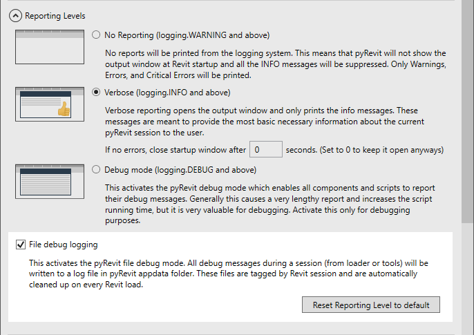
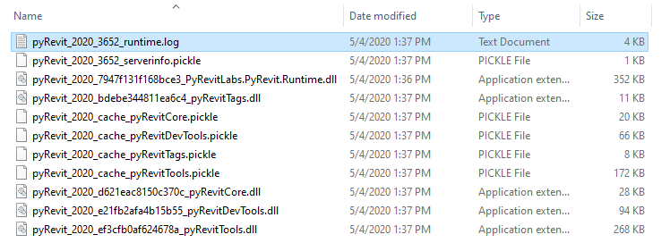

# Reporting issues

!!! warning ""

    Please follow the instructions on the issue templates to help us pin point the issues faster. Review the information that you are posting to the issue tracker for private content. Specifically consider sanitizing the `pyrevit env` reports.

[Open a new issue](https://github.com/pyrevitlabs/pyRevit/issues/new/choose)

## Submitting a Bug Report

### Describe the bug
Provide a description. Be as specific as possible and list steps to reproduce the issue. If you have any suggestions for the solution please list that as well.

If you have installed pyRevit, and the installation completed with no errors but pyRevit doesn't load, please run the command below in terminal. This should fix the issue on your machine, however, please continue filing the issue with instructions below.

`pyrevit attach master default --installed`

- **Explain how to reproduce the error**
- **Explain the expected behaviour**
- **If applicable, add screenshots to help explain your problem**

Follow the instructions below to collect the debug logs from your pyRevit installation and submit to the developers to help identifying the problem.

## Collecting a debug log

### Activating file logging

If pyRevit runs normally, and you can access the pyRevit settings, open **Settings** → **Reporting Levels** and activate the **File debug logging** option



But if pyRevit fails to run and crashes Revit for some reason, go to `%APPDATA%/pyRevit` directory and open the pyRevit configuration file `pyRevit_config.ini`. Make sure the file logging is activated (`filelogging = true`) under the `[core]` section. When the CLI works, `pyrevit configs filelogging enable` does the same.

If the file does not exist, create an empty text file matching the name and extension (`pyRevit_config.ini`) and place the content below inside the file

```text
[core]
filelogging = true
```

### Clearing the cache

Before collecting the debug log, we would want to clear all existing ones first. Open a command prompt window and run the command below:

```powershell
pyrevit caches clear --all
```

### Collecting the log

Now start Revit. pyRevit will take a bit longer this time to load since it is recording all the actions in a file on the disc. Once Revit is crashed or other pyRevit errors happen, go to the `%APPDATA%/pyRevit/<revit version>` directory that matches the Revit version you used and collect the debug log file. The debug log file name ends in `_runtime.log` as shown below


