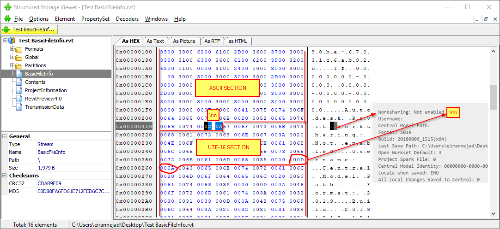
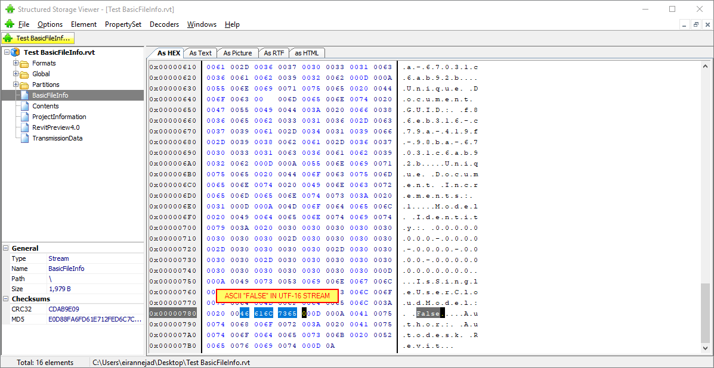

# BasicFileInfo stream

!!! note ""

    To easily extract this information from Revit models, see [Get Revit Model Information](../tools/get-rvt-info.md)  and [Extracting Revit File Info](index.md)  

### Stream Format

The metadata about a file is stored in the `BasicFileInfo` stream. Over the years, **TheBuildingCoder** has written many ([This](https://thebuildingcoder.typepad.com/blog/2013/01/basic-file-info-and-rvt-file-version.html), [This](https://thebuildingcoder.typepad.com/blog/2018/04/standalone-basicfileinfo-and-extractpartatom-method.html), [This](https://thebuildingcoder.typepad.com/blog/2014/08/document-version-guid-and-number-of-saves.html), and [This](https://thebuildingcoder.typepad.com/blog/2017/06/determining-rvt-file-version-using-python.html) to link a few) articles on how to extract info from this stream.

The **BasicFileInfo** is a [UTF-16 Little-Endian](https://en.wikipedia.org/wiki/UTF-16) text file and is formatted (as of Revit 2019.2) as shown here:

```text
Worksharing: Not enabled
Username:
Central Model Path:
Format: 2019
Build: 20180806_1515(x64)
Last Save Path: C:\Models\Project1.rvt
Open Workset Default: 3
Project Spark File: 0
Central Model Identity: 00000000-0000-0000-0000-000000000000
Locale when saved: ENU
All Local Changes Saved To Central: 0
Central model's version number corresponding to the last reload latest: 4
Central model's episode GUID corresponding to the last reload latest: 2ecc6fa1-2960-4473-9fd9-0abce22022fc
Unique Document GUID: 2ecc6fa1-2960-4473-9fd9-0abce22022fc
Unique Document Increments: 4
Model Identity: 00000000-0000-0000-0000-000000000000
IsSingleUserCloudModel: False
Author: Autodesk Revit
```

These are the changes to this format in 2019 going forward so watch for them if you’re reading older Revit files:

```bash
# added
Format: 2019
IsSingleUserCloudModel: False
Author: Autodesk Revit

# modified
Revit Build: Autodesk Revit 2016 (Build: 20161004_0715(x64)) --> Build: 20180806_1515(x64)
```

### Extracting the Stream

This UTF-16 stream (every two bytes represents one character) is usually stored after an ASCII stream (each single byte is a character).  
Both these streams are written with Windows-Style line-ending (`\r\n` with hex codes `0x0D 0x0A` read [Carriage-Return/Line-Feed](https://stackoverflow.com/questions/15433188/r-n-r-and-n-what-is-the-difference-between-them)). An ASCII line ending (`0x0D 0x0A` vs `0x0D 0x00 0x0A 0x00` in UTF-16) separates these two sections:



So the stream needs to be read in binary, split by `0x0D 0x0A` bytes, and the last section be converted into the UTF-16 format:

```bash
... 0x00 0x76 0x00 0x69 0x00 0x74 0x00      # ASCII stream split by: 0x0D 0x0A # End of ASCII stream
0x57 0x00 0x6F 0x00 0x72 0x00 0x6B...       # UTF-16 stream
... 0x0D 0x00 0x0A 0x00                     # End of UTF-16 stream
```

In addition, the string representation of boolean values are written in ASCII again inside this UTF-16 stream. So a binary search and replace is necessary.



Here is a snippet from pyRevitLabs that performs this search and replace:

```csharp
using pyRevitLabs.Common;

// replace False with UTF-16 LE False
utf16Stream = CommonUtils.ReplaceBytes(
    extractedStream,
    //           F     a     l     s     e     null
    new byte[] { 0x46, 0x61, 0x6C, 0x73, 0x65, 0x00 },
    //           F           a           l           s           e
    new byte[] { 0x46, 0x00, 0x61, 0x00, 0x6C, 0x00, 0x73, 0x00, 0x65, 0x00}
    );
```

Now the BasicFileInfo stream is cleaned up and ready to be converted to UTF-16:

```csharp
using System.Text;
var baseInfoString = Encoding.GetEncoding("UTF-16").GetString(utf16Stream);
```
