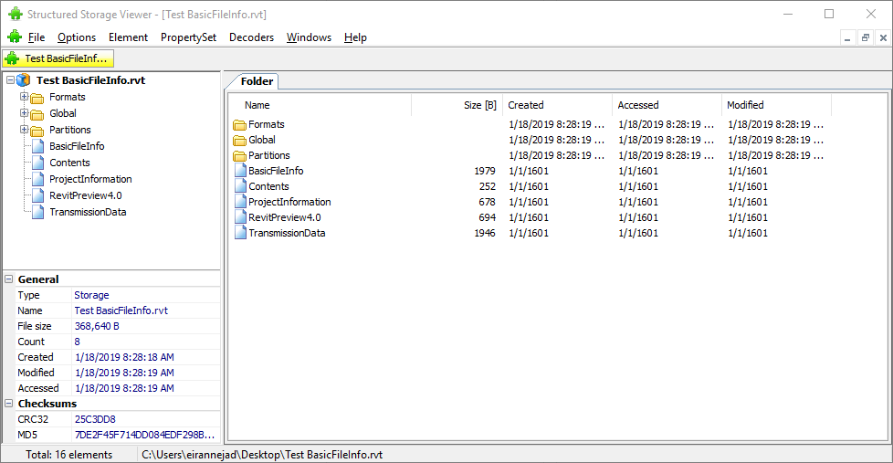
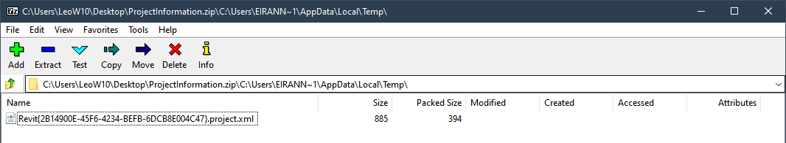

# ProjectInformation stream

!!! note ""

    To easily extract this information from Revit models, see [Get Revit Model Information](../tools/get-rvt-info.md)  and [Extracting Revit File Info](index.md)  

### Stream Format

The `ProjectInformation` contains the Project Information data and custom project parameters.



The stream is a blob of pk-zip archive. We can save this stream using SSView to a separate file and open it with 7zip. You will find a single xml file inside this archive when extracted.



Let’s peek into this xml file. The structure is very similar to the PartAtom stream discussed in the previous article:

```xml
<?xml version="1.0" encoding="UTF-8"?>
<entry xmlns="http://www.w3.org/2005/Atom" xmlns:A="urn:schemas-autodesk-com:partatom">
    <title>Project1</title>
    <updated>2019-06-30T11:52:15Z</updated>
    <A:taxonomy>
        <term>adsk:revit</term><label>Autodesk Revit</label>
    </A:taxonomy>
    <A:taxonomy>
        <term>adsk:revit:grouping</term><label>Autodesk Revit Grouping</label>
    </A:taxonomy>
    <link rel="design-2d" type="application/rvt" href=".">
    <A:design-file>
        <A:title>Project1.rvt</A:title>
        <A:product>Revit</A:product>
        <A:product-version>2019</A:product-version>
        <A:updated>2019-06-30T11:52:15Z</A:updated>
    </A:design-file>
    </link>
    <A:features>
        <A:feature>
            <A:title>Project Information</A:title>
            <A:group>
                <A:title>Text</A:title>
                <Custom_Project_Parameter displayName="Custom Project Parameter" type="custom" typeOfParameter="Text">
                    Custom Value</Custom_Project_Parameter>
            </A:group>
            <A:group>
                <A:title>Identity Data</A:title>
                <Organization_Name displayName="Organization Name" type="system" typeOfParameter="Text">Value
                </Organization_Name>
                <Organization_Description displayName="Organization Description" type="system" typeOfParameter="Text">
                    Value</Organization_Description>
                <Building_Name displayName="Building Name" type="system" typeOfParameter="Text">Value</Building_Name>
                <Author type="system" typeOfParameter="Text">Value</Author>
            </A:group>
            <A:group>
                <A:title>Energy Analysis</A:title>
            </A:group>
            <A:group>
                <A:title>Other</A:title>
                <Project_Issue_Date displayName="Project Issue Date" type="system" typeOfParameter="Text">Value
                </Project_Issue_Date>
                <Project_Status displayName="Project Status" type="system" typeOfParameter="Text">Value</Project_Status>
                <Client_Name displayName="Client Name" type="system" typeOfParameter="Text">Value</Client_Name>
                <Project_Address displayName="Project Address" type="system" typeOfParameter="Multiline Text">Multiline
                    Value
                    Multiline Value
                    Multiline Value</Project_Address>
                <Project_Name displayName="Project Name" type="system" typeOfParameter="Text">Value</Project_Name>
                <Project_Number displayName="Project Number" type="system" typeOfParameter="Text">Value</Project_Number>
            </A:group>
        </A:feature>
    </A:features>
</entry>
```

Notice that the project information key:values are grouped, similar to how the are grouped in Revit user interface:

```xml
<A:group>
    <A:title>Identity Data</A:title>
</A:group>
```

Inside each group, there are one or more custom xml elements that correspond to the project information parameter:

```xml
<Organization_Description displayName="Organization Description" type="system" typeOfParameter="Text">
    Value
</Organization_Description>
```

To be honest I do not know why these elements have custom names e.g. `Organization_Description`. But the actual pretty name of the parameter is set on the `displayName` attribute. The value, per xml standard, is the inner text of the element and could be multi-line as well:

```xml
<Project_Address displayName="Project Address" type="system" typeOfParameter="Multiline Text">
    Multiline Value
    Multiline Value
    Multiline Value
</Project_Address>
```

## Extracting Info

We can automate this process in code. These excerpts are from the pyRevitLabs code library that supports pyRevit and pyRevit CLI

```csharp
// extract ProjectInformation (Revit Project Files)
// ProjectInformation is a PK Zip stream
var rawProjectInformationData = CommonUtils.GetStructuredStorageStream(FilePath, "ProjectInformation");

Stream zipData = new MemoryStream(rawProjectInformationData);
var zipFile = new ZipArchive(zipData);
foreach (var entry in zipFile.Entries) {
    if (entry.FullName.ToLower().EndsWith(".project.xml")) {
        using (Stream projectInfoXamlData = entry.Open()) {
            var projectInfoXmlData = new StreamReader(projectInfoXamlData).ReadToEnd();
            ProcessProjectInfo(projectInfoXmlData);
        }
    }
}
```

```csharp
// parse the xml file and extract the data into a dictionary of key, values
var doc = new XmlDocument();

doc.LoadXml(rawProjectInfoData);
XmlNamespaceManager nsmgr = new XmlNamespaceManager(doc.NameTable);
nsmgr.AddNamespace("rfa", @"http://www.w3.org/2005/Atom");
nsmgr.AddNamespace("A", @"urn:schemas-autodesk-com:partatom");

// extract project parameters
var projectInfoDict = new Dictionary<string, string>();
XmlNodeList propertyGroups = doc.SelectNodes("//rfa:entry/A:features/A:feature/A:group", nsmgr);
foreach(XmlElement properyGroup in propertyGroups) {
    foreach(XmlElement child in properyGroup.ChildNodes) {
        if (child.HasAttribute("displayName")) {
            string propertyName = child.GetAttribute("displayName");
            string propertyValue = child.InnerText;
            projectInfoDict.Add(propertyName, propertyValue);
        }
    }
}
```
