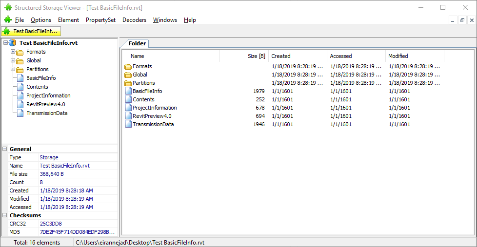

# Structured storage

As many of you might know, Revit files are [Structured Storage](https://en.wikipedia.org/wiki/COM_Structured_Storage) files (which basically are like an archive that contains a file system) and have multiple data streams (files?) written inside this bundle. You can use an application like [SSView](https://www.mitec.cz/ssv.html) to peek into this file structure.

SSView also allows exporting any of these streams out to a single file for further analysis

