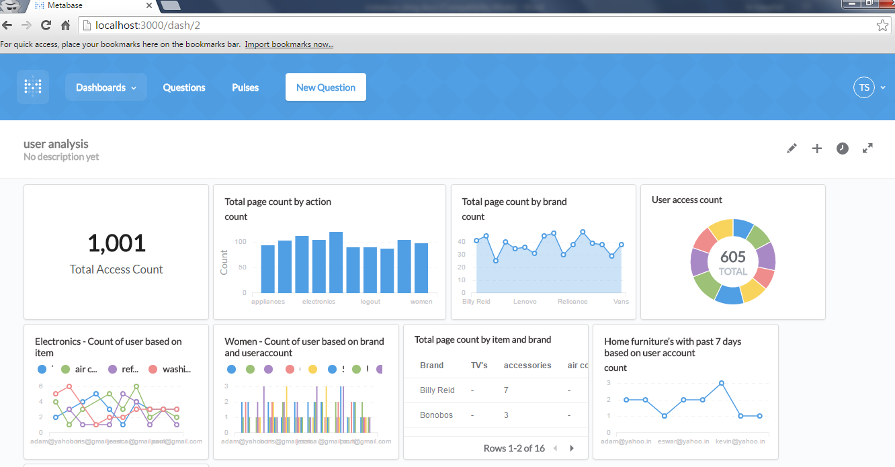

# Team deployment guide

!!! warning ""

    Basic understanding of [pyRevit CLI](../cli/index.md) and its purpose is necessary for this guide

See the resources below for more info on the individual components discussed here

- [Distribution Model](distribution-model.md)
- [Deployments](deployments.md)
- [pyRevit CLI](../cli/index.md)
- Windows Environment Variables

## Deploying pyRevit

This guide takes you through setting up an install and configuration script, to deploy pyRevit to your team. Take a look at the [Distribution Model](distribution-model.md) before reading the rest of this guide. It is important to understand that the Windows installer that is provided with pyRevit, is for single users that like to get started quickly. However, if you are managing pyRevit on more than one machine, or you are developing your own tools with pyRevit, it is strongly advised to get comfortable using the pyRevit CLI. This utility helps you manage the pyRevit clones and configurations, among other Revit related functions it provides.

In a managed pyRevit environment, the admin usually wants to

- Deploy the pyRevit core (standard or built by your own team)
- Deploy the standard pyRevit tools or the tools built by your own team
- Configure pyRevit
- Attach pyRevit to all installed Revits or a version only

pyRevit CLI supports all these tasks. In the next sections, we are going to discuss each of these tasks individually, and step by step, create an installation and configuration script for your environment.

## Overview

A simple team deployment workflow would follow the steps listed below:

- System user installs pyRevit CLI on the target machine
- System user clones pyRevit to desired location, using pyRevit CLI
- Optional: System user can clone the necessary pyRevit extensions using the CLI
- System user configures pyRevit using CLI. Configs are saved in System user private config file (`%appdata%` for system user)
- System user attaches pyRevit to installed Revit versions for all users (`--allusers`) using CLI. This creates the necessary `pyRevit.addin` manifest file under `%programdata%/Autodesk/Revit/Addins` for each Revit version
- System user then Seeds the config file to `%programdata%` (Seeding the config file is basically the process of copying config file into `%programdata%` for all users. Each users' pyRevit then, at first load, will use this config file as a seed or template to setup their own config file)
- At this point, the target machine has been configured for pyRevit

When the machine user logs into the machine at a later time:

- User logs into the machine, and runs Revit. The OS will create the necessary local files for this user
- Revit finds the `pyRevit.addin` file in `%programdata%/Autodesk/Revit/Addins` and loads pyRevit
- pyRevit finds the seed config file in `%programdata%` and configures pyRevit for the user. If the config file is not locked, pyRevit creates a clone of this config file in `%appdata%` so the user can apply furthur configurations without affecting the seed file

### Installing pyRevit CLI

The first step is to deploy the pyRevit CLI on all user machines. This utility is then used to deploy the pyRevit core and tools, and configure the deployments on the user machine.

Install the CLI with the installer from the [pyRevit Releases](https://github.com/pyrevitlabs/pyRevit/releases) page. There are two CLI installers: `pyRevit_CLI_<version>_signed.exe` installs for the current user, and `pyRevit_CLI_<version>_admin_signed.exe` installs for all users and needs administrator rights. See [Installers](../installers.md).

The installer checks for the .NET 8 runtime and WebView2 and installs them when they are missing, so the script does not need to install dependencies first.

```powershell
# install/update pyRevit CLI
Write-Output "Installing pyRevit CLI..."
Start-Process -FilePath ".\pyRevit_CLI_<version>_admin_signed.exe" `
              -Wait `
              -ArgumentList "/VERYSILENT /SUPPRESSMSGBOXES /NORESTART" > $null
```

Lastly we need to add the installed path of the CLI, so we can use the `pyrevit` command in the next part of our install script.

```powershell
$env:Path = "C:\Program Files\pyRevit CLI\bin;$env:Path"
```

### Cloning pyRevit

Once the pyRevit CLI is installed on the target machine, we can use the new `pyrevit` command in the shell to clone pyRevit core and base tools.

!!! tip ""

    Depending on the type of tools that you want, pyRevit has a couple of deployment options that you can choose from.  
    See [Deployments](deployments.md)  

!!! tip ""

    See [Manage pyRevit clones](../cli/clones.md) to learn more about deploying clones using the CLI

First, let's define a couple of global variables for our script, that will contain the installation and source locations. The variable names and the installation paths are used as an example. You need to modify the paths to where you want to deploy pyRevit on user machines.

```powershell
# pyRevit deploy root path
$pyrevitroot = "C:\pyRevit"

# the name of the clone we are going to create
$ourclonename = "ourmain"

# the deployment to install, see the Deployments page
$deploymentname = "base"

# pyrevit clone install path
$pyrevitcoredest = $(Join-Path $pyrevitroot $ourclonename)

# pyRevit extension install path
$pyrevitexts = $(Join-Path $pyrevitroot "Extensions")
```

If you are using the CLI to deploy your own custom core or extensions, define variables for these paths as well.

```powershell
# your custom pyRevit core repo path
$ourpyrevitcore = "\\path\to\internal\pyrevitcore.git"

# your custom pyRevit extension name and repo path
$ourextname = "OurpyRevitExtension"
$ourpyrevitext = "\\path\to\internal\ourpyrevitextension.git"
```

Now we can create a Powershell function that clones pyRevit on the user machine.

```powershell
# clone pyRevit
function Clone-PyRevit() {
    # stop if Revit is open: pyRevit files are in use and users may have unsaved work
    if (Get-Process -Name "Revit" -ErrorAction SilentlyContinue) {
        throw "Revit is running. Ask the user to save and close it, then run the script again."
    }

    # make sure the shared folders exist. their content is kept
    Confirm-Path $pyrevitroot
    Confirm-Path $pyrevitexts

    # forget and remove the previous clone if any. sibling clones and extensions are kept
    pyrevit clones forget $ourclonename > $null
    Remove-Clone $pyrevitcoredest

    # clone pyRevit now
    Write-Output "Cloning Core..."
    pyrevit clone $ourclonename $deploymentname --dest=$pyrevitcoredest
}
```

The `Clone-PyRevit` function uses the two utility functions provided here. `Confirm-Path` creates a folder when it is missing and never deletes anything. `Remove-Clone` deletes only the folder of the clone being replaced.

```powershell
# creates the target path if it does not exist
function Confirm-Path ([string] $targetpath) {
    Write-Output "Confirming $($targetpath)"
    New-Item -ItemType Directory -Force -Path $targetpath > $null
}

function Remove-Clone ([string] $clonepath) {
    If (Test-Path -LiteralPath $clonepath) {
        Remove-Item -LiteralPath $clonepath -Recurse -Force -ErrorAction Stop
    }
}
```

!!! warning ""

    The script does not close Revit for you. `pyrevit revits killall` ends every Revit process without a chance to save, so only use it when you are sure no one is working, for example in a logon script.

### Installing extensions

See [Distribute extensions](extensions.md) for the functions that install the pyRevit extensions and your own.

### Configuring pyRevit

!!! warning ""

    Please note that most of the times, the installer script is being executed by a System user account and not the user account that is going to be using the deployed pyRevit. This is especially important when configuring pyRevit on the target machine.

!!! warning ""

    See [pyRevit Configuration](configuration-file.md) and learn about the **pyRevit Seed Config** file.

This is an example of a function that we could use to configure pyRevit on the user machine. See [Configure pyRevit](../cli/configure.md)  to learn more about all the configuration options. The option names are pretty self-explanatory and are very similar to the naming in the **pyRevit Settings** tool.

```powershell
function Configure-PyRevit() {

    # make necessary config changes
    Write-Output "Configuring pyRevit..."
    pyrevit configs logs none
    pyrevit configs checkupdates disable
    pyrevit configs autoupdate disable
    pyrevit configs rocketmode enable
    pyrevit configs filelogging disable
    pyrevit configs loadbeta disable
    pyrevit configs telemetry disable

    # this final step is critical
    # this seeds the config file for all the future users
		pyrevit configs seed
}
```

### Attaching pyRevit

And finally, lets create a function that attached the cloned pyRevit to the installed Revit versions. See [Attach pyRevit to Installed Revits](../cli/attach.md) for more info on the `attach` command used here. Note that we are using the `$ourclonename` variable, defined before, to refer to the newly created clone. The example attaches pyRevit with the `default` engine; pass an engine id from [Engines](../runtime/engines.md) to pick another one. The pyRevit.addin manifest files are by default created under `%APPDATA%/Autodesk/Revit/Addins` and thus are only for the active user. You can use the `--allusers` flag if you want the manifest files to be created under `%PROGRAMDATA%/Autodesk/Revit/Addins` and be available to all the users on the target machine. In the example below, it is assumed that the install/update script is being executed by a system user and thus we do not want to attach pyRevit for this user only, so we apply the `--allusers` flag

```powershell
function Attach-PyRevit() {
    Write-Output "Attaching pyRevit to Installed Revits..."
    pyrevit attach $ourclonename default --installed --allusers
}
```

### Putting All Together

Now we can either create a separate script and import the functions that we just created, or we can add the lines below to the end of the script to orchestrate the pyRevit deployment. We are using the functions we created in order, to deploy and configure pyRevit. If you want to keep the functions in a separate Powershell module that could be used in other scripts, save the function into a `.ps1` file (`config.ps1` in this example) and import that into the final install script as shown below.

```powershell
# importing functions from external powershell module
. \\path\config.ps1

# orchestrate the installation
if (Test-CommandExists "pyrevit") {
		Clone-PyRevit
		Install-Extensions
		Configure-PyRevit
    Attach-PyRevit
}
```

The example above uses a utility function `Test-CommandExists` to verify that the `pyrevit` command is available on the user machine.

```powershell
# test whether a command exists in the environment
# Example: Test-CommandExists "pyrevit"
function Test-CommandExists {
    param ($command)
    $oldPreference = $ErrorActionPreference
    $ErrorActionPreference = 'stop'
    try {
        if(Get-Command $command){
            return $true
        }
    }
    catch {
        return $false
    }
    finally {
        $ErrorActionPreference=$oldPreference
    }
}
```

If you have problems running Powershell scripts on target machines due to Execution Policy configurations, you can create a BAT file to wrap the Powershell script. This BAT file runs Powershell with the correct Execution Policy setting and Powershell in return, runs the provided script.

```text
PowerShell -NoProfile -ExecutionPolicy Bypass -Command "& '\\MyNetworkDrive\pyRevit\pyRevitConfig.ps1'"
```

[pyRevitInstall.bat](../assets/teams/deployment-guide/pyrevitinstall.bat)

## Keeping the deployment updated

See [Update and maintain deployments](updating.md).

## Collecting Usage and Error Data

- [Telemetry System](telemetry.md)

See the guide on the telemetry system to learn more about starting your own telemetry server. Use the example configuration script here, to configure the pyRevit deployments to send their telemetry data to your server.

!!! tip ""

    Note  
    The `apptelemetry flags` shown in the example below, is setting a binary flag for the events telemetry system. Each bit of this flag toggles a certain application event on the telemetry system. To find the correct flag, use the pyRevit Settings tool to activate the Application Events you want to listen to, save settings, and use the flags stored in the configuration file in your config script:  

    `[telemetry]  
    apptelemetry_event_flags = "0x1d17e7f7ff59"  
    `

```powershell
function Configure-Telemetry() {

    Write-Output "Configuring pyRevit..."
    # scripts telemetry config
    pyrevit configs telemetry enable
    pyrevit configs telemetry utc yes
    pyrevit configs telemetry server "http://myserver.com:8080/api/v2/scripts/"

    # events telemetry config
    pyrevit configs apptelemetry enable
    pyrevit configs apptelemetry server "http://myserver.com:8080/api/v2/events/"
    pyrevit configs apptelemetry flags "0x1d17e7f7ff59"

    # this final step is critical
    # this seeds the config file for all the future users
    pyrevit configs seed
}
```

### Telemetry Only

If you want to use the pyRevit Telemetry inside your team, but not the tools, deploy pyRevit ***Core Deployment***  (See [Deployments](deployments.md) ), attach to installed Revits and configure pyRevit Telemetry system in your config scripts. Revit will load the pyRevit runtime and the telemetry system will send the requested Application Events to your server. Of course, since there are no tools loaded, there is no script telemetry information.

### Exploring the Telemetry Data

You can spin up an instance of [Metabase](https://www.metabase.com) (open-source data visualization app) to ask questions about the collected data and create data dashboards.


