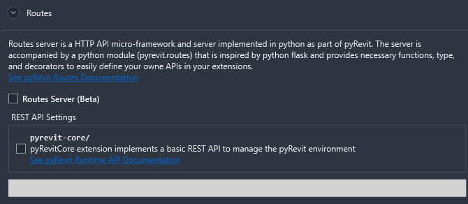
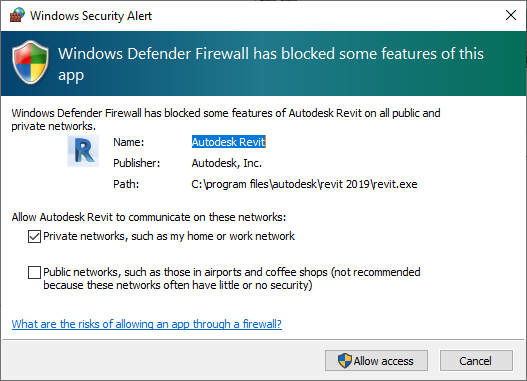
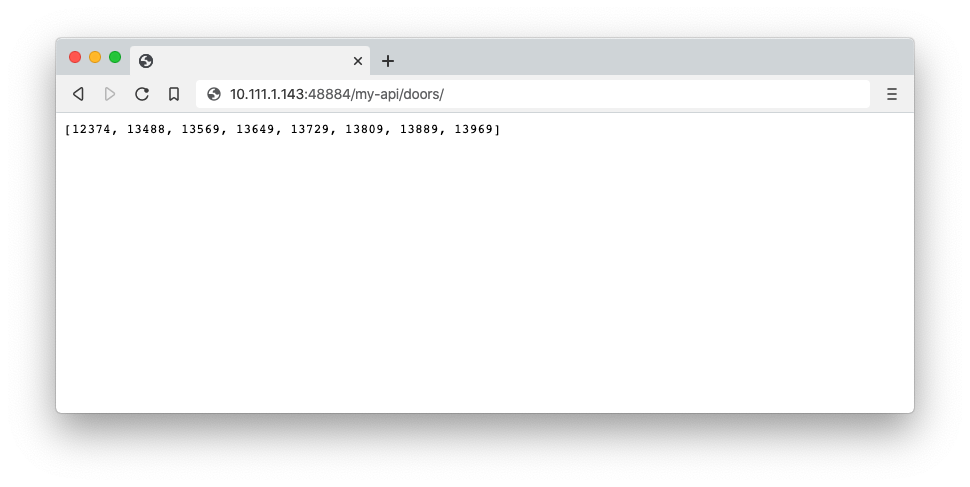
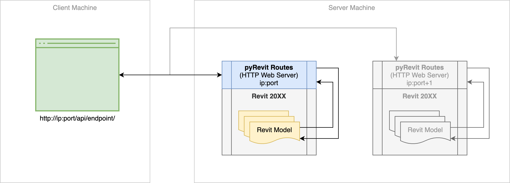

# Routes (HTTP API)

!!! warning ""

    pyRevit Routes is a **DRAFT** and is subject to change  
        There is no authentication mechanism implemented yet

!!! warning ""

    pyRevit Routes is a fairly isolated module under `pyrevitlib/pyrevit/routes/` in pyRevit source. You are encouraged to dive into the code and contribute to the project without affecting the other parts of the pyRevit ecosystem

## What is pyRevit Routes

Let's say we want to create a web application that would display a list of doors in a model. The web application would be split into two parts.

- **Front-end**: the part that runs in the browser and acts as the user interface, and
- **Back-end**: the part that the front-end contacts to send and receive data

While you are free to select whatever toolchain and GUI framework (React, Vue.js, etc) you are comfortable with for the front-end, the challenge has always been on how to create a back-end that has access to Revit contexts and can query or modify Revit documents. What we really needed is to run a HTTP web server over a running Revit instance and manage the HTTP calls in a way that would be executed in Revit context.

The new **Routes** python module, is an HTTP micro-framework to create web APIs running over Revit instances. This means that you can create functionality that could be triggerd from remote. This framework provides the necessary mechanism to create a back-end that has access to Revit context.

!!! tip ""

    **Fun fact:** The Runtime REST API  is implemented using this framework

## Getting Started

Let's create a simple API using the routes module. One important note here is that it is better to place this API inside your extensions' startup script (`startup.py`) so it only runs once per Revit instance.

### Creating Custom HTTP API Extension

Let's create an empty extension that will define our new HTTP API:

```text
MyExtensions/
    └── MyHTTPAPI.extension/
        └── startup.py
```

Note that the extension does not include anything else other than the `startup.py` script.

Now let's open the `startup.py` and import the `routes` module. This module provides the functionality we need to define the API:

```python
# first import the routes module and the Revit DB namespace
from pyrevit import DB, routes
```

Then we need to define a new API...

#### What is a Routes API

Routes API is very similar to a Flask App but at the same time is slightly different. Let's look at the structure of an API end point in pyRevit routes module:

```text
http://machine-ip:server-port/routes-api/api-path/...
			 └── 1      └── 2       └── 3      └── 4
```

1. `machine-ip` is the IP of the machine running Revit and the Routes server
1. `server-port` is the Routes server port
1. `routes-api` is the name of API defined by you. Each program or extension can define their own APIs or extend other APIs as long as the routes do not conflict. This is bascially the root path of all the endpoints defined in your Routes API
1. `api-path/...` is specific routes define in your API e.g. `doors/`

So with that knowledge, we are going to define our new API. We are using `my-api` as the unique name of our custom API:

```python
api = routes.API('my-api')
```

#### API Endpoints

Now that we have the API ready, we can define our API end points. To collect doors from an active Revit model, we would want to **collect (HTTP method GET)** and the **doors/** in active model using our custom API **my-api/**. So our API endpoint would look like this:

`GET my-api/doors/`

Let's define this endpoint. First we need to create a function that collects the doors in the model:

```python
def get_doors(doc):
    """Find doors in given model"""
    doors = DB.FilteredElementCollector(doc)\
                          .OfCategory(DB.BuiltInCategory.OST_Doors)\
                          .WhereElementIsNotElementType()\
                            .ToElements()
```

Notice that we have included a `doc` argument for our function since we do not know what the active document would be when this function is being triggered by a HTTP request from outside. So we would need the routes module to provide us the active document as the `doc` argument. See sections below to learn about other predefined arguments that you can define for your logic functions and the implications of each.

Now that we have our logic function, let's tell the Routes module that this is the function we want to be triggered when an HTTP call is made to the `my-api/doors` end point that we have decided on. The `api` object we created, provides handy decorators to make this process very easy:

```python
@api.route('/doors/')     #<---- add decorator to the function
def get_doors(doc):
    """Find doors in active model"""
    doors = DB.FilteredElementCollector(doc)\
                          .OfCategory(DB.BuiltInCategory.OST_Doors)\
                          .WhereElementIsNotElementType()\
                            .ToElements()
```

You might have noticed that we do not need to include the `my-api` part of the endpoint, since that's the root of our API and all the endpoints defined using `api.route` will end up after the API. So `@api.route('/doors/')` will mark the logic function for `my-api/doors` endpoint.

#### Returning Results

Now that we have the logic connected to the endpoint, we can prepare the doors data we have collected as a Response to be sent back to the caller. Let's say we would want to return the Ids of the doors at this point:

```python
@api.route('/doors/')
def get_doors(doc):
    """Find doors in active model"""
    doors = DB.FilteredElementCollector(doc)\
              .OfCategory(DB.BuiltInCategory.OST_Doors)\
              .WhereElementIsNotElementType()\
              .ToElements()

    # let's grab the integer ids of the door instances
    doors_data = [x.Id.IntegerValue for x in doors]
```

and now we can use the `routes` module again to prepare a reponse:

```python
@api.route('/doors/')
def get_doors(doc):
    """Find doors in active model"""
    doors = DB.FilteredElementCollector(doc)\
              .OfCategory(DB.BuiltInCategory.OST_Doors)\
              .WhereElementIsNotElementType()\
              .ToElements()
    doors_data = [x.Id.IntegerValue for x in doors]

    # create response and return
    return routes.make_response(data=doors_data)
```

We are passing a python list (serializable data type) as the response data to the `routes.make_response()` function. This function has more arguments that you can read about in the sections below but for this example we use the defaults (e.g. HTTP response status defaults to `200 OK`)

Well done. Our API endpoint is ready. Let's fire up Revit and the HTTP server now...

### Starting Up The Routes Server

Let's start Revit. The Routes server is disabled by default. After Revit is fully loaded, open pyRevit Settings, and under the **Routes** section, turn on the server.



The default port for the server is set to `48884` . The first instance of Revit will use the port `48884`, the next Revit instance will use `48885` and so on. See below for information about the **pyRevit Routes Core API** that could be used to inspect the running Revit instances and their port numbers remotely.

Now Restart Revit. This time Revit will run the `startup.py` in your extension and will attemp to start the Routes Server.

Your operating system might ask you if you want to allow the Routes server (now running inside Revit) to open a connection to the outside and start listening on the predefined port number.



Now that your Revit is fully loaded, and the pyRevit Routes server is also running and authorized to listed on the port, we can test our API endpoint:

- First open a model that contains a few doors so our API endpoint has some data to return
- Then go to a different machine on your network, open a browser and type this path in the address bar. Replace the `<machine-ip>` with the IP address of your machine that is running the Revit instance. You can see that in the **Example** provided under the Routes server status message in pyRevit settings

    **`http://<machine-ip>:48884/my-api/doors/`**

You should be able to see a list of door Ids returned as a JSON list object



## Advanced Routing

### Function Arguments

The predefined arguments listed here can be added to your handler functions if needed. The Routes server will set the appropriate value on these arguments if necessary.

- `request` a **routes.Request** object will be passed as this argument that contains information about the request that triggered the execution
- `uiapp` is a reference to the **UIApplication** object provided by Revit runtime
- `uidoc` is a reference to the **UIDocument** object provided by Revit runtime
- `doc` is a reference to the active **Document** object provided by Revit runtime

!!! warning ""

    **IMPORTANT NOTE:** if any of the `uiapp`, `uidoc`, or `doc` arguments are defined in your handler function, the Routes server will assume your handler function needs Revit API context and will execute your function as an **External Event** using the Revit API. This way your handler function can use transactions to make changes to the Revit document and is guranteed to be the only function running in API context

### Defining Routes

The `api.route` decorator can be used to create more complex routes:

#### Request Methods

You can pass the acceptable HTTP methods for your handler function to the decorator as shown below:

```python
@api.route('api/end/point/', methods=["GET", "POST"])
```

The `request` argument on your handler functions can be used to check which HTTP method is being called on the endpoint:

```python
@api.route('api/end/point/method', methods=["GET", "POST"])
def test_method(request):
    if request.method == "POST":
        # do post stuff
    else:
        # do get stuff
```

#### Route Parameters

You can define a series of parameters to be extracted from the endpoint path and passed to the handler function.

Define the parameter following the `/<type:name>/` format e.g. `/<int:door_id>/` in the example below:

```python
# /doors/12
# /doors/2313

@api.route('/doors/<int:door_id>')
def post_id(door_id):
    # do stuff with door_id
```

A few other data types are supported as well (`int`, `float`, `bool`, `uuid`)

```python
@api.route('/doors/<uuid:door_uniqueid>')
def post_uuid(door_uniqueid):
    # do stuff with door_uniqueid
```

#### Request Data

The `request` argument on your handler functions can be used to grab any data being passed to the endpoint:

```python
@api.route('api/end/point/data', methods=["POST"])
def test_data(request):
    if request.data:
        # process data
```

#### Request Headers

The `request` argument on your handler functions can be used to grab request headers:

```python
@api.route('api/end/point/headers', methods=["POST"])
def test_headers(request):
    headers = request.headers  # dictionaty of header key:value
```

### Returning Results

The `routes.make_response` function can be used to prepare a **routes.Response** object:

```python
@api.route('api/end/point/reponse', methods=["POST"])
def mirror(request):
    return routes.make_response(
        data=request.data,
        status=routes.OK,
        headers = {"pyRevit": "v4.6.7"}
    )
```

### Providing Callback URL

API calls to the Routes server can provide a callback URL when the endpoint handler is going to take a lot of time to complete the work. Include the `callbackUrl` in the data sent by the HTTP request:

```json
{
    // your data,
    "callbackUrl": "http://mycallbackserver/api/end/point/callback"
}
```

If callback URL is provided, the server will immediately accept the request and will sent back status `204 NO_CONTENT`

When the handler function completes the work, the Routes server will make a **POST** call to the callback URL and will provide the results on the handler function

### Exceptions

The Routes server will provide information about any exceptions that occur when running your handler function:

```json
{
    "exception": {
        "source": "Autodesk Revit 2019.2 build: 20190808_0900(x64)",
        "message": "ZeroDivisionError: Attempted to divide by zero.\n  File \"...\""
    }
}
```

## pyRevit Routes Core API

pyRevit Routes defines its own core API to help you test the status of the running instances of the Routes server on the target machine. Note that at least one instance of Revit must be running to be able to receive and respond to these calls.

See this page for more information about the routes/ and pyrevit-core/ APIs

- Runtime REST API

## Server Configurations

### Configuring Starting Port Number

Use the pyRevit CLI to configure the starting port number for the Routes servers running on the host machine. First Revit instance will start with this number and other instances will continue up adding one for each instance e.g. 48884 → 48885 → 48886 → ... See Runtime REST API  for methods to know about running Routes servers on a machine

```powershell
# read port number
$ pyrevit configs routes port
Routes Port: 48884

# set port number
$ pyrevit configs routes port <port-number>
```



*Each new Revit instance uses the next available port number*

[pyrevit-routes.drawio](../assets/teams/routes/pyrevit-routes.drawio)

### pyRevit Core API

See Runtime REST API  for pyRevit Core API that provides methods to manage the pyRevit environment itself. This API can be toggled using the pyRevit Settings window or the pyRevit CLI

```powershell
# read core api status
$ pyrevit configs routes coreapi
Routes Core API is disabled

# set core api status
$ pyrevit configs routes coreapi enable
$ pyrevit configs routes coreapi disable
```


!!! warning ""

    Runtime REST API is a **DRAFT** and is subject to change  
        There is no authentication required  
        There are no validations performed on the schema

See the guide below on configuring the TCP port for the Runtime HTTP server

- [pyRevit Configuration](configuration-file.md)

## pyRevit Routes Runtime API `routes/`

### GET status/

Get the status of Routes Server

```json
{
    "host": "Autodesk Revit 2019.2 build: 20190808_0900(x64)",
    "username": "jdoe",
    "session_id": "07ba444f-0494-4c63-ba25-512b099c756e"
}
```

### GET sisters/

Get all the other running instances of Routes server

```json
[
    {
        "host": "Autodesk Revit 2019.2 build: 20190808_0900(x64)",
        "process_id": 8964,
        "server_host": "",
        "server_port": 48884,
        "version": "2019"
    },
    {
        "host": "Autodesk Revit 2021.0 build: 21.0.0.383",
        "process_id": 612,
        "server_host": "",
        "server_port": 48885,
        "version": "2021"
    }
]
```

### GET sisters/\<int:revit\_year\>

Get all the running instances of Routes server on a specific Revit year

```json
[
    {
        "host": "Autodesk Revit 2019.2 build: 20190808_0900(x64)",
        "process_id": 8964,
        "server_host": "",
        "server_port": 48884,
        "version": "2019"
    }
]
```

## pyRevit Core Runtime API `pyrevit-core/`

### POST sessions/

Reload pyRevit remotely into a new session. Returns new session info

```json
{
    "session_id" : "541a2a8d-0954-4f9a-9644-3551c1a2118e"
}
```
