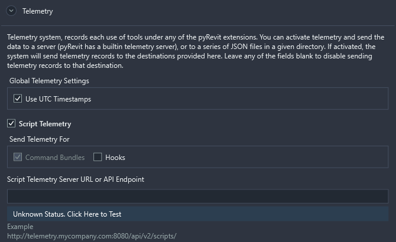
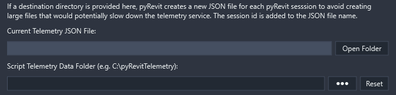
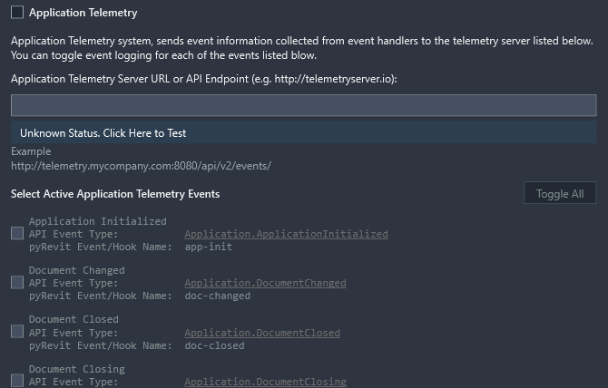
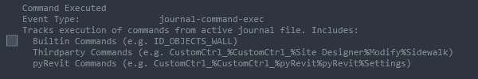

# Telemetry

!!! warning ""

    pyRevit does not collect your data. All your telemetry data is private to you.  
    Telemetry system is optional and is designed to be used internally inside your ogranization.

## What is the Telemetry System

The telemetry system allows you to quickly setup a server and listen to reports being sent from all pyRevit instances being used on all your machines and by your users. It's a feature that benefits you if you are managing and using pyRevit for your team or company.

There are two types of reports being sent by pyRevit

- **Script Execution Reports**  
  Every time a user clicks on a pyRevit tool (or your custom pyRevit tools), the telemetry system will send a report to the server with information about the tool, the environment, and the results. This includes any error messages generated by the engine, alongside any custom data sent by the script.
- **Application Event Reports**  
  Revit has a built-in event system. pyRevit can be configured to listed to these events, generate a report based on the arguments passed to that event, and submit these records to the server. An example would be listening to the "Document Opened" event and sending a report with information about the opened document to the server.

    - **Custom Application Events**  
      pyRevit also provides its own events that can send telemetry data.

## Run a telemetry server

The telemetry server is a separate project: [pyrevitlabs/telemetry-server](https://github.com/pyrevitlabs/telemetry-server). It is a .NET 10 web service that receives the records pyRevit sends and stores them in a database. It no longer ships inside the pyRevit installation.

Pick a machine that the pyRevit machines can reach, and start the server there with Docker and the database you want:

```bash
git clone https://github.com/pyrevitlabs/telemetry-server.git
cd telemetry-server
docker compose -f docker-compose.yml -f docker-compose.postgres.yml up -d
```

The clone provides the compose files; `docker compose` pulls the server image `ghcr.io/pyrevitlabs/telemetry-server`.

The compose files in the server repository cover PostgreSQL, SQL Server, SQLite, Oracle and MongoDB. The server README lists the environment variables (`DbProvider`, `ConnectionStrings__DefaultConnection`, `ASPNETCORE_HTTP_PORTS`) and how to build the server from source.

The server listens on port `8080` by default and exposes:

| Endpoint | Purpose |
|---|---|
| `POST /api/v2/scripts` | script execution records |
| `POST /api/v2/events` | application event records |
| `GET /api/v2/status` | service and database status |
| `GET /metrics` | Prometheus metrics |

Open `http://<server>:8080/api/v2/status` to check that the server is up before you point pyRevit at it.

## Configuring pyRevit Telemetry

### Setting Server Paths

Open pyRevit Settings and under the ***Telemetry*** section, turn on the ***Script Telemetry*** option. Notice that the script telemetry system can also write the logs to files in a given directory but this feature is kept mostly for backwards compatibilty. It is preferred and suggested to use the Telemetry Server for recording pyRevit telemetry data.

Add the url for the script telemetry data formatted as below, inside the server url box. The window shows the status of the server under the box, and the current telemetry file when saving telemetry to files is activated.

`http://your.domain:port/api/v2/scripts/`

- Replace `you.domain` with the server machine IP or domain name. Remember that this machine needs to be accessible from your pyRevit workstations.
- Replace `port` with the port that you started the server with.





### Activating Events

Open pyRevit Settings and under the ***Telemetry*** section, turn on the ***Application Telemetry*** option.  Add the url for the application telemetry data formatted as below, inside the server url box.

`http://your.domain:port/api/v2/events/`

- Replace `you.domain` and `port` similar to above

Now browse through the events list and turn on the events that you want pyRevit to listen to and send their information to the server. **Toggle All** flips each checkbox: checked events become unchecked and unchecked events become checked.



### Timestamp Setting

By default the telemetry system timestamps all the records in UTC time format. Turning off **Use UTC Timestamps**, under *Global Telemetry Settings*, timestamps the records to the machine local time.

### Command Execution Events

pyRevit can also track command executions by listening to the changes to the active journal file. This helps providing telemetry information about any command (builtin, third-party, or pyRevit). Activate the command execution events under Application Telemetry events list.



### Hook Execution Events

You can also track the execution of the hook scripts defined in your extensions. Turn the **Hooks** option on under *Send Telemetry For* section to send the hooks telemetry to your server

You can also send custom data as part of the hook telemetry:

```python
from pyrevit import forms
from pyrevit import EXEC_PARAMS
from pyrevit import script

results = script.get_results()
results.timesaved = 10
```

### Configuring Telemetry System Using pyRevit CLI

Checkout the pyRevit CLI documentation below and look under the configuration section.

- [Configure pyRevit](../cli/configure.md)

### Manually Setting the Telemetry System Configuration

Checkout the pyRevit configuration page and look under the telemetry configs section.

- [pyRevit Configuration](configuration-file.md)

## Reading Telemetry Records

Most of the information provided in telemetry records are self-explanatory like timestamps, bundle names, Revit versions, etc. The sections below describe the more complex data included in the records.

### Execution Result Codes

pyRevit returns an interger code as the result of each script execution. The snippet here, shows what each of these values mean. If the result value is anything other than `Succeeded`, pyRevit will fill the *Trace Message* field on the record data with information about the exception, collected from the execution engine e.g IronPython or CLR engines. See [Executor](../runtime/executor-result-codes.md)  for the Result Codes table.

### Custom Telemetry Data

See the  [Sending Custom Telemetry Data](../build-extensions/scripting/custom-telemetry.md)  below, on how to add custom data to the telemetry record inside your pyRevit scripts.

## Application Event Arguments

Sections below, list the schema for the JSON objects recorded in the `args` field of the application events telemetry records. You can read and parse this information in your analytics platform to gather more information about the active users, revit verisons, active documents, views, element changes, and many others. The data is collected from the evetn argument object passed by Revit to the event handlers. Each section below, lists one of the event argument objects with a link to the API documentation, and its associated JSON schema in pyRevit telemetry records.

#### Application Events

- **File Exporting**
- **File Exported**

```json
{
    "export_path": String,
    "export_format": String,
}
```

- **File Importing**
- **File Imported**

```json
{
    "import_path": String,
    "import_format": String,
}
```

- **Linked Resource Opening**  
  Revit ≥ 2018
- **Linked Resource Opened**  
  Revit ≥ 2018

```json
// Revit >= 2018
{
    "link_path": String,
    "link_type": String,
}
```

- **Progress Changed**

```json
{
    "stage": String,
    "caption": String,
    "position": Integer,
    "lower": Integer,
    "upper": Integer,
}
```

- **Dialog Box Showing**

```json
{
    "dialog_id": String   // Revit >= 2017, otherwise null
}
```

- **Displaying Options Dialog**

```json
{
    "page_count": Integer
}
```

- **Dockable Frame Visibility Changed**  
  Revit ≥ 2015

```json
{
    "pane_id": String,
    "frame_shown": Boolean
}
```

- **Dockable Frame Focus Changed**  
  Revit ≥ 2015

```json
{
    "pane_id": String,
    "focus_gained": Boolean
}
```

- **Fabrication Part Browser Changed**  
  Revit ≥ 2017

```json
{
    "operation": String,
    "service_id": Integer,
    "solutions_count": Integer
}
```

- **Transferring Project Standards**  
  Revit ≥ 2018

```json
{
    "from_document": {
        "docname": String,
        "docpath": String,
        "projectnum": String,
        "projectname": String
    },
    "to_document": {
        "docname": String,
        "docpath": String,
        "projectnum": String,
        "projectname": String
    },
    "external_items": {
        "<item_guid>": "<item_name>",
        // ...
    }
}
```

- **Transferred Project Standards**  
  Revit ≥ 2018

```json
{
    "to_document": {
        "docname": String,
        "docpath": String,
        "projectnum": String,
        "projectname": String
    },
    "external_items": {
        "<item_guid>": "<item_name>",
        // ...
    }
}
```

#### Document Events

- **Document Changed**

```json
{
    // type of operation: DB.Events.UndoOperation
    "operation": String,

    // number of elements added, deleted, and modified
    "added": Integer,
    "deleted": Integer,
    "modified": Integer,

    // list of name of transactions recorded as part of this change
    "txn_names": String[],
}
```

- **Document Created**
- **Document Opened**
- **Document Saved**

```json
{
    // project information
    "project_info": {
        // project information properties
        "org_name": String,
        "org_description": String,
        "project_number": String,
        "project_name": String,
        "project_client_name": String,
        "project_building_name": String,
        "project_issue_date": String,
        "project_status": String,
        "project_author": String,
        "project_address": String,
        // custom project info parameters
        "project_parameters": Object,
        // Example
        // {
        // 	"<parameter_name>": Object,
        // 	...
        // }
    },
}
```

- **Document Saving As**

```json
{
    "as_master_file": Boolean,
    "path": String
}
```

- **Document Saved As**

```json
{
    // project information
    "project_info": {
        // project information properties
        "org_name": String,
        "org_description": String,
        "project_number": String,
        "project_name": String,
        "project_client_name": String,
        "project_building_name": String,
        "project_issue_date": String,
        "project_status": String,
        "project_author": String,
        "project_address": String,
        // custom project info parameters
        "project_parameters": Object,
        // Example
        // {
        // 	"<parameter_name>": Object,
        // 	...
        // }
    },
    "as_master_file": Boolean,
    "original_path": String
}
```

- **Document Printing**

```json
{
    // list of view info selected for printing
    "views": [{
            "type": String,
            "family": String,
            "name": String,
            "title": String
        },
        // ...
    ],
    // Revit >=2017, includes print settings info, otherwise null
    "settings": {
        "color_depth": String,
        "hidden_line_view_type": String,
        "hide_cropbounds": Boolean,
        "hide_refplanes": Boolean,
        "hide_scopeboxes": Boolean,
        "hide_unref_viewtags": Boolean, // Revit >=2014, otherwise null
        "margin_type": String,
        "mask_lines": String,           // Revit >= 2015, otherwise null
        "page_orientation": String,
        "paper_placement": String,
        "paper_size": String,
        "paper_source": String,
        "raster_quality": String,
        "halftone_thinlines": Boolean,
        "user_margin_x": Double,
        "user_margin_y": Double,
        "blue_hyperlinks": Boolean,
        "zoom": Double,
        "zoom_type": String,
    }
}
```

- **Document Printed**

```json
{
    // list of view info for printed views
    "print_pass_views": [{
            "type": String,
            "family": String,
            "name": String,
            "title": String
        },
        // ...
    ],
    // list of view info for views that failed to print
    "print_fail_views": [{
            "type": String,
            "family": String,
            "name": String,
            "title": String
        },
        // ...
    ]
}
```

- **Document Synchronizing With Central**

```json
{
    "comments": String,
    "location": String,
    "options": {
        "comment": String,                 // Revit >=2014, otherwise null
        "compact": Boolean,                // Revit >=2014, otherwise null
        "relinquish_borrowed": Boolean,
        "relinquish_family_worksets": Boolean,
        "relinquish_projectstd_worksets": Boolean,
        "relinquish_user_worksets": Boolean,
        "relinquish_view_worksets": Boolean,
        "save_local_after": Boolean,       // Revit >=2014, otherwise null
        "save_local_before": Boolean,      // Revit >=2014, otherwise null
    }
}
```

- **Document Synchronized With Central**

```json
{
    "status": String
}
```

- **Element Type Duplicating**  
  Revit ≥ 2015

```json
{
    "category": String,
    "from_typename": String,
}
```

- **Element Type Duplicated**  
  Revit ≥ 2015

```json
{
    "category": String,
    "from_typename": String,
    "to_typename": String,
    "to_typeid": Integer,
}
```

- **Failures Processing**

```json
{
    "txn_committing": Boolean,
    "pending": Boolean,
    "permits_resolution": Boolean,
    "permits_deletion": Boolean,
    "active": Boolean,
    "txn_name": String,
    "severity": String,
    "messages": {
        // dict of failure information by failure GUID
        "<failure_guid>": {
            "description": String,
            "severity": String,
            "failing_elements_count": Integer,
            "has_resolutions": Boolean,
            "resolutions_count": Integer,
            "current_resolution": String,
            "default_resolution": String,
            "attempted_resolutions": String[]
        },
        // ...
    },
    "can_rollback": Boolean,
    "can_commit": Boolean,
}
```

- **Family Loading Into Document**  
  Revit ≥ 2015

```json
{
    "family_name": String,
    "family_path": String,
}
```

- **Family Loaded Into Document**  
  Revit ≥ 2015

```json
{
    "family_name": String,
    "family_path": String,
    "family_category": String,
    "original_family_name": String
}
```

- **Formula Editing**  
  Revit ≥ 2019

```json
{
    "param_id": Integer,
    "param_name": String,
    "formula": String
}
```

#### Document View Events

- **View Activating**
- **View Activated**

```json
{
    "from_view": {
        "type": String,
        "family": String,
        "name": String,
        "title": String
    },
    "to_view": {
        "type": String,
        "family": String,
        "name": String,
        "title": String
    }
}
```

- **View Exporting**  
  Revit ≥ 2018
- **View Exported**  
  Revit ≥ 2018

```json
{
    "view": [{
        "type": String,
        "family": String,
        "name": String,
        "title": String
    }]
}
```

- **View Printed**

```json
{
    "view": [{
        "type": String,
        "family": String,
        "name": String,
        "title": String
    }],
    "view_index": String,
    "total_views": String,
}
```

- **View Printing**

```json
{
    "view": [{
        "type": String,
        "family": String,
        "name": String,
        "title": String
    }],
    "view_index": String,
    "total_views": String,
    // Revit >=2017, includes print settings info, otherwise null
    "settings": {
        "color_depth": String,
        "hidden_line_view_type": String,
        "hide_cropbounds": Boolean,
        "hide_refplanes": Boolean,
        "hide_scopeboxes": Boolean,
        "hide_unref_viewtags": Boolean, // Revit >=2014, otherwise null
        "margin_type": String,
        "mask_lines": String,           // Revit >= 2015, otherwise null
        "page_orientation": String,
        "paper_placement": String,
        "paper_size": String,
        "paper_source": String,
        "raster_quality": String,
        "halftone_thinlines": Boolean,
        "user_margin_x": Double,
        "user_margin_y": Double,
        "blue_hyperlinks": Boolean,
        "zoom": Double,
        "zoom_type": String,
    }
}
```

#### Command Execution Events

- **Command Executed**

```json
{
    "command-id": String
}
```

!!! warning ""

    Telemetry Server API is a **DRAFT** and is subject to change  
        There is no authentication required to use the API

## API Version 2.0

### Endpoint: `api/v2/`

### Check Status GET status/

```json
{
  "status": String // "pass" or "fail"
  "version": String // "0.17"
  "output": String // ""
  "serviceid": UUID // "efcf68fc-7996-4213-a06f-d5d78b7f53c0"
  "checks": {
    "<dbname>": {  // "postgres"
      "status": String // "pass" or "fail"
      "version": String // "PostgreSQL 10.9, compiled by Visual C++ build 1800, 64-bit"
      "output": String // ""
    }
  }
}
```

### Add Script Telemetry Record POST scripts/

Creates a new script telemetry record on the records database.

```json
{
    "meta": {
        "schema": "2.0"
    },
    "timestamp": String, // "2019-08-13T13:40:01.4545Z"
    "username": String, // "jdoe"
    "host_user" : String, // "WORKSTATION-01\\jdoe"
    "revit": String, // "2019"
    "revitbuild": String, // "20181217_1515(x64)"
    "sessionid": UUID, // "541a2a8d-0954-4f9a-9644-3551c1a2118e"
    "pyrevit": String, // "4.7-beta:1a6e1d8"
    "clone": String, // "dev"
    "debug": Boolean, // false
    "config": Boolean, // false
    "from_gui": Boolean, // true
    "exec_id": String, // "dXVpZA=="
    "exec_timestamp": String, // "2019-08-13T13:40:01.4545Z"
    "commandname": String, // "Settings"
    "commanduniquename": String, // "pyrevitcore-pyrevit-pyrevit-settings"
    "commandbundle": String, // "Settings.pushbutton"
    "commandextension": String, // "pyRevitCore"
    "docname": String, // "Project1"
    "docpath": String, // "C:\\path\\to\\Project1.rvt"
    "resultcode": Integer, // 0
    "commandresults": Object, // string values: { "time_saved": "30" }
    "scriptpath": String, // "C:\\path\\to\\Bundle.bundle\\script.py"
    "trace": {
        "engine": {
            "type": String, // "ironpython"
            "version": String, // "277"
            "syspath": String[], // [ "path\\", "path\\" , "path\\" ],
            "configs": Object // varies per engine type, see below
        },
        "message": String, // "Error: This is the err message."
    }
}
```

#### IronPython Engine Configurations Schema (trace.engine.configs)

```json
"configs": {
    "clean" : String, // "True" or "False"
    "persistent" : String,
    "full_frame" : String
}
```

## Add Application Event Telemetry Record

### POST events/

Creates a new application events telemetry record on the records database.

```json
{
    "meta" : {
        "schema" : "2.0"
    },
    "timestamp" : String,          // "2019-08-13T13:40:29.4545Z"
    "type" : String,               // "view-activated"
    "args" : Object,               // { "document": "path\\" }
    "username" : String,           // "jdoe"
    "host_user" : String,          // "WORKSTATION-01\\jdoe"
    "revit" : String,              // "2019"
    "revitbuild" : String,         // "20181217_1515(x64)"
    "cancellable" : Boolean,       // false
    "cancelled" : Boolean,         // false
    "docid" : Integer,             // 0
    "doctype" : String,            // "",
    "doctemplate" : String,        // "",
    "docname" : String,            // "Project1"
    "docpath" : String,            // "C:\\path\\to\\Project1.rvt"
}
```
