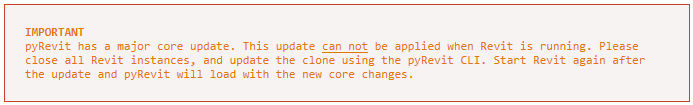

# Update and maintain deployments

Now that the CLI is installed on the user machine, we can create user login scripts that run every time the user logs in and would update the pyRevit clones and extensions.

```powershell
function Update-PyRevit() {
    Write-Output "Updating pyRevit..."
    pyrevit clones update $ourclonename
    pyrevit extensions update $ourextname
}
```

If you are deploying pyRevit's original clone or your own clone as a git repository (when no deployment is specified in the `pyrevit clone` command), then the users can use the **Update** tool from the interface to keep their clone and extensions updated.

## COREUPDATE

!!! warning ""

    This only affects pyRevit cores that are deployed as a git repository.

If you are managing your own pyRevit core, there are times that you might change a binary in the repo or make changes to files that are normally blocked when pyRevit is loaded in Revit. For example, most of the DLLs inside the `bin/` directory are blocked when Revit is up since they are loaded in to the Revit application memory. `COREUPDATE` convention can help you notify users when such changes are made to the core.

When you are merging such changes into your pyRevit core repo, start the commit message with `COREUPDATE`. The pyRevit Update tool fetches the changes before pulling them into the local clone, and when seeing this commit message on the new changes, it will show the prompt below and will notify the user that Revit needs to be closed for this update.


