# Testing

**All first-party automated tests run in CI unless they use the Revit API or require installed/running Revit.** This includes dependencies and fixtures. Revit-dependent tests run locally; vendored tests are outside this policy. The self-hosted [`revit-integration.yml`](ci-cd.md#revit-integration-tests) workflow is a separate release-gate load check, not part of the shared test runner.

To run a change locally, see the workflow in [`dev-guide.md`](dev-guide.md). For how CI/CD is wired, see [`ci-cd.md`](ci-cd.md). For the checks that gate a release, see [`release-qualification.md`](release-qualification.md).

## Running API-free tests

From the repository root on Windows, with the product's .NET SDKs installed:

```powershell
python dev/tests/run_tests.py --install-dependencies
python dev/tests/run_tests.py --list
python dev/tests/run_tests.py
```

Dependencies are pinned in `Pipfile.lock`. An existing development environment can use `pipenv run test`. Add `--language python` or `--language dotnet` for one language. `--list` inventories Revit suites without executing them. Several C# suites test the deployed `bin` tree, so build the product (`cd build && dotnet run -c Release -- ci`) before running the C# selection; the runner stops with that instruction when `bin` is missing.

CI uses the same runner: Python checks, product build, then C# tests. Product builds do not execute fixtures. Results, inventory and coverage go into a fresh `.test-results/<run>/` directory and are uploaded even on failure. See [CI/CD](ci-cd.md).

## Implemented test suites

```mermaid
flowchart LR
    Runner["run_tests.py<br/>CI and local API-free execution"] --> Python["Python<br/>test_*.py under dev/, pyrevitlib/pyrevit/unittests/, extensions/<br/>*_tests.py under extensions/"]
    Runner --> Loader
    Runner --> Runtime
    Runner --> Labs
    Runner --> Build["Build.Tests"]

    subgraph Loader["Loader tests"]
        Parser["pyRevitExtensionParser.Tests"]
        Builder["pyRevitAssemblyBuilder.Tests"]
        Integration["pyRevitLoader.Integration.Tests"]
    end

    subgraph Runtime["Shared scripting runtime"]
        SharedRuntime["pyRevitLabs.PyRevit.Runtime.Tests"]
        RuntimeInterop["pyRevitLabs.PyRevit.Runtime.Shared.Tests"]
    end

    subgraph Labs["Labs tests"]
        CLI["pyRevitCLI.Tests"]
        Doctor["pyRevitDoctor.Tests"]
        Common["pyRevitLabs.Common.Tests"]
        Emojis["pyRevitLabs.Emojis.Tests"]
        Config["pyRevitLabs.Configurations.Tests"]
        INI["pyRevitLabs.Configurations.Ini.Tests"]
        Facade["pyRevitLabs.PyRevit.Tests"]
        Deployment["pyRevitLabs.PyRevit.Integration.Tests"]
        Products["pyRevitLabs.TargetApps.Revit.Tests"]
        Agent["pyRevitLabs.PyRevit.Runtime.Agent.Tests"]
        CPython["pyRevitLabs.PyRevit.Runtime.CPython.Tests"]
        EnvVars["pyRevitLabs.PyRevit.Runtime.EnvVars.Tests"]
        Renderer["pyRevitLabs.PyRevit.Renderer.Tests"]
        Shell["pyRevitLabs.PyRevit.Shell.Tests"]
        Forms["pyRevitLabs.PyRevit.Forms.Tests"]
        FormsBinding["pyRevitLabs.PyRevit.Forms.Binding.Tests"]
        FormsIronPython["pyRevitLabs.PyRevit.Forms.IronPython.Tests"]
    end

    Local["Local Revit validation<br/>Outside CI"] --> Hosted["Python library and agent suites<br/>DevTools commands"]
    Local --> Fixtures["Revit-tagged C# fixtures<br/>Fixture-specific host setup"]
```



The implemented CI selection has **23 C# projects across 39 runs** (37 project/framework runs plus a second IronPython engine for the shell and IronPython forms suites, which declare both engines in their csproj `PyRevitTestEngines` property) and the API-free Python suite. The legacy mixed suite is split by owner with its former MSTest cases converted to NUnit. Local validation on 2026-11-21: **3,970 C# cases and 818 Python cases, zero skips**. Counts include each framework and engine run. The three forms suites open real WPF windows, so they need an interactive desktop session; the hosted Windows runner provides one. Local Revit results are separate; a general C# in-Revit runner is not implemented.

Level describes the test; Environment determines where it runs:

| Level | Tests |
|---|---|
| Unit | Isolated behavior |
| Integration | Boundaries such as files, configuration, subprocesses or interpreters |
| E2E | A built product completing a user workflow |
| Performance | Repeatable workloads compared with an explicit baseline |

Regression is a purpose, not a level. Bug fixes need a reproducer at the lowest useful level, an issue reference, and a `regression` marker (pytest), `Regression` category (NUnit/MSTest), or `Purpose=Regression` trait (xUnit).

## Ownership and placement

Keep C# tests in separate assemblies beside their owning area, normally `dev/<area>/tests/<Module>.Tests/`. NUnit, MSTest and xUnit are supported. A reviewed framework migration must preserve cases, effective tags, fixture isolation and coverage floors. Share discovery and policy; keep fixtures with their owners. Cross-component tests belong in an explicit integration suite.

| Area | Suite locations |
|---|---|
| Parser | `dev/pyRevitLoader/tests/pyRevitExtensionParser.Tests/` |
| Assembly builder, session services, hooks and ribbon | `dev/pyRevitLoader/tests/pyRevitAssemblyBuilder.Tests/` |
| Parser-to-command integration | `dev/pyRevitLoader/tests/pyRevitLoader.Integration.Tests/` |
| Shared scripting runtime | `dev/pyRevitLabs.PyRevit.Runtime/tests/pyRevitLabs.PyRevit.Runtime.Tests/` |
| CLI, doctor, Common, Emojis, configuration, PyRevit facade, agent, CPython and env-var adapters | Named projects under `dev/pyRevitLabs/tests/` |
| Deployment, config seeding and install-scope integration | `dev/pyRevitLabs/tests/pyRevitLabs.PyRevit.Integration.Tests/` |
| Product metadata, add-on paths and cache files | `dev/pyRevitLabs/tests/pyRevitLabs.TargetApps.Revit.Tests/` |
| Dynamo interop and graph contracts | `dev/pyRevitLabs/tests/pyRevitLabs.PyRevit.Runtime.Shared.Tests/` |
| Build pipeline | `build/tests/` |
| API-free Python tooling/library checks | `dev/tests/python/**/test_*.py` |
| Hosted Python library tests | `pyrevitlib/pyrevit/unittests/` |
| Hosted agent tests and manual checks | DevTools command bundles under `extensions/` |

Each suite's README owns its fixtures, maintainer, frameworks/engines and focused commands. Small repository helpers live in `dev/tests/csharp/`; loader helpers live in `dev/pyRevitLoader/tests/TestSupport/`. A shared base class is not mandatory.

Reorganized C# suites appear in area solutions for navigation, without default solution-build selection. The shared runner builds them explicitly; product builds must not build tests for every interpreter configuration.

## Test levels and regression coverage

| Level | Contract | Execution |
|---|---|---|
| Unit | Isolated behavior without external services or user configuration | CI when API-free; local when using the Revit API |
| Integration | Real boundaries such as files, configuration backends, subprocesses, or interpreter interoperability | CI when API-free; local when using the Revit API |
| E2E | Built product completes a user workflow with objective assertions | CI for API-free workflows, such as an isolated CLI workflow; local for Revit workflows |
| Performance | Repeatable workload with explicit measurements and a comparison baseline | CI when API-free; local when using the Revit API |

Regression describes a test's purpose and can apply at any level. A bug fix must include a reproducer at the lowest effective level, with the issue reference recorded in test metadata or its contract documentation. A source-inspection assertion may guard a structural contract but does not replace execution of changed behavior.

## Tags and discovery

Every automated test needs literal Environment and Level metadata. Class/module defaults and method overrides are supported:

| Framework | Example defaults |
|---|---|
| NUnit | `[Category("HostFree")]`, `[Category("Unit")]` |
| MSTest | `[TestCategory("HostFree")]`, `[TestCategory("Unit")]` |
| xUnit | `[Trait("Environment", "HostFree")]`, `[Trait("Level", "Unit")]` |
| Python | `TEST_ENVIRONMENT = "HostFree"`, `TEST_LEVEL = "Unit"` |

Use `Revit` for any Revit dependency and one of the four levels above. Every Python module declares the module-level literals; a class may refine them with class attributes. A class or method cannot downgrade a Revit fixture to HostFree. A C# category must be an Environment, a Level or the `Regression` purpose; any other value, such as a misspelled `Revti`, fails discovery instead of silently inheriting the class defaults. C# tags are read only from the method, its class and enclosing types, never from a base class, so a derived fixture must repeat its tags; a `[Test]` declared on an abstract base is cataloged once under the base, not per derived class. HostFree Python modules must be safe to import; isolate API-dependent imports and fixture initialization. Hosted `unittest` modules use plain assignments without importing pytest. API-free pytest cases can override defaults with `@pytest.mark.environment(...)` and `@pytest.mark.level(...)`.

- **C#:** evaluated `IsTestProject=true` projects under `dev/` and `build/`, all declared frameworks, and native discovery. No class/project allowlist.
- **Python:** `test_*.py` under first-party `dev/`, `pyrevitlib/pyrevit/unittests/`, and `extensions/`, plus `*_tests.py` under `extensions/` only (the extensions' in-Revit suite convention; elsewhere it would match the runner and manual scripts), each module listed once. Discovery skips only `dev/modules/`, `.git`, `.venv`, `site-packages`, and `bin`/`obj` beside a project file; any other folder, such as `lib/modules`, is first-party. Metadata is read before imports; pytest runs eligible `unittest` cases too.
- **Fail closed:** missing/invalid metadata, missing reports, empty selected suites/frameworks, a C# run executing fewer tests than its cataloged HostFree methods, and skipped/expected-failure HostFree cases fail validation. Every explicitly selected Python module needs eligible cases, even when its neighbors pass. Revit cases are excluded before fixtures run. The skip and expected-failure rejection applies when the runner invokes pytest (it sets `PYREVIT_STRICT_SKIPS`); ad hoc `pytest` runs keep normal skip semantics.

Adding a test or adjacent project must not require changing a central list. Network/elevation requirements must be provisioned or isolated, not used to silently exempt HostFree tests from CI.

`dev/tests/python/library/test_diagnose_invisibility_page.py` runs the real `report.js` of the Diagnose Invisibility report in a headless Edge or Chrome, through `fixtures/diagnose_invisibility_page/harness.html`, with a stubbed WebView2 bridge. Set `PYREVIT_TEST_BROWSER` to a browser executable to override the lookup. A missing browser fails the module when `CI` is set and skips it otherwise.

## Test quality

- Assert outcomes and propagate failures. Printed comparisons, dialogs and debugger launchers are manual checks.
- Use private temporary fixtures. Restore configuration, environment, imports and process-wide caches; never deploy test builds into an active clone.
- Bound subprocesses and concurrent waits. Sleeps alone do not prove synchronization. Parallelize only isolated fixtures.
- Test failure, cleanup, rollback and concurrency behavior where applicable. Source inspection does not replace execution tests.
- Missing required fixtures fail. Quarantines need an issue, reason, owner and review within **14 days**. The module maintainer owns them; otherwise the author does. Extensions require recorded review, and retries must preserve the original failure.

## Test matrix and pitfalls

A pass on one machine, one engine, one Revit year and one model proves little: most bugs reviewers and release testers find come from a case the author never tried. Before a feature or fix is merged, the author goes through the axes below and either runs the cases that apply or says in the PR which ones were not run and why. Reviewers use the same list. [`release-qualification.md`](release-qualification.md) runs the cases that matter for every release; this section is the version for a single change.

Not every axis applies to every change. A change to a `pyrevitlib` helper that formats lengths needs *Units* and *Locale and text*; a change to a CLI command needs *Environment* and *Failure paths*. Pick by what the code touches, not by effort.

Revit-dependent cases run locally (see [Revit integration tests](#revit-integration-tests)); a case that needs no Revit belongs in an API-free test that CI runs (see [Tags and discovery](#tags-and-discovery)). The `pyrevit` CLI commands used below are listed in [`dev-guide.md`](dev-guide.md#running-several-clones-at-the-same-time) and [`cli/doctor-launch-update.md`](cli/doctor-launch-update.md).

### Engine

| Case | How to reach it | A pass looks like |
|---|---|---|
| IronPython 2.7.12 (default) | `pyrevit launch <clone> default <year> --isolated` | The script runs and gives the same result as on the other engines |
| IronPython 3.4.2 | `pyrevit launch <clone> 342 <year> --isolated` | Same |
| CPython 3.12 | A script with a `#! python3` shebang in any session | Same, including after **Reload** (the interpreter stays up for the whole Revit session) |

The IronPython version is fixed per session, so each one needs its own session.

Run `pipenv run check-py3 <path>` for what it can see (see [Linters](#what-the-linters-catch)). Everything in the tables below that the linters miss needs a run on the engine named in the first column.

#### Known traps per engine

| Engine | Trap | Linted |
|---|---|---|
| IronPython 2.7 | `/` on two integers truncates: `500 / 180` is `2`. Add `from __future__ import division` or use a float operand | No |
| IronPython 2.7 | A non-ASCII character in the source without a `# -*- coding: utf-8 -*-` line is a `SyntaxError` and the button does not load. CPython and IronPython 3 read source as UTF-8 and do not need the line | No |
| IronPython 2.7 | `io.open(path, encoding="utf-16")` silently returns an empty string instead of the file's text. Check what a read returned, or read bytes and decode them | No |
| IronPython 2.7 | `str` is bytes and `unicode` is text; `"é"` and `u"é"` are different types, and mixing them raises `UnicodeDecodeError` once a non-ASCII name arrives. `unicode` itself does not exist in Python 3, so use `six.text_type` for code that runs on every engine | Partly: `check-py3` flags the name `unicode` |
| IronPython 2.7 | `**kwargs,` with a trailing comma in a signature or call does not parse | Yes: `check_ipy2_compat.py`, run by a pre-commit hook on `pyrevitlib/` only |
| IronPython 3.4.2 | `print` in a session without a console fails with `unknown encoding: codepage___0`. Write to `script.get_output()` or a logger | No |
| IronPython 3.4.2 | A script that leaves a Python worker thread running when it returns can end with `engine_error` and no traceback. Join every thread before the script ends | No |
| CPython 3.12 | `open()` without `encoding=` uses the Windows ANSI code page (usually cp1252), not UTF-8. Always pass `encoding="utf-8"` | No |
| CPython 3.12 | pythonnet has no named indexers (`element.Parameter[...]`, `element.Geometry[...]`, `element.BoundingBox[view]`); call the `get_` method instead | Partly: `CLR-NAMED-INDEXER` in `check-py3` flags only `Parameter` and `Geometry` |
| CPython 3.12 | Interface-typed properties return the interface, not the concrete object; see [Differences from IronPython](build-extensions/scripting/cpython.md#differences-from-ironpython) | No |

The last column says whether a linter reports the trap. "No" means only a run on that engine finds it.

### Units

| Case | How to reach it | A pass looks like |
|---|---|---|
| Metric project | A scratch document from `app.NewProjectDocument(DB.UnitSystem.Metric)`, or **Manage > Project Units** | Displayed numbers, thresholds and parsed input match the project units |
| Imperial project | The same with `DB.UnitSystem.Imperial` | Same |
| Internal feet | Read the raw `Parameter.AsDouble()` of a length, area, volume or angle | No raw internal value reaches a user, a threshold or a written file unless the file's format says it is feet |

Revit stores lengths in feet, areas in square feet, volumes in cubic feet and angles in radians, whatever the project shows. Convert with `UnitUtils.ConvertFromInternalUnits` / `ConvertToInternalUnits` and a `ForgeTypeId`. The `pyrevit.revit.units` helpers `format_length`, `format_area` and `format_slope` follow the document's display units, but `parse_length` and `parse_slope` do not: `parse_length` treats a bare number as feet, so input that should follow the project's units needs explicit units or a parser that reads them. `DisplayUnitType` does not exist on newer Revit years (see [Revit year](#revit-year)). A fixed number in a script, such as `if length > 500`, is a unit bug unless it says which unit it is in. Include area, volume and an angle in the cases, and a value that rounds differently in the two systems.

### Locale and text

| Case | How to reach it | A pass looks like |
|---|---|---|
| Non-English Revit UI | `pyrevit launch ... --language=<code>` with a Latin language other than English and a non-Latin one | The code finds the same elements as in English |
| Decimal comma | A Windows user whose regional format is, for example, German | Numbers shown, parsed and written use one format on purpose; a file meant for a machine is not locale-dependent |
| Non-ASCII names | Cyrillic, CJK and umlauts in element, parameter, family and view names, in paths and in the output window | Names are found, displayed and written without `?` or an exception |
| pyRevit language | `user_locale` set to a locale the bundles are translated to in the session's config (see [`config-api.md`](config-api.md)) | Titles and tooltips are translated and the button runs |

Look categories up with `BuiltInCategory` and parameters with `BuiltInParameter` or a shared parameter GUID, never by their localized name: `"Walls"` is not `"Wände"`. Compare `element.Name` only for names the user typed. Pass `encoding=` on every file read and write.

### Revit year

| Case | How to reach it | A pass looks like |
|---|---|---|
| One year per runtime group | Revit 2021-2024 (.NET Framework 4.8), 2025-2026 and 2027 and later; see [Revit versions and .NET](adding-revit-version.md#revit-versions-and-net) | The change works on one year of each group the code can run on |
| Revit 2025 or 2026 on .NET 8 and on .NET 10 | A 2025 or 2026 host before and after its `.5` update (.NET 10); the pyRevit assemblies target .NET 8 in both | Same result on both hosts |
| Oldest and newest supported year | `pyrevit launch <clone> default <year> --isolated` | Same, and the code uses no API the oldest year lacks |

Some API changes alter behaviour instead of removing a member: `ElementId` moved from `int` to `long` (use `get_elementid_value_func()` from `pyrevit.compat` instead of `.IntegerValue`), and `DisplayUnitType` gave way to `ForgeTypeId`. `pipenv run check-revit-api` finds uses that are not protected for every year the code can run on (see [`revit-api-compat.md`](revit-api-compat.md)); it checks the API surface, not whether the result of a changed member is the same.

### Document state

| Case | How to reach it | A pass looks like |
|---|---|---|
| No document open | Start Revit and stay on the start page | The button stops with a message; nothing raises |
| Family document | Open a `.rfa` and run the button | Same |
| Linked model | A project with a Revit link; select an element of the link | The code uses the link's document and transform, not the host's |
| Workshared model | A central model with elements owned by another user | A refused edit is reported and does not abort the rest |
| Design options, phases | A model with a second design option and phase | The code sees the elements it should, not every option's |
| Read-only model | Open a model read-only | An edit or save that Revit refuses is reported clearly |
| Detached model | Open a workshared model with **Detach from Central** | Supported edits and saves work on the separate model without syncing to the original central model |

### View and selection

| Case | How to reach it | A pass looks like |
|---|---|---|
| Active view type | Run on a sheet, a schedule, a 3D view, a legend and a plan | Each either works or stops with a message |
| Selection | Empty, one element, many, and an element of a link | Each either works or asks for a selection |

### Environment

| Case | How to reach it | A pass looks like |
|---|---|---|
| Spaces and non-ASCII in the user name and clone path | A second Windows account or a virtual machine; a clone path with a space and a non-ASCII letter | pyRevit loads, the button runs, and its files are read and written |
| Per-user and all-users install | The two installers, see [`installers.md`](installers.md) | The same behaviour, including where files are read and written |
| Light and dark theme | Revit 2024+: switch the Revit theme option (see [`theming.md`](theming.md)) | Forms and report pages are readable in both |
| High DPI | Windows display scaling of 150 % or more | Dialogs and report pages are not clipped |

### Failure paths

| Case | How to reach it | A pass looks like |
|---|---|---|
| The user cancels | Cancel every dialog and press Escape during a pick | The model is unchanged and no traceback appears |
| A transaction fails or rolls back | Make the edit invalid, for example a read-only parameter | The group or transaction is rolled back and the user is told |
| The script errors halfway | Raise after the first edit | No half-applied model and no transaction left open |

### What the linters catch

| Linter | Catches | Does not catch |
|---|---|---|
| `pipenv run check-py3 <path>` | Python 2 only names, iterators and modules, CLR APIs that behave differently on CPython (see [`dev/checks/README.md`](https://github.com/pyrevitlabs/pyRevit/blob/develop/dev/checks/README.md)) | Integer division, a missing coding line, file encodings, units, locale |
| `python dev/checks/check_ipy2_compat.py <file.py>` | `**kwargs,` | Everything else that IronPython 2.7 cannot parse |
| `pipenv run check-revit-api` | Revit API members that do not exist on every year the code runs on | What a changed member returns, units, locale, document state |

Units, locale, document state, the view and selection, the environment and the failure paths need a person or a live test; no linter reaches them.
### Recording the matrix

Name the cases you ran in the PR description, with the engine, Revit year and model, and list the ones you skipped with the reason.
## Coverage baselines

`dev/tests/coverage-baselines.json` sets **line and branch floors per module/framework**, not a repository-wide target. Normal runs fail on decreases, missing established modules, or new measured modules without a baseline. Review scope/denominator changes as well as percentages. Raise floors as coverage improves.

```powershell
python dev/tests/run_tests.py --update-baselines
```

This explicit update can lower floors: review its diff and explain every reduction with a reason and follow-up. Never remove source from reporting to make a gate pass.

Python scope is explicit in `pyproject.toml`, including unexecuted files. C# coverage includes instrumented first-party assemblies and their unexecuted code; assemblies never loaded by tests still need dedicated suites. Exclude vendor/generated/test code, normalize Windows document paths, and merge line/branch identities without duplicate deployment copies. `dotnet-linked/` measures production source compiled into test assemblies. Source inspection does not establish execution coverage of the inspected code. Keep language and local Revit results separate.

`dev/tests/README.md` records collector details and initial baseline calibration.

## Revit integration tests

Revit-dependent tests run locally, outside the shared test runner. Attach a development clone:

```powershell
pyrevit clones add dev <path-to-repo>
pyrevit attach dev default --installed
```

In Revit, use DevTools **Debug > Unit Tests > Run All Tests**, a specific library module, or Agent Tests. `Run All Tests` runs every `test_` module in `pyrevitlib/pyrevit/unittests` whatever its `TEST_LEVEL`, except the opt-in modules that have their own entry point: `test_revit_api_catalog` (**Revit API Catalog Tests**), `test_config_roundtrip` (**Config Module Tests**), `test_create_view_helpers` (**Create View Helpers Tests**), `test_dynamo_execution` (**Dynamo Module Tests**), `test_ribbon_control_ids` (**Ribbon Control Id Tests**) and `test_forms_parity` (**Debug > Forms Tests**). Record required models/elements, engine capabilities and actual skips. IronPython 3 needs a separate clone attachment.

Set `PYREVIT_TEST_JUNIT_PATH` before launching Revit for XML evidence. Use a fresh destination per year/engine/run. Module results aggregate; rerunning a module replaces its result. Requested report-write failures and unexpected successes must fail the command, including on IronPython 2.7. Record the commit, Revit year, engine, fixture, command and outcome.

**C# host setup remains fixture-specific:** installing Revit does not make `dotnet test` a Revit host. API-dependent fixtures need suitable assembly resolution; live document/UI scenarios need execution inside Revit. There is no C# in-Revit runner yet. Document a validated invocation before claiming a fixture passed.

For local load/signing smoke checks, launch the intended Revit year and inspect its journal and dialogs. Loading successfully does not prove functional correctness or contribute to CI coverage. Never publish locally test-signed binaries.

[`revit-integration.yml`](ci-cd.md#revit-integration-tests) signs `bin/` with a throwaway certificate, launches Revit 2022–2027 by default on a self-hosted runner, and fails if any session shows the unsigned add-in dialog. Its accepted year range excludes supported Revit 2021. It answers whether Revit loads the build cleanly; it does not run the Python unit tests.

**Remaining coverage gaps:** assemblies outside the instrumented scope need dedicated tests; no general performance budget has been established. Suite READMEs should record fixture-specific gaps as they are found.

### Dynamo execution check

Use **DevTools > Debug > Unit Tests > Dynamo Module Tests** in a disposable project. The test starts Dynamo headlessly and requires a newly generated DesignScript token from the engine's evaluated output. A successful command return is insufficient. The graph has no Python nodes, external packages, or model geometry, and the test rolls back Dynamo's startup preview materials. An existing user Dynamo workspace is never replaced.

For a reproducible local matrix, use an absolute script path:

```powershell
pyrevit run C:/path/to/pyRevit/dev/tests/revit/run_dynamo.py --revit=2026 --purge
```

The journal launches a separate Revit process, creates a disposable project, checks cold and repeat execution with different tokens, and exits. Evidence is written to `.test-results/dynamo/<year>/<run-id>/result.json`, including actual Revit/Dynamo versions and a test-source hash. Each invocation preserves earlier results. Project filenames also include the run ID. The project lives in the journal's working directory; `--purge` deletes that directory after Revit exits and releases file locks. Omit `--purge` only to retain the journal and model for diagnosis. These tests stay outside CI. The test exercises the Dynamo bundled with the Revit host it runs in; independently installed Dynamo packages and patch versions are not covered.

Invoke this entry point once per journal process; its cold/repeat checks share one project. Use a fresh `pyrevit run` process for retries. Invoking it twice in one Revit process is not supported: the second invocation can fail graph-output verification after a new document is activated.
