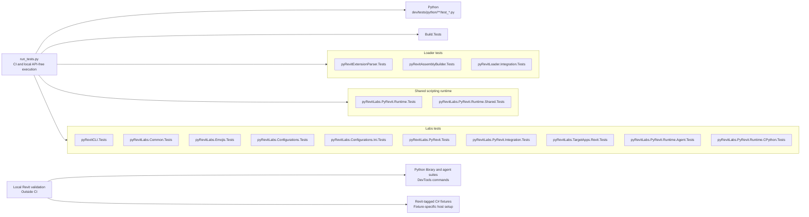

# Testing

**All first-party automated tests run in CI unless they use the Revit API or require installed/running Revit.** This includes dependencies and fixtures. Revit-dependent tests run locally; vendored tests are outside this policy.

## Running API-free tests

From the repository root on Windows, with the product's .NET SDKs installed:

```powershell
python dev/tests/run_tests.py --install-dependencies
python dev/tests/run_tests.py --list
python dev/tests/run_tests.py
```

Dependencies are pinned in `Pipfile.lock`. An existing development environment can use `pipenv run test`. Add `--language python` or `--language dotnet` for one language. `--list` inventories Revit suites without executing them.

CI uses the same runner: Python checks, product build, then C# tests. Product builds do not execute fixtures. Results, inventory and coverage go into a fresh `.test-results/<run>/` directory and are uploaded even on failure. See [CI/CD](ci-cd.md).

## Implemented test suites



The implemented CI selection has **16 C# projects across 26 project/framework runs** and the API-free Python suite. The legacy mixed suite is split by owner with its former MSTest cases converted to NUnit. Counts include each framework run. Local Revit results are separate; a general C# in-Revit runner is not implemented.

Level describes the test; Environment determines where it runs:

| Level | Tests |
|---|---|
| Unit | Isolated behavior |
| Integration | Boundaries such as files, configuration, subprocesses or interpreters |
| E2E | A built product completing a user workflow |
| Performance | Repeatable workloads compared with an explicit baseline |

Regression is a purpose, not a level. Bug fixes need a reproducer at the lowest useful level, an issue reference, and a `regression` marker (pytest), `Regression` category (NUnit/MSTest), or `Purpose=Regression` trait (xUnit).

## Ownership and placement

Keep C# tests in separate assemblies beside their owning area, normally `dev/<area>/tests/<Module>.Tests/`. NUnit, MSTest and xUnit are supported. A reviewed framework migration must preserve cases, effective tags, fixture isolation and coverage floors. Share discovery and policy; keep fixtures with their owners. Cross-component tests belong in an explicit integration suite.

| Area | Suite locations |
|---|---|
| Parser | `dev/pyRevitLoader/tests/pyRevitExtensionParser.Tests/` |
| Assembly builder, session services, hooks and ribbon | `dev/pyRevitLoader/tests/pyRevitAssemblyBuilder.Tests/` |
| Parser-to-command integration | `dev/pyRevitLoader/tests/pyRevitLoader.Integration.Tests/` |
| Shared scripting runtime | `dev/pyRevitLabs.PyRevit.Runtime/tests/pyRevitLabs.PyRevit.Runtime.Tests/` |
| CLI, Common, Emojis, configuration, PyRevit facade, agent and CPython adapters | Named projects under `dev/pyRevitLabs/tests/` |
| Deployment, config seeding and install-scope integration | `dev/pyRevitLabs/tests/pyRevitLabs.PyRevit.Integration.Tests/` |
| Product metadata, add-on paths and cache files | `dev/pyRevitLabs/tests/pyRevitLabs.TargetApps.Revit.Tests/` |
| Dynamo interop and graph contracts | `dev/pyRevitLabs/tests/pyRevitLabs.PyRevit.Runtime.Shared.Tests/` |
| Build pipeline | `build/tests/` |
| API-free Python tooling/library checks | `dev/tests/python/**/test_*.py` |
| Hosted Python library tests | `pyrevitlib/pyrevit/unittests/` |
| Hosted agent tests and manual checks | DevTools command bundles under `extensions/` |

Each suite's README owns its fixtures, maintainer, frameworks/engines and focused commands. Small repository helpers live in `dev/tests/csharp/`; loader helpers live in `dev/pyRevitLoader/tests/TestSupport/`. A shared base class is not mandatory.

Reorganized C# suites appear in area solutions for navigation, without default solution-build selection. The shared runner builds them explicitly; product builds must not build tests for every interpreter configuration.

## Tags and discovery

Every automated test needs literal Environment and Level metadata. Class/module defaults and method overrides are supported:

| Framework | Example defaults |
|---|---|
| NUnit | `[Category("HostFree")]`, `[Category("Unit")]` |
| MSTest | `[TestCategory("HostFree")]`, `[TestCategory("Unit")]` |
| xUnit | `[Trait("Environment", "HostFree")]`, `[Trait("Level", "Unit")]` |
| Python | `TEST_ENVIRONMENT = "HostFree"`, `TEST_LEVEL = "Unit"` |

Use `Revit` for any Revit dependency and one of the four levels above. A method cannot downgrade a Revit fixture to HostFree. HostFree Python modules must be safe to import; isolate API-dependent imports and fixture initialization. Hosted `unittest` modules use plain assignments without importing pytest. API-free pytest cases can override defaults with `@pytest.mark.environment(...)` and `@pytest.mark.level(...)`.

- **C#:** evaluated `IsTestProject=true` projects under `dev/` and `build/`, all declared frameworks, and native discovery. No class/project allowlist.
- **Python:** `test_*.py` under first-party `dev/`, `pyrevitlib/pyrevit/unittests/`, and `extensions/`, plus `*_tests.py` under `extensions/`. Metadata is read before imports; pytest runs eligible `unittest` cases too.
- **Fail closed:** missing/invalid metadata, missing reports, empty selected suites/frameworks, and skipped/expected-failure HostFree cases fail validation. Every explicitly selected Python module needs eligible cases, even when its neighbors pass. Revit cases are excluded before fixtures run.

Adding a test or adjacent project must not require changing a central list. Network/elevation requirements must be provisioned or isolated, not used to silently exempt HostFree tests from CI.

## Test quality

- Assert outcomes and propagate failures. Printed comparisons, dialogs and debugger launchers are manual checks.
- Use private temporary fixtures. Restore configuration, environment, imports and process-wide caches; never deploy test builds into an active clone.
- Bound subprocesses and concurrent waits. Sleeps alone do not prove synchronization. Parallelize only isolated fixtures.
- Test failure, cleanup, rollback and concurrency behavior where applicable. Source inspection does not replace execution tests.
- Missing required fixtures fail. Quarantines need an issue, reason, owner and review within **14 days**. The module maintainer owns them; otherwise the author does. Extensions require recorded review, and retries must preserve the original failure.

## Coverage baselines

`dev/tests/coverage-baselines.json` sets **line and branch floors per module/framework**, not a repository-wide target. Normal runs fail on decreases, missing established modules, or new measured modules without a baseline. Review scope/denominator changes as well as percentages. Raise floors as coverage improves.

```powershell
python dev/tests/run_tests.py --update-baselines
```

This explicit update can lower floors: review its diff and explain every reduction with a reason and follow-up. Never remove source from reporting to make a gate pass.

Python scope is explicit in `pyproject.toml`, including unexecuted files. C# coverage includes instrumented first-party assemblies and their unexecuted code; assemblies never loaded by tests still need dedicated suites. Exclude vendor/generated/test code, normalize Windows document paths, and merge line/branch identities without duplicate deployment copies. `dotnet-linked/` measures production source compiled into test assemblies. Source inspection does not establish execution coverage of the inspected code. Keep language and local Revit results separate.

`dev/tests/README.md` records collector details and initial baseline calibration.

## Revit integration tests

Revit-dependent tests and load/signing smoke checks are local only. Attach a development clone:

```powershell
pyrevit clones add dev <path-to-repo>
pyrevit attach dev default --installed
```

In Revit, use DevTools **Debug > Unit Tests > Run All Tests**, a specific library module, or Agent Tests. Record required models/elements, engine capabilities and actual skips. IronPython 3 needs a separate clone attachment.

Set `PYREVIT_TEST_JUNIT_PATH` before launching Revit for XML evidence. Use a fresh destination per year/engine/run. Module results aggregate; rerunning a module replaces its result. Requested report-write failures and unexpected successes must fail the command, including on IronPython 2.7. Record the commit, Revit year, engine, fixture, command and outcome.

**C# host setup remains fixture-specific:** installing Revit does not make `dotnet test` a Revit host. API-dependent fixtures need suitable assembly resolution; live document/UI scenarios need execution inside Revit. There is no C# in-Revit runner yet. Document a validated invocation before claiming a fixture passed.

For load/signing smoke checks, launch the intended Revit year and inspect its journal and dialogs. Loading successfully does not prove functional correctness or contribute to CI coverage. Never publish locally test-signed binaries.

**Remaining coverage gaps:** assemblies outside the instrumented scope need dedicated tests; no general performance budget has been established. Suite READMEs should record fixture-specific gaps as they are found.

### Dynamo execution check (#2992)

Use **DevTools > Debug > Unit Tests > Dynamo Tests** in a disposable project. The test starts Dynamo headlessly and requires a newly generated DesignScript token from the engine's evaluated output. A successful command return is insufficient. The graph has no Python nodes, external packages, or model geometry, and the test rolls back Dynamo's startup preview materials. An existing user Dynamo workspace is never replaced.

For a reproducible local matrix, use an absolute script path:

```powershell
pyrevit run C:/path/to/pyRevit/dev/tests/revit/run_dynamo.py --revit=2026 --purge
```

The journal launches a separate Revit process, creates a disposable project, checks cold and repeat execution with different tokens, and exits. Evidence is written to `.test-results/dynamo/<year>/<run-id>/result.json`, including actual Revit/Dynamo versions and a test-source hash. Each invocation preserves earlier results. The project lives in the journal's working directory; `--purge` deletes that directory after Revit exits and releases file locks. Omit `--purge` only to retain the journal and model for diagnosis. These tests stay outside CI. Validate the installed Dynamo bundled with each supported Revit 2021–2027 host; this is not a claim about every independently installed Dynamo package or patch version.

Local validation on 2026-10-19 used IronPython 2.7.12 and a fresh project in each journal process. Both cold startup and repeat execution passed with distinct, verified tokens:

| Revit | Loaded DynamoCore | Cold / repeat |
|---|---|---|
| 2021 | 2.6.1.8786 | Passed / passed |
| 2022 | 2.10.1.3976 | Passed / passed |
| 2023 | 2.16.4.10216 | Passed / passed |
| 2024 | 2.18.1.5096 | Passed / passed |
| 2025 | 3.3.2.11986 | Passed / passed |
| 2026 | 3.7.0.11777 | Passed / passed |
| 2027 | 4.2.1.5887 | Passed / passed |

Each report records the test-source SHA-256. Interactive ribbon verification also passed twice on Revit 2025 build `25.5.0.57` with Dynamo `3.3.2.11986`: each run returned matching token/output values, the tokens differed between runs, and Dynamo reported `StartedUIless`. The measured execution times were 2.546 seconds and 0.124 seconds. Other Python engines and independently installed Dynamo versions remain unverified; this ribbon evidence does not establish model-change isolation.
