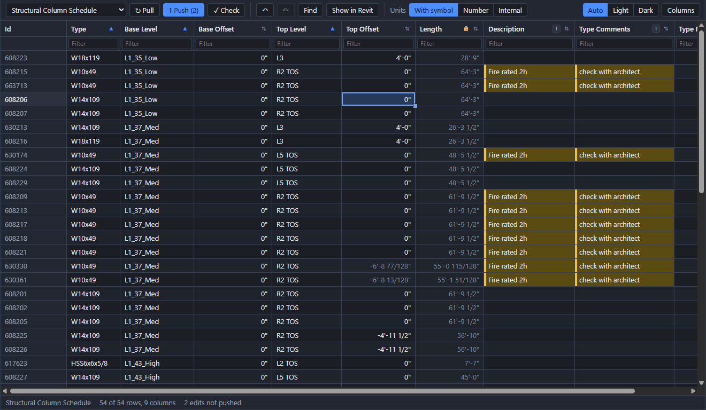
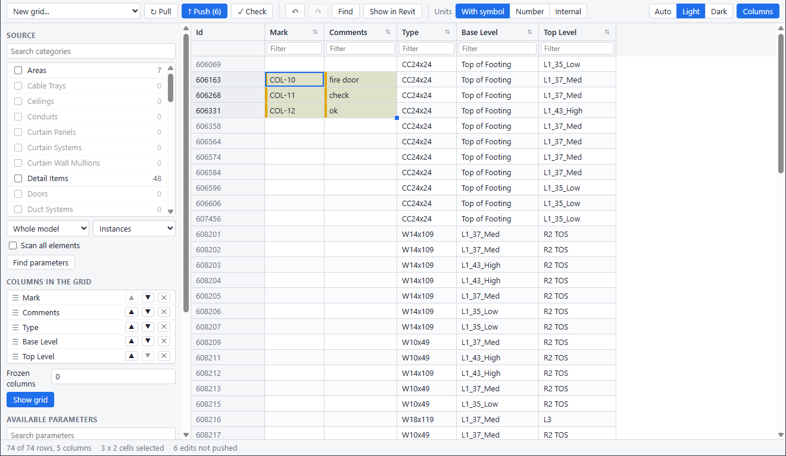

# Attribute Editor

Revit schedules show parameter values but offer no way to change many of them at once. The **Attribute Editor** opens a schedule as a spreadsheet-like grid in pyRevit's output window. You can edit cells freely, paste whole blocks from Excel, drag the fill handle, and write everything back to the model in one step.

It needs the WebView2 output window and the IronPython engines (2.7 or 3.4); on any other setup the button shows a message instead of opening the grid.

With a project open, launch **Attribute Editor** from the ***Modify*** panel, in the **Edit** pulldown. If the active view is a schedule, that schedule opens straight away. Otherwise you pick one from a list.

## What you see

Every row is one element of the schedule, and every column is one of its visible parameter fields, in the schedule's own order and sort. Three things are marked in the grid:

- **Pending edits** have an amber background and an amber bar on the left edge. Nothing is written to Revit until you push.
- **Locked cells** are grey. They belong to read-only parameters, or the element does not have the parameter. In **Number** mode a cell is also locked when its unit differs from the rest of its column (see [Units](#units)).
- A **T** next to a column heading means a type parameter. Changing one value changes it for every element of that type, so the grid shows the new value on all of those rows at once.

Calculated, combined and count fields of the schedule are not shown.

## Editing

- Type to replace a cell, press **F2** or double-click to edit its text, and press **Enter** or **Tab** to confirm and move on. **Alt+Enter** adds a line break to a multi-line text. **Esc** cancels. **Delete** clears the selected cells.
- Select a range by dragging or with **Shift** and the arrow keys. Click a column heading to select the column and a row number to select the row.
- **Ctrl+C**, **Ctrl+X** and **Ctrl+V** work with Excel in both directions. Paste a table copied from Excel into the grid: it lands with its top-left corner on the selected cell. Pasting one value into a larger selection fills the whole selection.
- Drag the small square at the bottom-right corner of the selection to fill cells, as in Excel. Text that ends in a number continues counting (`Door 1`, `Door 2`, ...), two or more numbers continue their step, and anything else is copied. Hold **Ctrl** to switch between copying and counting. **Ctrl+D** and **Ctrl+R** fill down and right from the first row or column of the selection.
- **Ctrl+Z** and **Ctrl+Y** undo and redo edits inside the grid.
- **Ctrl+F** opens find and replace for the selection, the column or all cells.
- Click the arrows in a heading to sort (**Shift** adds a second sort) and use the filter boxes under the headings to narrow the rows.
- **Show in Revit**, or a double-click on a row number, selects the elements of the selected rows in Revit and zooms to them.

## Units

The **Units** switch decides how numbers with units are shown and typed:

| Mode | Shows | Accepts |
|---|---|---|
| **With symbol** | Values as Revit shows them, such as `1'-6"` or `450 mm` | The same text Revit's own fields accept, including feet and inches |
| **Number** | Plain numbers in the project display unit, with the unit in the heading | A number written the way the project writes numbers |
| **Internal** | Revit's raw values, for example feet for lengths, with no unit in the heading | A number written the way the project writes numbers |

Every cell is converted with the unit of its own parameter. A column that is found by parameter name can hold different quantities on different elements (an Area on one, an Angle on another). In **Number** mode the heading names the unit of the column's first cell, so cells with another unit show Revit's own text and are locked. Switch to **With symbol** to edit them.

In **Number** and **Internal** mode the project's decimal symbol (point or comma) is the decimal separator, and the other one is read only as digit grouping in groups of three: `1,250` is 1250 in a project that uses a decimal point and 1.25 in one that uses a decimal comma. Text that could be read either way, such as `1,5` in a decimal-point project, is refused instead of guessed, and so are `nan`, `inf` and numbers too large for Revit.

A schedule field that sets its own number format keeps that format in **With symbol** mode, so the grid matches the schedule.

Changing the units re-reads the grid, so the pending edits are discarded after you confirm.

## Writing to Revit

**Push** writes every pending cell in one transaction, so a single **Undo** in Revit reverts all of it. A cell that Revit rejects stays marked in red; hover over it for the reason, and the other cells are still written. This includes errors Revit raises only when it commits the change: the cells that caused them show Revit's message, the rest are written without them, and Revit's own failure dialog never opens. In a workshared model, elements that another user has checked out, or that changed in the central model, fail up front with that reason.

**Check** runs the same steps, commit included, and then discards the result, so you can find out which cells would fail without changing the model.

**Pull** reads the current values from Revit and keeps your pending edits. A grid built from the current selection keeps the elements it was built from, even if the selection in Revit changes, and so does a column change with **Show grid**. To use a new selection, start a new grid. If a cell was changed in Revit after you loaded it and you edited it in the grid as well, it is marked orange and a bar offers **Keep my values** or **Use Revit's values**. Push never overwrites such a cell silently.

## Choosing columns

**Columns** opens a side panel with the columns of the grid and the parameters that can be added. Add, remove, reorder (drag, or use the arrows) and set how many columns stay frozen at the left. **Show grid** reads the new column set. With a schedule open, **Write layout to schedule** also adds, removes and reorders the columns of the Revit schedule itself; a field the schedule has hidden is shown again instead of added twice, and a field that a filter, sort or group refers to is hidden instead of removed, so those rules keep working. Filters, sorting and fields it does not manage, such as the count, stay as they are.

## Starting from scratch

**Shift-click** the button, or pick **New grid...** in the schedule list, to build a grid without a schedule:

1. Tick one or more categories.
2. Choose whether the grid covers the whole model, the active view or the current selection, and whether it lists instances or types.
3. Press **Find parameters**, add the columns you want and press **Show grid**.

Parameter discovery reads a sample of the chosen elements. Tick **Scan all elements** to find parameters that only a few families carry.

## Colors

The page uses pyRevit's colors: navy for the toolbar, amber for the main action, the active cell and keyboard focus, and a navy tint for the selection. It follows Revit's theme (Revit 2024 and later) and has its own **Auto / Light / Dark** switch, which pyRevit remembers between sessions.

## Limits

- Needs Revit 2022 or later, and a project document.
- Schedule filters, sorting and grouping are not written back to the schedule; only the column set and order are.
- Elements hidden by the schedule's own filters are not in the grid.
- Parameters that reference other elements (such as a level or a type) are edited by typing the name the grid shows. Parameters that Revit shows as a word for a whole number (the function of a wall, for example) accept that word when an element in the same category shows it, or the plain number.
- A parameter without a value shows an empty cell. Number and Yes/No cells cannot be cleared back to empty, because Revit has no way to do that.
- Opening the Attribute Editor again replaces the open one. If it holds unsent edits, you are asked first.
- A conflict is detected by comparing the text Revit shows, so a change in Revit smaller than a cell's display accuracy is not flagged.
- Editing a parameter can make Revit regenerate other elements (moving a column's base level moves its foundations, for instance). **Pull** after a push to see dependent values.
