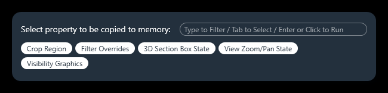
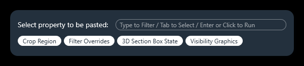
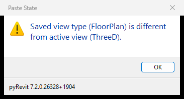
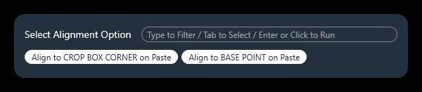
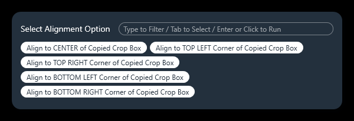
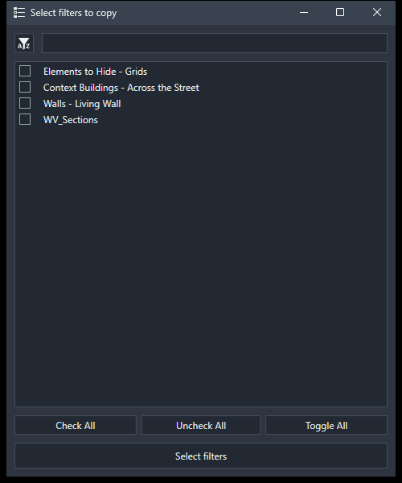

# Copy State and Paste State

**Copy State** and **Paste State ●** copy a property of a view to memory and apply it to another view: the zoom, the crop region, the visibility settings, the filter overrides, the section box of a 3D view, or the position of a viewport on its sheet. Use them to make views look the same without opening the same dialogs again and again.

Both buttons are on the ***Selection*** panel of the pyRevit tab.

## How it works

1. Make the view active, or select what you want to copy (for example a viewport on a sheet).
2. Click **Copy State**. A dialog lists what can be copied right now. Pick one.
3. Switch to the target view, or select the target views or viewports.
4. Click **Paste State ●**. If more than one copied property fits, a dialog lets you pick one. If only one fits, it is applied directly.

The list changes with the active view and the selection: the same dialog in a floor plan with nothing selected offers fewer entries than in a 3D view. **Paste State ●** lists only the properties you copied before and that fit the current view.

A copied property stays in memory until you copy it again, or until [Purge Memory Files](selection-memory.md#purging-all-memory-files) removes it. Some properties can be pasted into any project, others only into the project they were copied in.

## What can be copied

| Property | Copied from | Pasted to | Other projects |
|---|---|---|---|
| **View Zoom/Pan State** | The active plan, section, 3D, sheet or drafting view, with nothing selected. 3D and section views also store their orientation. | An active view of the same kind. Plans, ceiling plans, engineering plans and area plans count as the same kind. | Yes |
| **3D Section Box State** | The active 3D view. | The active 3D view. The view then zooms to fit. | Yes |
| **Visibility Graphics** | The active view, with nothing selected. Not available on sheets and schedules. | The active view. It takes over the settings of the copied view that a view template can control. | No |
| **Crop Region** | The first cropable view among the selected views, or the active view if no view is selected. The crop shape (the crop box in a 3D view) and whether the crop is switched on are copied. | Every selected view that can be cropped, or the active view. | Yes |
| **Viewport Placement on Sheet** | Exactly one selected viewport. | Every selected viewport. | Yes |
| **Filter Overrides** | The filters you choose from the view's filter list. | The active or selected views, or the view templates you choose. | No |

!!! note "Pasting crops between 2D and 3D views"

    Copy a crop from a 3D view to 3D views, and from any other view to other views. A crop shape copied from a 2D view does not replace the crop box of a 3D view, it only switches that crop box on or off, and a 3D crop box cannot be pasted into a 2D view. Revit also requires the copied crop shape to be parallel to the plane of the target view, so a plan crop cannot be pasted into a section.

!!! note "Split crop regions"

    A split crop region has more than one boundary. Only the first boundary is copied, so the pasted crop can be smaller than the original. If the target view's crop region is already split, Revit keeps its split, and the result is not necessarily a single region.

!!! note "Visibility Graphics and Filter Overrides follow the source view"

    These two do not store a snapshot of the settings. **Visibility Graphics** remembers the view it was copied from, and **Filter Overrides** remembers which filters you picked and that view. **Paste State ●** reads the settings from that view at the moment you paste, so changes you made to the source view after copying are pasted as well.

### Zoom and Pan

Pasting needs a view of a compatible type. If the copied view and the active view are of different types, you get a message that names both. A 3D view with a locked orientation refuses the pasted orientation, and a section view must be parallel to the copied one.

### Viewport placement

Select one viewport on a sheet and copy its placement. Unless the view is a drafting view or a legend, the dialog asks how the viewport will be aligned when you paste:

- **Align to CROP BOX CORNER on Paste** copies the position relative to the crop box. When you paste, you choose the center or one of the four corners of the copied crop box.
- **Align to BASE POINT on Paste** copies the position relative to the point where the model origin appears in the view. It does not depend on the crop box.

The position is measured from the title block, so the viewport lands in the same place on sheets whose title block sits somewhere else.

!!! tip "Shift-click"

    Hold ++shift++ while clicking **Paste State ●** to choose the axis when you paste a viewport placement: **X**, **Y** or **XY**. With **X** or **Y** only that coordinate of the viewport is taken from the copied placement. The other coordinate stays where it is, except that the title block offset is added to it again: on a sheet whose title block sits at a nonzero position along the other axis, the viewport moves along that axis too. The other properties ignore ++shift++.

### Filter overrides

**Copy State** opens a list of the filters applied to the view. Tick the filters whose overrides you want to copy, then click **Select filters**.

When you paste, you decide where the overrides go:

- **Active/Selected View** pastes into the selected views, or the active view if none is selected. The view you copied from is left out. Views whose view template controls the filter settings are skipped, and you are told so.
- **Select View Templates** opens a list of view templates to paste into.

A filter that the target view does not have yet is added. A filter that is already applied to the target view is removed and added again with the copied overrides, so it is switched on afterwards even if it was switched off in the target view.
