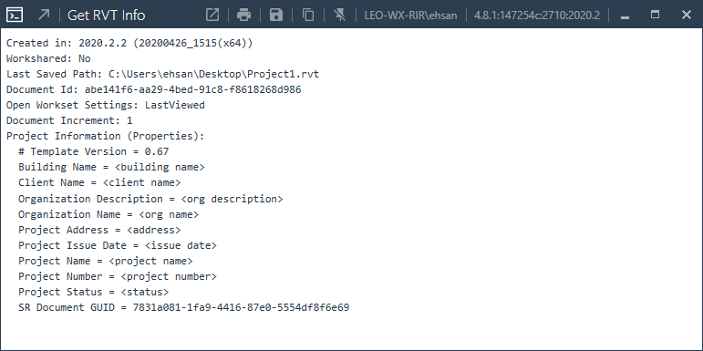

# Get RVT Info

You can use this tool in pyRevit’s Project panel to read information about any Revit file (`rvt`, `rte`, `rfa`, `rft`). One important step is that pyRevit will lookup the build number stored in this file info against its database and provides the exact version of Revit used to write the file:



Here are the results for the example file. Currently the most important info is printed out but more info can be added easily in the future:

```text
Created in: 2019.2.2 Hotfix (20190808_0900(x64))
Workshared: No
Last Saved Path: C:\Test Model.rte
Document Id: 82c0623f-b95a-4ac7-b711-7eac7961a1cd
Open Workset Settings: LastViewed
Document Increment: 582

Project Information (Properties):
  Building Name = <building name>
  Client Name = <client name>
  Organization Description = <org description>
  Organization Name = <org name>
  Project Address = <address>
  Project Issue Date = <issue date>
  Project Name = <project name>
  Project Number = <project number>
  Project Status = <status>
```

!!! tip ""

    You can also hold CTRL while clicking on the tool to see all the DEBUG results which includes full extracted stream and binary data
