# Keynotes

pyRevit has a built in **Keynote Manager**. The keynote manager, uses a trick to store information inside the standard Revit keynote text files. Let's create an empty model and configure to use the pyRevit Keynote Manager. You can find the tool here

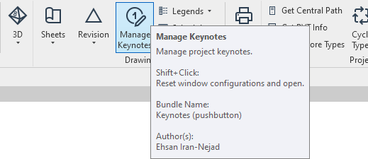

## Setting Up the Keynote File

Let's create a keynote text file for this test similar to what is shown below.

```text
A0.0	SITE
A1.0	PLANS
A2.0	ROOF
A3.0	RCP
A4.0	ELEVATION
A5.0	SECTIONS
A6.0	OPENINGS
A7.0	INTERIOR
0.01	BIO SWALE	A0.0
1.01	08 0000 - OVERHEAD SECTIONAL DOOR	A1.0
2.01	07 0000 - TPO ROOFING	A2.0
3.01	09 0000 - GYPSUM CEILING	A3.0
4.01	05 0000 - GLAZED METAL RAILING	A4.0
5.01	<placeholder>	A5.0
6.01	<placeholder>	A6.0
7.01	08 0000 - STOREFRONT WINDOW SYSTEM	A7.0
```

Now create an empty test model, and launch the **Manage Keynotes** tool. The tool will inspect the keynote file attached to the model and will notify you that it doesn't have any attached to it. The tool will help you attach a keynote and configure that for the pyRevit Keynote Manager.

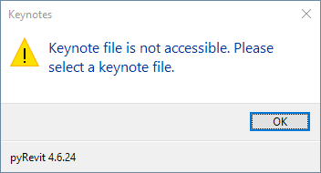

Click **OK** and select the keynote file we just created

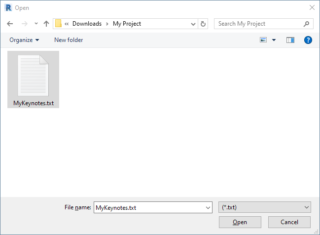

Keynote manager will notify you that the file needs to be configured for this tool. Click **Convert**

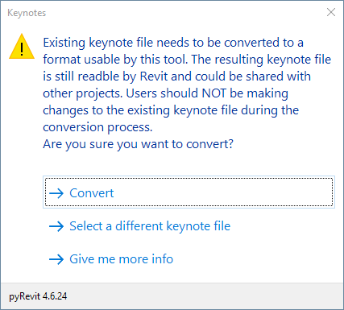

Keynote manager configures the text file, saves it back, and will update you. It also saves a `.bak` file as a backup of the main keynote file in the same directory.

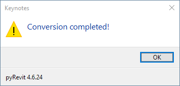

Take a look at the converted keynote file. It should look similar to this

```text
# @datastore("txt") @source("..\My Project\MyKeynotes.txt") @version("0.1") @encoding("UTF-16")
# ===================== @db(txn_db:"Internal DB")
# --------------------- @table(locks_table:"Locks Table") @sep("\t") @internal(yes) @tags(yes) @history(no) @encap(no) @headers(no) @key(lock_uuid) @uuid(lock_uuid:"") @text(lock_source:"") @text(lock_requester:"") @uuid(lock_conn_uuid:"") @text(lock_dbname:"") @text(lock_tablename:"") @text(lock_recordkey:"")
# ===================== @db(keynotesdb:"pyRevit Keynotes Manager DB")
# --------------------- @table(categories:"Root Keynotes Table") @sep("\t") @internal(no) @tags(no) @history(no) @encap(no) @headers(no) @key(cat_key) @text(cat_key:"") @text(cat_title:"")
A0.0	SITE
A1.0	PLANS
A2.0	ROOF
A3.0	RCP
A4.0	ELEVATION
A5.0	SECTIONS
A6.0	OPENINGS
A7.0	INTERIOR
# --------------------- @table(keynotes:"Keynotes Table") @sep("\t") @internal(no) @tags(no) @history(no) @encap(no) @headers(no) @key(keynote_key) @text(keynote_key:"") @text(keynote_text:"") @text(parent_key:"") @wire(parent_key:cat_key) @wire(parent_key:keynote_key)
0.01	BIO SWALE	A0.0
1.01	08 0000 - OVERHEAD SECTIONAL DOOR	A1.0
2.01	07 0000 - TPO ROOFING	A2.0
3.01	09 0000 - GYPSUM CEILING	A3.0
4.01	05 0000 - GLAZED METAL RAILING	A4.0
5.01	<placeholder>	A5.0
6.01	<placeholder>	A6.0
7.01	08 0000 - STOREFRONT WINDOW SYSTEM	A7.0
```

All the lines that start with `#` are invisible to Revit. So this keynote text file is still fully compatible with Revit and you can use it normally, archive it with your project, and not worry about depending on a third-party tool to read the keynotes in your Revit model. pyRevit uses these Comment lines to store metadata about the keynotes. It uses this metadata to

- Organize the keynotes
- Coordinate changes to the keynote text file when multiple users are making changes to the keynotes at the same time
- Store history of changes to keynotes

!!! note ""

    If you are interested in more advanced information, see DeFFRel DB API for more information about the API that manages this text file.

## Manage Keynotes Window

The keynote manager window

- Has a pretty advanced search
- Helps you manage all the keynotes and categories
- Export and Import keynotes
- Create keynotes of different kinds
- Is smart about the location and size of the window, by project!

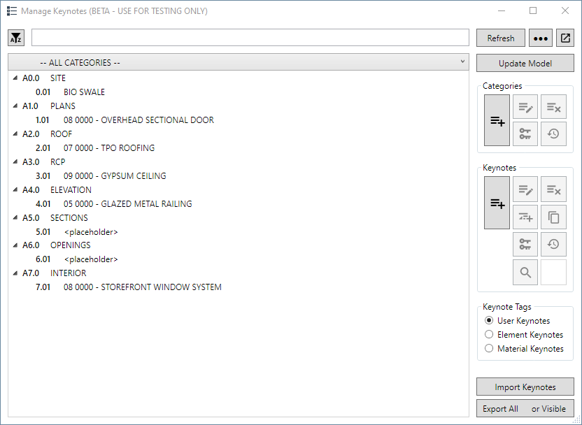

### Search

The search bar at the top of the window, helps you search the keynotes effectively and would filter down the results. The

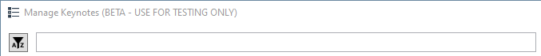

The filter button on the left side, gives you more options to search

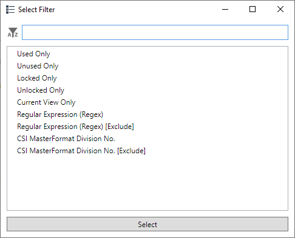

### Keynote Management

The buttons on the top right, help you refresh the keynotes, find or change the keynote file. Hover over the keys for tooltips.

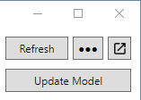

The Categories and Keynote tools help with creating and editing keynotes and categories. Hover over the keys for tooltips.

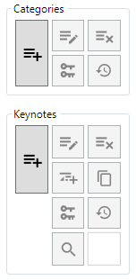

### Browsing Keynotes

The category selector helps filtering down the keynotes shown in the window to a specific category


The main keynote box, shows the keynotes inside the selected keynote category

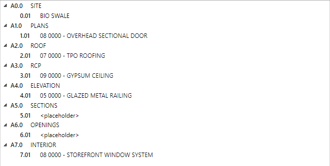

### Creating Categories

Click on the new category button

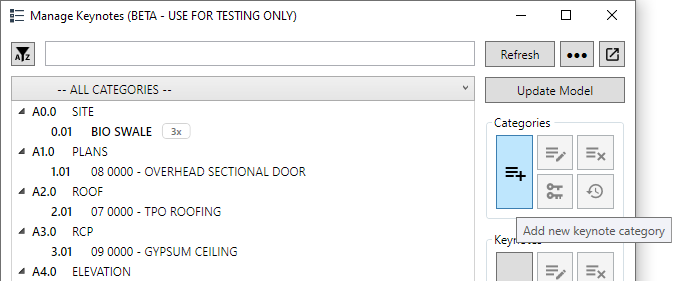

The most important step is to select a unique key for this category.

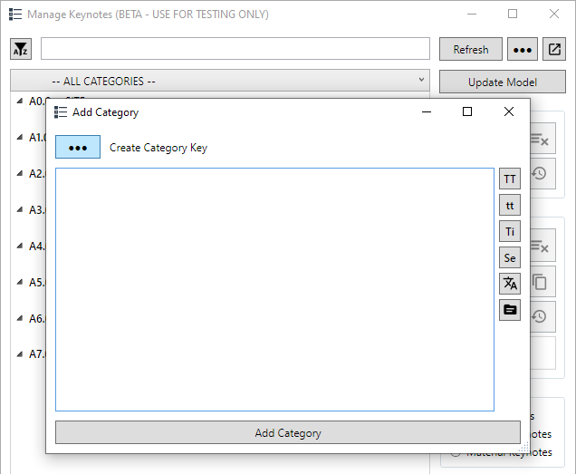

The tool shows all the reserved (already used, in Red) keys in the window. Select a key until there are no items shown in reserved list.

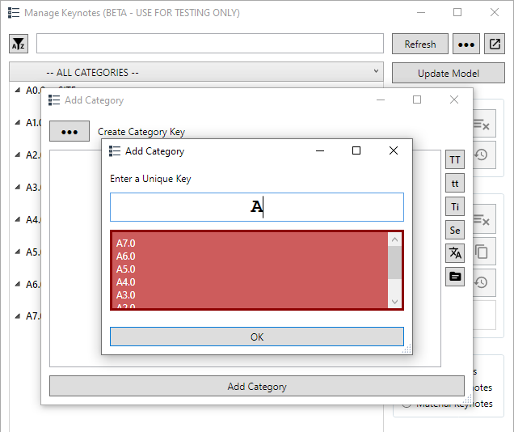

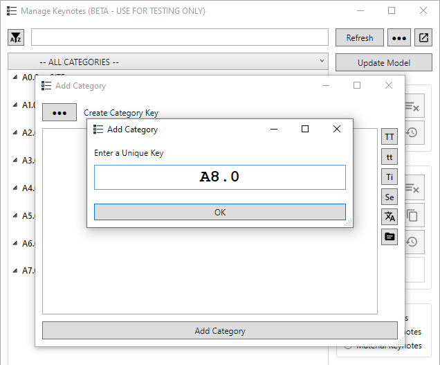

Now type the name of the category in the box. Use the buttons on the side to change the casing if necessary.

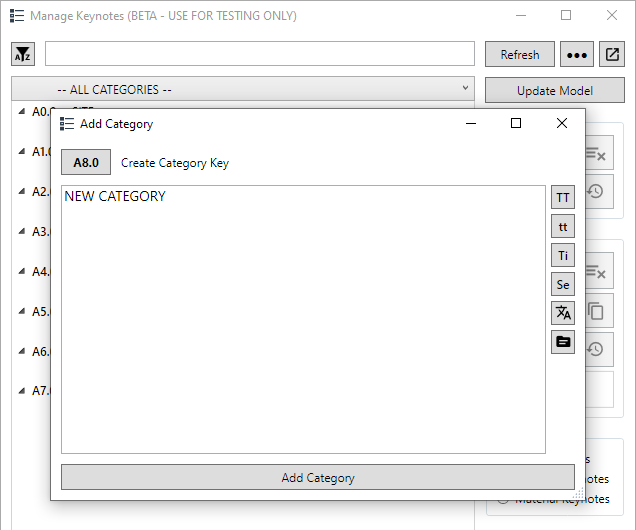

Click **Add Category** and the category will be added to the keynote file. The category selector will automatically switch to this new category

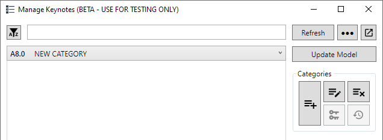

### Creating Keynotes

Create keynotes similar to the categories. Remember that every keynote, needs a parent category. The parent category key is shown at the bottom of the **Add**  **Keynote** window.

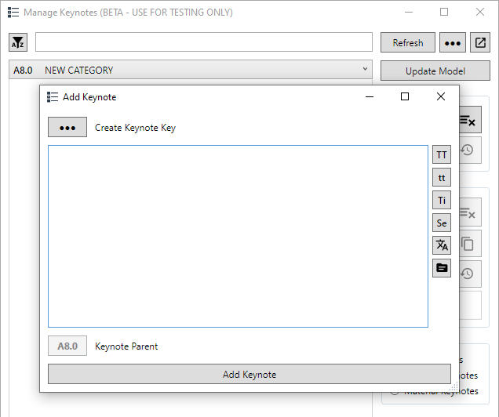

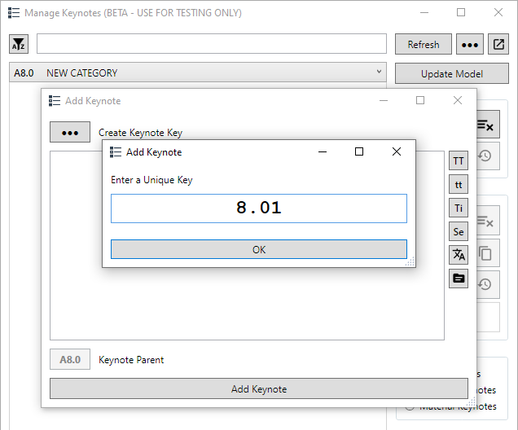

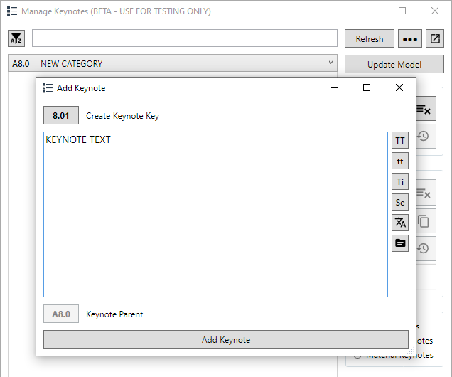

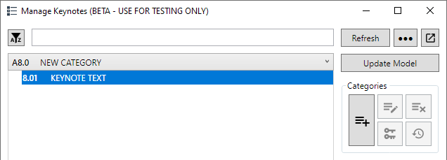

You can also create child keynotes for the selected keynote. Follow the same workflow as creating keynotes. The child keynotes' parent, is the selected parent keynote.

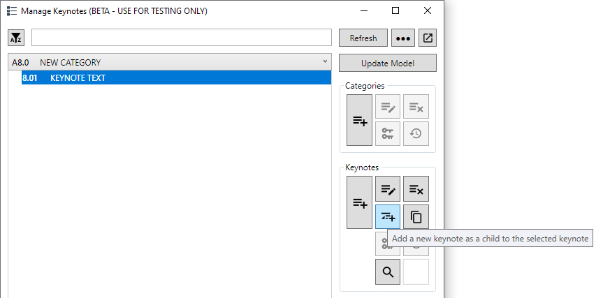

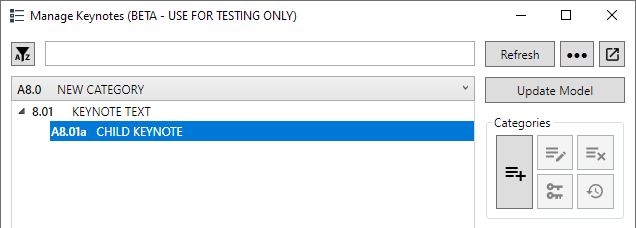

### Placing Keynotes

Double-Click on any of the keynotes shown in the main window, to place in your model. You can place multiple keynotes in the model. Hit **Escape** when done and the tool will apply the correct keynote number to the keynotes.

The type selector on the side, determines which type of keynote is placed by the tool

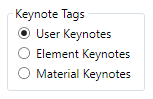

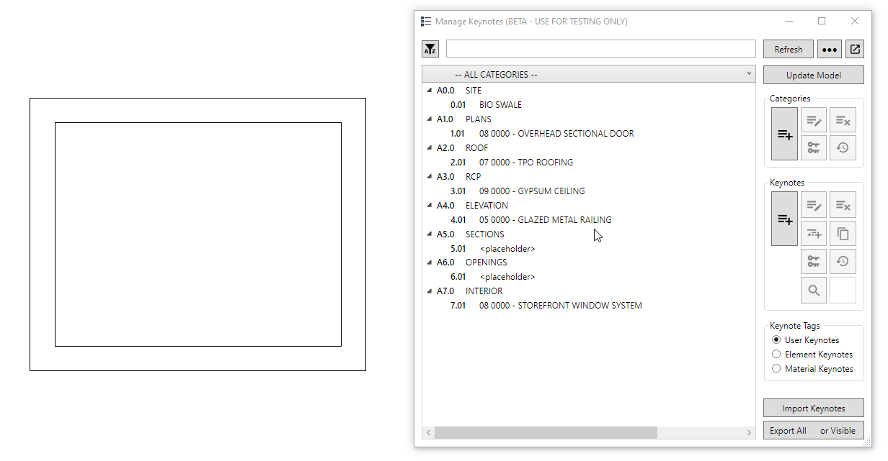

*Example of placing multiple keynotes at the same time*

From now on, the tool will show the number of times a keynote is used in a model

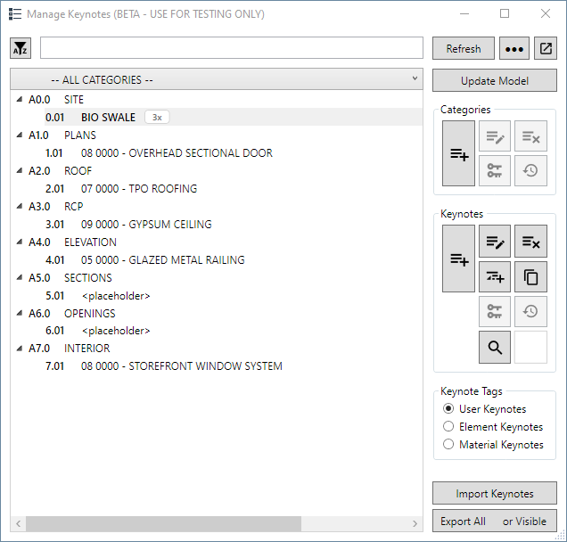

You can click on the Find Keynote Instances to get a list of these keynotes

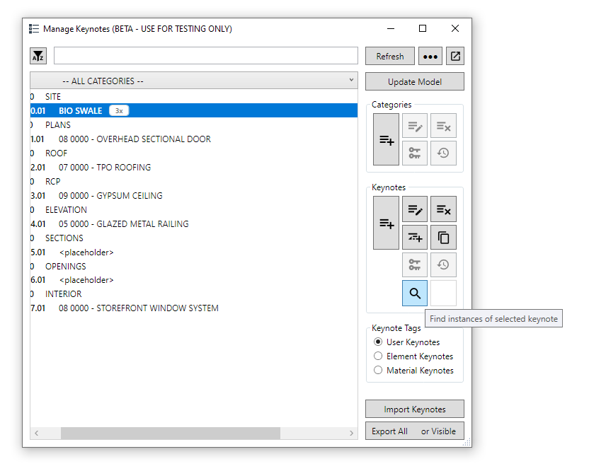

Click on the Keynote Ids (the numbers) and pyRevit will take you to that specific keynote.

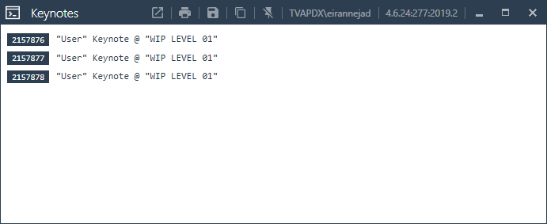

### Import & Export

You can use the import and export tools to import new keynotes from another file, or export all the keynotes (or visible ones) to a clean new keynote text file.

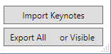

Keynote Manager can operate in two modes:

- ***Local Network:*** in this mode, Keynote Manager is working with `.txt` keynote file that is shared between Revit users on a local network. This means that the same keynote file is being used and modified by multiple users.
- ***BIM360:*** *in this mode,* Keynote Manager is working with `.txt` keynote file that is hosted on BIM360 and is made available locally by the **Autodesk Desktop Connector.**

In either of these modes, Keynote Manager needs to ensure multiple users do not overwrite each others’ work. To achieve that:

- ***Local Network:*** Keynote Manager creates a `.lock` file alongside the keynote text file to notify other Keynote Manager users that the keynote file is being written.

    !!! warning ""

        Deleting an orphaned `.lock` file when there are no users active, should solve the stuck Keynote Manager problem
- ***BIM360:***  Keynote Manager uses the **Autodesk Desktop Connector** API to ask BIM360 to lock the keynote file when a user opens Keynote Manager.

    

    This effectively stops others from writing their changes until the first user has closed Keynote Manager and released the file.

    !!! warning ""

        You can unlock the keynote file from BIM360 portal

## Edit Locks

When a user edits a keynote, Keynote Manager will write some info inside the keynote file (hidden to Revit) that a user has borrowed that specific keynote for editing. If you have a sticky lock on a specific keynote, manually clear the content of `Locks Table` in the keynote file. These locks are written in between the two lines below

```text
# --------------------- @table(locks_table:"Locks Table")
>>> locks are listed here...
# ===================== @db(keynotesdb:"pyRevit Keynotes Manager DB")

```

For example a lock with id `tf5n6dURvk+JrZQ5r3gD5g==` exists in this keynote file example:

```text
# @datastore("txt") @source("C:\Users\ehsan\Desktop\Keynotes.txt") ...
# ===================== @db(txn_db:"Internal DB")
# --------------------- @table(locks_table:"Locks Table")
# tf5n6dURvk+JrZQ5r3gD5g==	leo-wx-rir	eirannejad	w8/8rO/UOUyP0vs1oS53zA== ...
# ===================== @db(keynotesdb:"pyRevit Keynotes Manager DB")
C1	CATEGORY ONE
C2	OTHER CATEGORY
# --------------------- @table(keynotes:"Keynotes Table")

```

So to clear the locks, remove the lock lines. Coordinate this with your team so you are the only person changing the file
