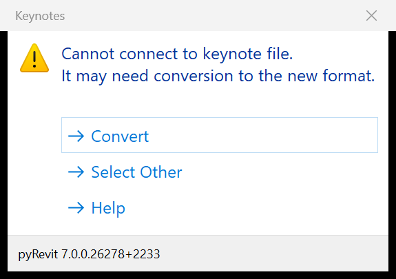
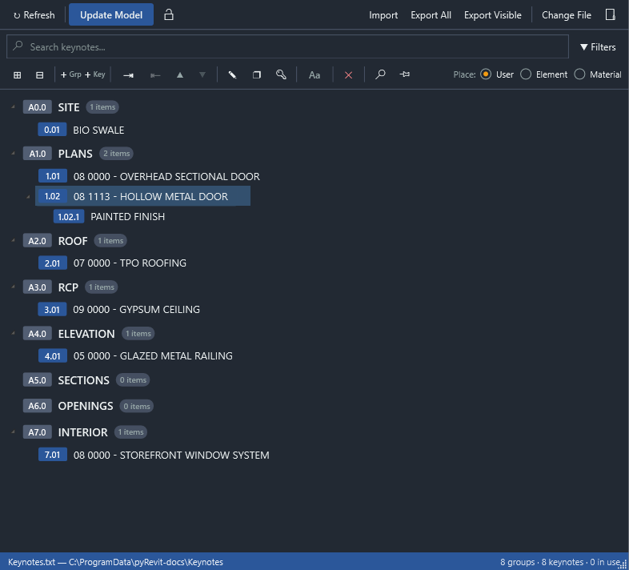
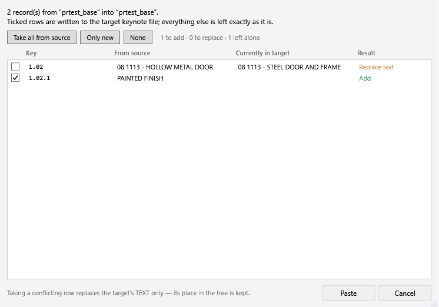
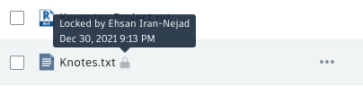

# Keynotes

pyRevit has a built in **Keynote Manager**. It stores its own information inside the standard Revit keynote text file, so the file stays usable by Revit without pyRevit. The tool is **Manage Keynotes** in the **Drawing Set** panel of the pyRevit tab. Shift-click it to reset the window configuration and open.

## Setting Up the Keynote File

Let's create a keynote text file for this test similar to what is shown below.

```text
A0.0	SITE
A1.0	PLANS
A2.0	ROOF
A3.0	RCP
A4.0	ELEVATION
A5.0	SECTIONS
A6.0	OPENINGS
A7.0	INTERIOR
0.01	BIO SWALE	A0.0
1.01	08 0000 - OVERHEAD SECTIONAL DOOR	A1.0
2.01	07 0000 - TPO ROOFING	A2.0
3.01	09 0000 - GYPSUM CEILING	A3.0
4.01	05 0000 - GLAZED METAL RAILING	A4.0
5.01	<placeholder>	A5.0
6.01	<placeholder>	A6.0
7.01	08 0000 - STOREFRONT WINDOW SYSTEM	A7.0
```

Now create an empty test model, and launch the **Manage Keynotes** tool. When the keynote file of the model cannot be found, the tool says *Keynote file not found* and asks you to select one. Select the keynote file we just created.

Keynote Manager then tells you that the file needs to be converted for this tool. Click **Convert**.



Keynote Manager converts the text file in place and opens it. It copies the file to the pyRevit data folder before converting, and keeps that copy. When the conversion fails, the original content is restored, or the path of the copy is shown when it cannot be restored.

Take a look at the converted keynote file. It should look similar to this

```text
# @datastore("txt") @source("..\My Project\MyKeynotes.txt") @version("0.1") @encoding("UTF-16")
# ===================== @db(txn_db:"Internal DB")
# --------------------- @table(locks_table:"Locks Table") @sep("\t") @internal(yes) @tags(yes) @history(no) @encap(no) @headers(no) @key(lock_uuid) @uuid(lock_uuid:"") @text(lock_source:"") @text(lock_requester:"") @uuid(lock_conn_uuid:"") @text(lock_dbname:"") @text(lock_tablename:"") @text(lock_recordkey:"")
# ===================== @db(keynotesdb:"pyRevit Keynotes Manager DB")
# --------------------- @table(categories:"Root Keynotes Table") @sep("\t") @internal(no) @tags(no) @history(no) @encap(no) @headers(no) @key(cat_key) @text(cat_key:"") @text(cat_title:"")
A0.0	SITE
A1.0	PLANS
A2.0	ROOF
A3.0	RCP
A4.0	ELEVATION
A5.0	SECTIONS
A6.0	OPENINGS
A7.0	INTERIOR
# --------------------- @table(keynotes:"Keynotes Table") @sep("\t") @internal(no) @tags(no) @history(no) @encap(no) @headers(no) @key(keynote_key) @text(keynote_key:"") @text(keynote_text:"") @text(parent_key:"") @wire(parent_key:cat_key) @wire(parent_key:keynote_key)
0.01	BIO SWALE	A0.0
1.01	08 0000 - OVERHEAD SECTIONAL DOOR	A1.0
2.01	07 0000 - TPO ROOFING	A2.0
3.01	09 0000 - GYPSUM CEILING	A3.0
4.01	05 0000 - GLAZED METAL RAILING	A4.0
5.01	<placeholder>	A5.0
6.01	<placeholder>	A6.0
7.01	08 0000 - STOREFRONT WINDOW SYSTEM	A7.0
```

All the lines that start with `#` are invisible to Revit. So this keynote text file is still fully compatible with Revit and you can use it normally, archive it with your project, and not worry about depending on a third-party tool to read the keynotes in your Revit model. pyRevit uses these Comment lines to store metadata about the keynotes. It uses this metadata to

- Organize the keynotes
- Coordinate changes to the keynote text file when multiple users are making changes to the keynotes at the same time
- Store history of changes to keynotes

## Manage Keynotes Window

The window shows the keynote file as one tree. The top-level rows are groups (the categories of the keynote file) and the rows under them are keynotes, which can have child keynotes of their own. The status bar shows the keynote file and how many groups and keynotes it holds, and how many keynotes are used in the model.



### File toolbar


| Button | What it does |
|---|---|
| **Import** | Imports keynotes from a standard Revit keynote `.txt` file (Ctrl+I) |
| **Export All**, **Export Visible** | Writes all the keynotes, or only the listed ones, to a clean Revit keynote file |
| **Change File** | Attaches another keynote file to the project |
| Show in Explorer | Shows the keynote file in Explorer |
| **Refresh** | Reloads the keynote file (F5) |
| **Update Model** | Reloads the keynote file in Revit, so the model shows the changes |
| Release locks | Releases the locks a closed or crashed Revit session left behind, see [Edit Locks](#edit-locks) |

### Search

The search bar filters the tree as you type. **Filters** adds a ready-made filter to the search: used or unused keynotes, locked or unlocked ones, element, material or user keynotes only, a regular expression, or a CSI MasterFormat division number. The regular expression and division filters also have an *Exclude* form.

### Editing the tree

The toolbar above the tree works on the selected rows. Most of them are also in the right-click menu.


| Command | Shortcut |
|---|---|
| Expand all, Collapse all | |
| Add group (top-level category) | |
| Add keynote | Ctrl+N |
| Indent: make the keynote a child of the sibling above | Tab |
| Promote: move the keynote up one level | Shift+Tab |
| Move up, Move down | Ctrl+Up, Ctrl+Down |
| Edit | F2, or double-click the row |
| Duplicate | Ctrl+D |
| Copy, Paste here | Ctrl+C, Ctrl+V |
| Change key | |
| Change text capitalization | |
| Delete | Del |
| Find in model | |

Drag a row onto another one to move it under a new parent. Ctrl+click and Shift+click select several rows.

Every group and every keynote needs a unique key. When you add one, the window lists the keys that are already taken.

A group that still has keynotes, and a keynote that has child keynotes or is used in the model, cannot be deleted.

### Copying keynotes between projects

**Copy** and **Paste here** also work between two projects that use different keynote files. Before anything is written, the **Paste Keynotes** window lists every copied row with what is currently in the target file and the result: added, text replaced, already there, or locked by another user. Only the ticked rows are written. Taking a row that conflicts replaces the text of the target keynote and keeps its place in the tree.



### Placing Keynotes

Select the kind of keynote to place under **Place**: **User**, **Element** or **Material**. Then select a keynote and click the place button, or Alt+click the keynote in the tree. Revit starts its keynote tool with that key.

Groups cannot be placed, and neither can a keynote that another user has locked.

**Find in model** lists the places where the selected keynote is used in the pyRevit output window, one line per keynote tag. Click an element id in the list to go to that keynote. In a workshared model, the line also names the last user who edited the tag.

```text
Keynote: 2157876 | Source: User | View: Level 1
Keynote: 2157877 | Source: User | View: Level 1
```

## Working with a shared keynote file

Keynote Manager can operate in two modes:

- ***Local Network:*** in this mode, Keynote Manager is working with `.txt` keynote file that is shared between Revit users on a local network. This means that the same keynote file is being used and modified by multiple users.
- ***Autodesk cloud:*** in this mode, Keynote Manager is working with `.txt` keynote file that is hosted on BIM 360 or Autodesk Construction Cloud and is made available locally by the **Autodesk Desktop Connector**. The connector must be installed and running.

In either of these modes, Keynote Manager needs to ensure multiple users do not overwrite each others’ work. To achieve that:

- ***Local Network:*** Keynote Manager creates a `.lock` file alongside the keynote text file to notify other Keynote Manager users that the keynote file is being written.

    !!! warning ""

        Deleting an orphaned `.lock` file when there are no users active, should solve the stuck Keynote Manager problem
- ***Autodesk cloud:*** Keynote Manager asks the **Autodesk Desktop Connector** to lock the keynote file when a user opens Keynote Manager. When the connector cannot sync or lock the file, the manager still opens, so check the lock on the file before a long editing session.

    

    This effectively stops others from writing their changes until the first user has closed Keynote Manager and released the file.

    !!! warning ""

        You can unlock the keynote file from the Autodesk web portal

## Edit Locks

When a user edits a keynote, Keynote Manager will write some info inside the keynote file (hidden to Revit) that a user has borrowed that specific keynote for editing. When a Revit session closes or crashes while a keynote is being edited, its lock stays in the file. Use the release locks button in the file toolbar: it names every lock holder and asks you to check with them first, because it cannot tell an abandoned lock from one a colleague holds right now.

If that is not possible, clear the content of `Locks Table` in the keynote file by hand. These locks are written in between the two lines below

```text
# --------------------- @table(locks_table:"Locks Table")
>>> locks are listed here...
# ===================== @db(keynotesdb:"pyRevit Keynotes Manager DB")

```

For example a lock with id `tf5n6dURvk+JrZQ5r3gD5g==` exists in this keynote file example:

```text
# @datastore("txt") @source("C:\Projects\Keynotes.txt") ...
# ===================== @db(txn_db:"Internal DB")
# --------------------- @table(locks_table:"Locks Table")
# tf5n6dURvk+JrZQ5r3gD5g==	workstation-01	jdoe	w8/8rO/UOUyP0vs1oS53zA== ...
# ===================== @db(keynotesdb:"pyRevit Keynotes Manager DB")
C1	CATEGORY ONE
C2	OTHER CATEGORY
# --------------------- @table(keynotes:"Keynotes Table")

```

So to clear the locks, remove the lock lines. Coordinate this with your team so you are the only person changing the file
