# Print Sheets

pyRevit includes a fairly advanced print tool that allows you to print the sheets in a model or a linked model in order, format the output file names and apply custom print settings on a per sheet basis

With the model open, launch the tool from the ***Drawing Set*** panel

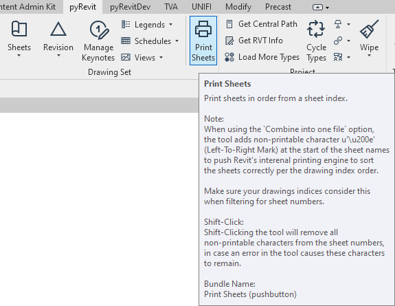

## Selecting Model and Drawing Index

Select the host model first. If the host model has other Revit models linked into it, the drop down menu shows the linked models as well. Printing options for linked models are fairly limited compared to printing from main model due to the challenges in opening the linked model, apply printing changes, and reloading the model back into the host model.

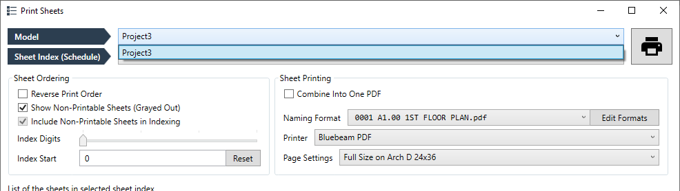

Linked modes are shows as `Linked: <model name>`

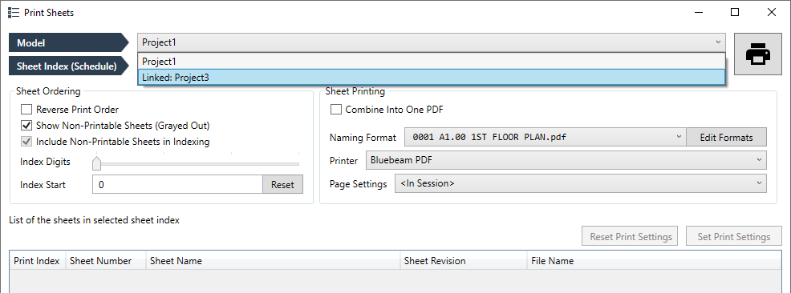

After selecting the model, print tools pulls a list of all drawing indices in the selected model. This drawing index is used to read the order of the sheets. The intention is that you would have one drawing index in your model that is placed on the index sheet and the same drawing index is being used to print the sheets in order.

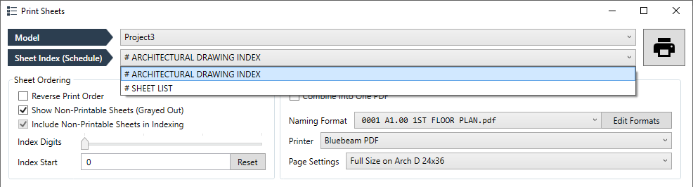

After the model and the drawing index are seleted, you should see a list of sheets with their corresponding index number. The list shows the final name of the PDF file for each sheet as well.

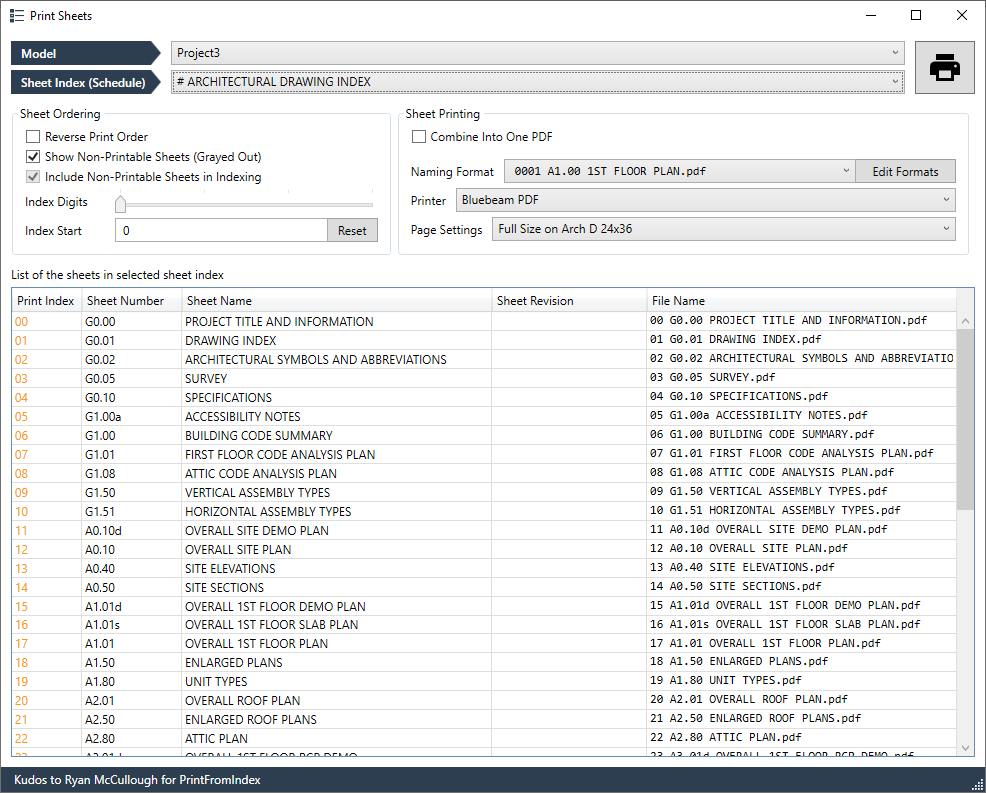

## Indexing Configuration

The print tools provides a few options to adjust the indexing

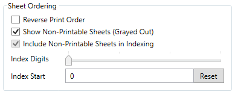

- **Reverse Print Order** reverses the order of the sheets
- **Show Non-Printable Sheets** lists the non-printable(placeholder) sheets on the list as well and allows you to reserve index numbers for these sheets. The print tool would not attempt to print these sheets and this is an option to help with indexing only.
- **Index Digits** is the number of digits used as index
- Set the starting integer for indexing on **Index Start** field. **Reset** to 0 if necessary.

## Print Configurations

The print tools provides a few options to adjust the printing output

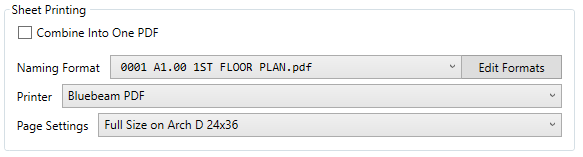

### Naming Formats

You can define highly customized naming formats for your prints. The Edit Naming Formats window, provides a list of smart tags that would be replaced with the target value at print time, to form the final name of the PDF file. For example:

`{index}_{number}_{name}.pdf`

would be translated to Sheet index, Sheet number, and Sheet name for each sheet.

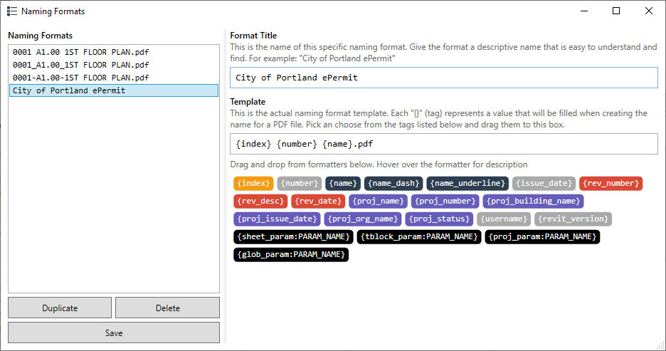

There are a couple of advanced tags (shown in black) that allow you to read values for custom parameters at print time. For example `{tblock_param:PARAM_NAME}` allows you to apply the value of a custom project parameter for titleblocks, or a native titleblock parameter to the final file name.

### Per-Page Print Settings / Variable Paper Size

The print tool, under **Print Settings** option, allows you to define a custom print setting for each sheet by choosing `<Variable Paper Size>`. Once this option is selected, the print tool reviews the sheets and tries to determine the best print option for that sheet based on its titleblock size.

You can select any ranges of sheets and manually **Set Print Settings** on those sheets as well.

The **Set Print Settings** window shows two groups of print settings that are available in the model

- **Matching Print Settings** are the onces with the matching sheet size and orientation to the sheet
- **All Print Settings** are all the available print settings in the model

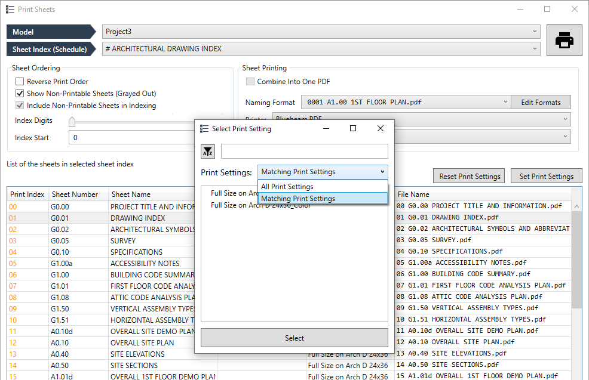

Select the appropriate print setting and the sheet list reflects the newly applied settings

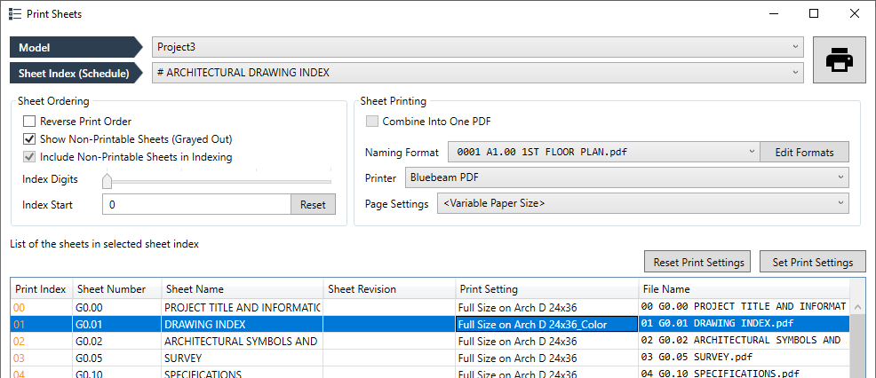

### Combining Sheets Into One File

The print tool allows you to combine multiple sheets into one file (`Ordered Sheets.pdf`). Under this option, many of the indexing and print settings are not available to the underlying printing mechanism in Autodesk Revit. For full flexibility, it is better to print the sheets individually and combine them later.

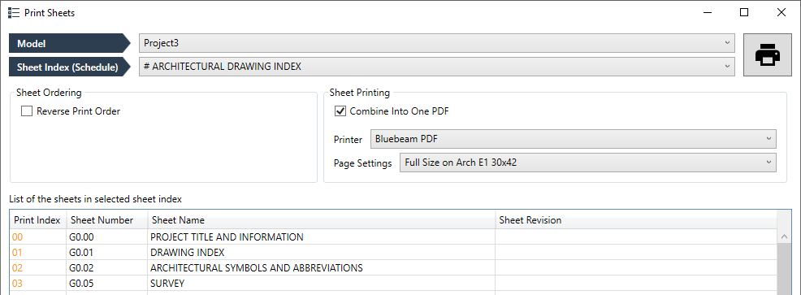

## Starting Print

Once you are happy with the indices, printing configurations, and the output file names, click on the big Print button to start the print process.

 The tool will ask you

- Whether you want to print the selected sheets (if any) or all the sheets listed in the tool

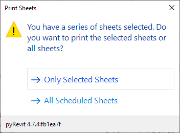

- If you are sure about starting the print process if there are more than 5 sheets in the print queue

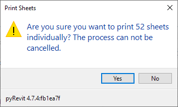
