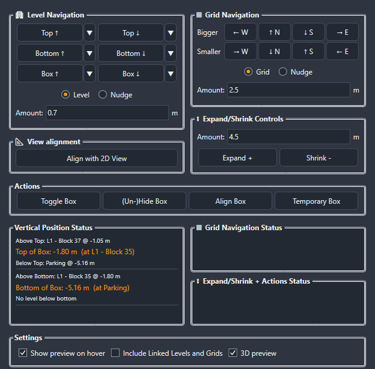
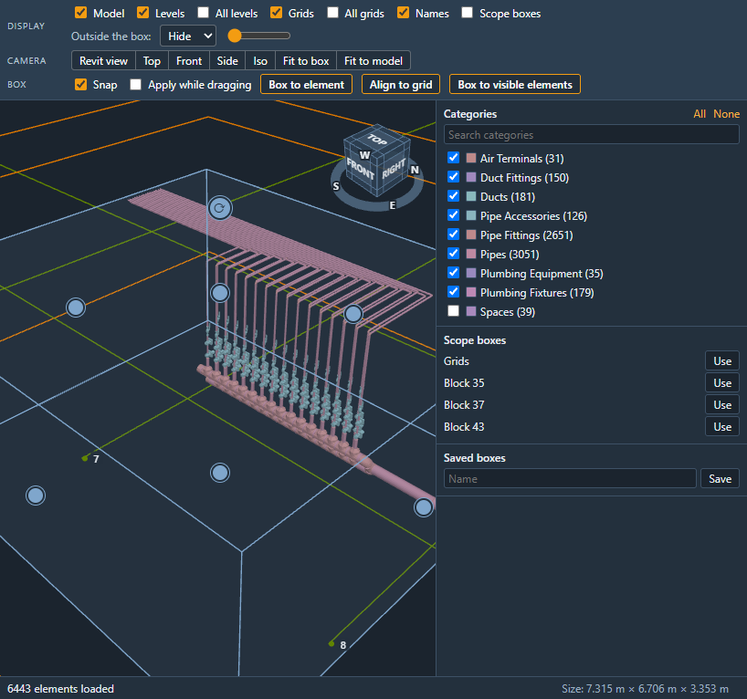
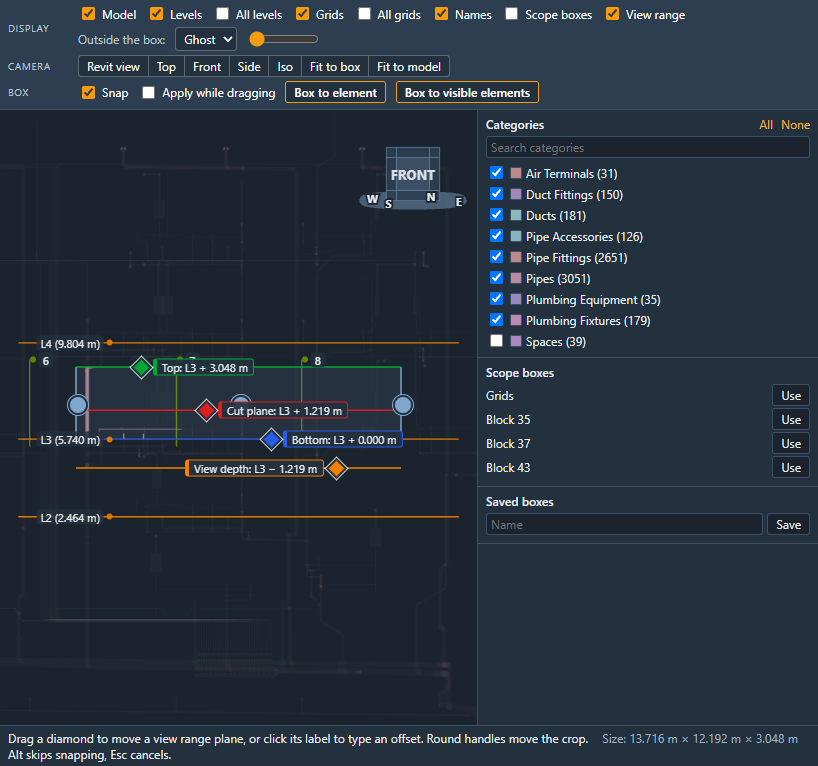

# Section Box Navigator

The Section Box Navigator is a window that stays open while you work. In a 3D view it moves the **section box**. In plan, section and elevation views it moves the **crop box**. It snaps to levels and grids, and its 3D preview lets you drag the box directly, or the view range of a plan view.

Open it with **SectionBox Navigator** in the **Modify** panel, in the **3D** pulldown. It needs Revit 2022 or later.

The window follows the Revit theme, also when you switch it while the window is open.

## A view without a box

If the view has no section box or active crop box, the navigator asks where the new one should come from:

- the elements visible in the view,
- a scope box chosen from a list,
- a scope box you click in the view.

In a 3D view with a switched-off section box that the navigator remembers, it offers to restore that box instead.

## Level Navigation

Level navigation works in 3D views. **Top**, **Bottom** and **Box** move the top face, the bottom face or the whole box up and down.

- In **Level** mode a button moves to the next level in that direction. The arrow next to it lists all levels to choose from.
- In **Nudge** mode a button moves by the **Amount**, in project units.

**Vertical Position Status** shows the levels above and below the top and bottom of the box. When an end of the box sits on a level, its line names it, for example `Top of Box: 9.00 m  (at Level 3)`.

## Grid Navigation

**Bigger** moves a side of the box outwards and **Smaller** moves it inwards. West, north, south and east follow what you see: the camera in a 3D view, the sheet in a 2D view.

- In **Grid** mode a side moves to the next grid line in that direction.
- In **Nudge** mode a side moves by the **Amount**.

## Expand/Shrink Controls

**Expand** and **Shrink** move every side of the box by the **Amount**. In a 3D view that includes the top and bottom.

## Button tooltips

Every level, grid, nudge, expand and shrink button says in its tooltip where it will take the box: the level and its elevation, the grid, or the distance. If the button cannot move the box, the tooltip says why. Grid directions depend on the camera, so the tooltip is refreshed when you point at the button.

With **Show preview on hover** on, pointing at a button in a 3D view also draws the resulting box in the model.

## View alignment

- In a 3D view, **Align with 2D View** gives the section box the extent of a plan, section or elevation view you pick, after you confirm.
- In a plan view, **Align with 3D View** takes the section box of a 3D view you pick. It either rotates the crop element or sets the crop shape, and sets the view range to the height of the box. A plan view with a scope box cannot be aligned.

## Actions

| Button | What it does |
|---|---|
| **Toggle Box** | Turns the section box or crop box off and on again, keeping its shape |
| **(Un-)Hide Box** | Hides or shows the box in the view |
| **Align Box** | Rotates the section box to a face you pick |
| **Temporary Box** | Puts a temporary box around the selected elements, and restores the previous one the next time |

## 3D preview

Tick **3D preview** to open an interactive picture of the model next to the navigator. It needs the WebView2 output window and the IronPython engine. It follows the Revit theme.

- Drag the round handles to move a face. Faces snap to levels, grids and scope boxes. Hold ++alt++ to move freely, and press ++esc++ to cancel a drag.
- In a 3D view, drag the arrow above the box to rotate it.
- Drag to orbit, ++shift++-drag or right-drag to pan, and scroll to zoom. The view cube and the **Camera** buttons give fixed viewpoints.
- With **Apply while dragging** the box changes in Revit during the drag, otherwise when you let go.
- **Box to element**, **Align to grid** and **Box to visible elements** fit the box without dragging.
- **Outside the box** shows, ghosts or hides what the box cuts away.
- **Categories** shows and hides categories, for the model and for each link.
- **Saved boxes** stores boxes to apply again later.

### Levels and grids

To keep the picture readable, the preview shows the levels inside the box and the next one above and below it. For grids it shows those crossing the box and the next one beyond each side. **All levels** and **All grids** show everything. Choosing a grid with **Align to grid** also shows all grids. Snapping always considers every level and grid.

### Which elements are shown

The preview follows the **detail level**, **phase**, **phase filter** and **design options** of the view, and loads the model again when one of them changes or you switch to a view that differs.

- At **Coarse** and **Medium**, Revit gives pyRevit only lines for some elements, without a 3D shape. The preview does not draw them at first: their category shows how many are **not loaded**. Click **Load** to draw them in the shape they have at **Fine**, without changing the view, or set the view to Fine. In the Snowdon Towers Plumbing sample that comes with Revit, these are pipe fittings and pipe accessories at both levels, and duct fittings at Coarse. Other families can behave differently. They are not loaded again after the preview reloads the model.
- The preview is not a copy of the view: for example, it shows pipes with a 3D shape at Coarse and Medium, where the view draws them as lines.
- A view whose phase filter is **None** shows every phase.
- Each design option set shows its primary option, unless the view is dedicated to an option, or you are editing one. Choices made on the **Design Options** tab of Visibility/Graphics are not available to pyRevit.
- Linked models show their primary design options and are not filtered by phase.
- Visibility/Graphics, view filters and hidden elements are not applied, so you can drag the box over geometry the view hides.

Very large models are loaded up to a size limit, large elements and those near the box first. A category with elements left out by the limit also says how many are **not loaded**, with a **Load** link.

### View range of plan views

In floor, ceiling and structural plans the preview draws the **view range**: top (green), cut plane (red), bottom (blue) and view depth (orange). **View range** under **Display** turns it off.

- Drag a diamond to move a plane. The **Front** and **Side** cameras show heights best. The **Top** camera hides the diamonds.
- A plane snaps to levels. Without a snap, its offset is rounded to 10 mm, or to half an inch in imperial projects.
- Click a plane's label to type its offset in project units.
- Only the offset changes. A plane keeps its associated level, also when you snap it to another one.
- A plane stops at its neighbours. If **Bottom** and **View depth** are at the same height, dragging **Bottom** down takes **View depth** along. To separate them, drag **View depth** down or **Bottom** up.
- Ceiling plans look up, so **View depth** is highest. They have no separate **Bottom** plane: it follows the cut plane.
- Every change is one undo step, **Adjust View Range**.

Some planes cannot be edited:

- If a **view template** controls the view range, the planes are read-only and the status line names the template.
- Planes set to **Level Above** or **Level Below** are not shown, and the status line names them. The Revit API does not report which level they use.
- Planes set to **Unlimited** have no height and are not shown.

A scope box or a custom crop shape stops you from resizing the crop, but not from editing the view range.

## Settings

| Setting | Effect |
|---|---|
| **Show preview on hover** | Draws the result of a button in the 3D view before you click |
| **Include Linked Levels and Grids** | Uses the levels and grids of loaded links, and shows linked geometry in the 3D preview |
| **3D preview** | Opens the 3D preview |

The navigator remembers these settings, the nudge amounts and the preview's display settings.

## Troubleshooting

**The window opens too small.** The navigator remembers its size and position. Resize the window once and it opens at that size from then on. To go back to the default size, close the navigator and delete the file ending in `last_window_position_Section Box Navigator.pym` in `%APPDATA%\pyRevit\<Revit version>`. Do not use `pyrevit caches clear` for this: it closes running Revit sessions and deletes all stored pyRevit data of that version.

**Pipe or duct fittings are missing from the 3D preview.** In a Coarse or Medium view, click **Load** next to their category, or set the detail level of the view to **Fine**. See [Which elements are shown](#which-elements-are-shown).

**Other elements are missing from the 3D preview.** Check the category list on the right: the category may be unticked, or show elements as **not loaded**. Rooms and spaces start unticked. Elements of another phase or of a design option the view does not show are left out on purpose.
