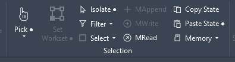
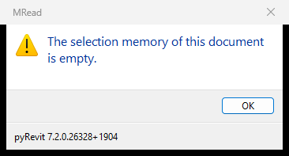
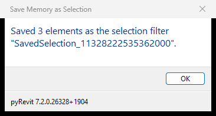
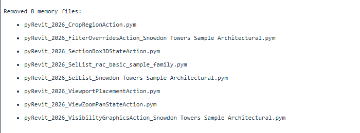

# Selection Memory

The selection memory buttons store a set of elements and bring it back later, like the memory keys of a calculator. Use them to collect elements from different views, to walk through them one by one, or to keep a selection for the next session.

You find the buttons on the ***Selection*** panel of the pyRevit tab, in two places:

- **MAppend**, **MWrite** and **MRead** are stacked next to the **Copy State** group.
- **Next**, **Prev**, **MDeduct**, **MClear**, **Save Memory as Selection** and **Purge Memory Files** are in the **Memory** pulldown.

## How the memory works

Each document has its own memory. It is saved as a `.pym` file in the `pyRevit` folder of your user profile (`%appdata%\pyRevit`), so it survives closing Revit. The file name contains the Revit version and the file name of the document, which means that two documents with the same file name share one memory.

The memory holds the ids of the selected elements of the active document. Elements inside linked models are not stored.

## The calculator buttons

| Button | What it does | Calculator key |
|---|---|---|
| **MAppend** | Adds the selected elements to the memory. | M+ |
| **MWrite** | Replaces the memory with the selected elements. | MC, then M+ |
| **MRead** | Selects the elements in the memory. Elements that were deleted in the meantime are skipped. | MR |
| **MDeduct** | Removes the selected elements from the memory and keeps the rest. | M- |
| **MClear** | Empties the memory. | MC |

**MAppend**, **MWrite** and **MDeduct** need a selection and stay disabled while nothing is selected. **MRead** and **MClear** work in projects and in families.

If the memory is empty, or none of its elements exist any more, **MRead** says so instead of changing the selection.

## Walking through the memory

**Next ●** and **Prev ●** select one element of the memory at a time, in order of element id. The last element they selected is stored per document, and the first click in a document that has none selects the first element. The walk continues from that element when you add elements to the memory or remove some, or when elements are deleted. If the last element is no longer in the memory, it continues with the next element by id. After the last element, **Next** wraps around to the first one, and **Prev** wraps around the other way.

!!! tip "Shift-click"

    Hold ++shift++ while clicking **Next** or **Prev** to move ten elements instead of one.

## Saving the memory as a selection filter

**Save Memory as Selection** turns the memory into a Revit selection filter named `SavedSelection_<project name>_<time stamp>` and tells you its name. The filter is created in one step, so a single undo removes it. Elements that no longer exist are left out. If Revit rejects the change when it commits, you are told that no filter was saved. If Revit raises an error while it creates the filter or sets its elements, for example because the name already exists, the command stops with that error and does not show this message.

## Purging all memory files

**Purge Memory Files** deletes every `.pym` file of the running Revit version, for all documents, and lists what it removed. It works without an open document.

!!! warning "More than selection memories"

    pyRevit tools other than the selection memory also keep their data in `.pym` files. The purge removes the states saved by [Copy State](copy-paste-state.md) as well, and it cannot be undone.
