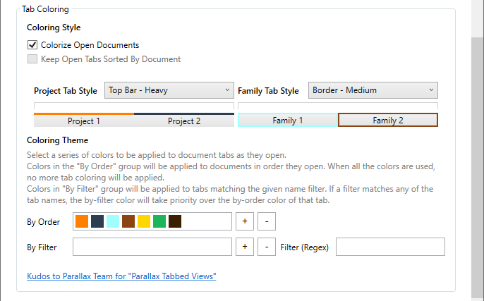
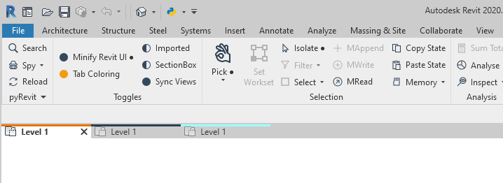
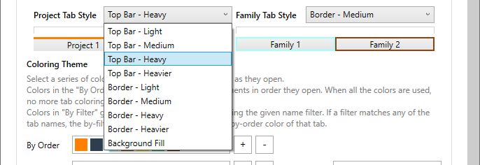
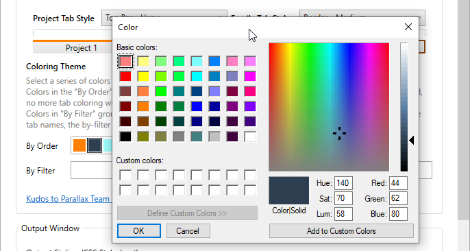
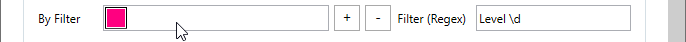
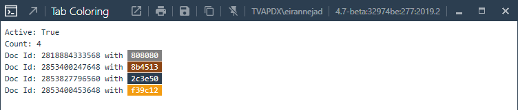

# Tab Coloring

pyRevit can colorize Revit tabs by the open document. Open **pyRevit Settings**, and activate the **Tab Colorizer** under **UI/UX** section.

Save settings and the open tabs will be colored by document

You can use the Toggle Coloring tool to activate, deactivate the coloring in your current session.

### Setting Colorizer Theme

Select the styling option for *Project* and *Family* tabs separately:

You can select a series of color swatches under the "By Order" section to colorize the document tabs as they open:

Under "By Filter", you can select a series of colors and Regular expression patterns to colorize tabs by their title. In the example below, all the tabs that match the regex pattern `Level \d`, will be colorized with magenta:

#### Developer Tip

If you want to know the id and assigned color for each document, SHIFT-Click on the Tab Coloring tool

