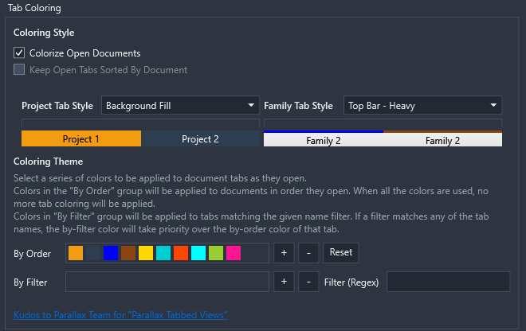
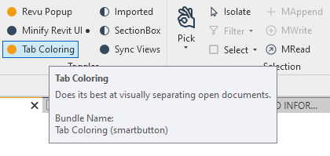
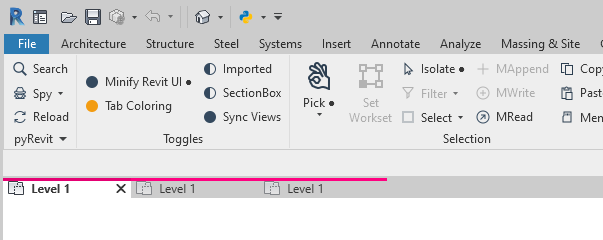

# Tab Coloring

pyRevit can colorize Revit tabs by the open document. Open the pyRevit **Settings** and turn on **Colorize Open Documents** under **UI / UX** → **Tab Coloring**.

!!! note "Screenshots"

    The screenshots of Revit tabs, of the ribbon button and of the output window on this page come from an older version of pyRevit. The behaviour is the same.

Save settings and the open tabs will be colored by document

The **Tab Coloring** button in the **Toggles** panel turns the coloring on and off for the current session.

### Setting Colorizer Theme

Select the styling option for *Project* and *Family* tabs separately, in **Project Tab Style** and **Family Tab Style**. The preview below them shows the result.

The color swatches under **By Order** colorize the document tabs as they open. Use **+** and **-** to add and remove colors, and **Reset** to go back to the default colors.

Under **By Filter**, you can select a series of colors and regular expression patterns to colorize tabs by their title. For example, with the pattern `Level \d` and a magenta swatch, all the tabs that match the pattern are colorized with magenta:

#### Developer Tip

If you want to know the id and assigned color for each document, SHIFT-Click on the Tab Coloring tool

